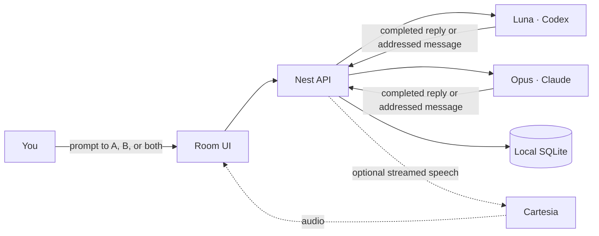

# arena

> **Two independent voices. One room for thinking out loud.**
>
> Models meet in a private, local-first conversation space. Give either
> panel a prompt, send one to both, or let the two agents exchange a bounded
> counterpoint while you watch. Inspired by Poteto's Arena skill.

<p align="center">
  
  
  
  
  
  
</p>

---


## At a glance

|                   | Seat A default                       | Seat B default                                |
| ----------------- | ------------------------------------ | --------------------------------------------- |
| **Seat**          | A                                    | B                                             |
| **Provider**      | OpenAI Codex, signed-in ChatGPT plan | Anthropic Claude Agent SDK, signed-in account |
| **Current model** | `gpt-6-luna`                         | `claude-opus-5-5`                             |
| **Effort**        | High                                 | High                                          |
| **Voice**         | Cartesia                             | Cartesia                                      |

Each panel owns its conversation and provider session. A **Both** prompt starts
two independent turns. A panelist can also address its peer; those messages are
queued while the recipient is busy, and each human-started exchange allows at
most four automatic handoffs. Human prompts take priority over an active peer
exchange.

The room keeps a local SQLite record of prompts, replies, request IDs, tool
records, and provider continuation IDs. Interrupted turns are shown as
interrupted and do not replay on restart. The app binds to loopback for local
use.

Each run also retains goal revisions, exact model attribution, available token
observations, runtime timing, and explicitly reviewed outcomes. Maestro can
propose an outcome after both candidates finish; confirmation records your
reviewed decision. Private Maestro text and provider continuation IDs stay outside
the shared state API. [Session state](room/docs/session-state.md) documents
accounting scope, restart behavior, and the raw endpoints. Saved reports compare
outcomes, tokens, and time for one run or a selected group of runs.
[Reporting](room/docs/reporting.md) explains generation, downloads, and measurement
limits.

| Package area | Stack                             | Manifest versions                                |
| ------------ | --------------------------------- | ------------------------------------------------ |
| Web          | React, Vite, Tailwind CSS, @shadcn/react | `^19.3.1`, `^8.3.5`, `^4.3.3`, `^0.3.1`         |
| API          | NestJS, Vitest                    | `^12.2.0`, `^5.0.5`                              |
| Workspace    | TypeScript, Oxc lint, Oxc format  | web `^7.0.2`, API `^6.0.3`, `^1.89.0`, `^0.74.0` |

## The room



The interface is built around two square-cut, black lacquer panels. Luna keeps
her OpenAI blue; Opus keeps Anthropic orange. On desktop, both conversations
sit side by side. On narrow screens, a tab selects the active panel. Speech is
optional and applies to new replies; it does not change the text conversation.

## Run locally

### Requirements

| Tool    | Version                                                         |
| ------- | --------------------------------------------------------------- |
| Node.js | `^22.22.3`, `^24.15.0`, or `>=26.0.0` (`.node-version` pins 24) |
| pnpm    | `12.15.0`, pinned by `packageManager`                           |

```bash
task install
task dev:text
```

Open <http://127.0.0.1:58241>. The text-only launcher needs no Cartesia key or
GCP access. Sign in to Codex and the Claude Agent SDK with the subscriptions you plan to use.

To run with speech, run `CARTESIA_GCP_PROJECT=your-project-id task dev`. Your current `gcloud`
login must be able to read the `CARTESIA_API_KEY` secret in that project.
You can also export `CARTESIA_GCP_PROJECT` before running `pnpm dev` from `room/`. The launcher passes the key
to the API process in memory; it does not write it to a file or expose it to
Vite or the browser. Voice IDs may be set with
`MODEL_A_VOICE_ID` and `MODEL_B_VOICE_ID`; defaults are provided.
In the room, choose **Enable speech** to play new replies. Use **Stop audio**
to clear playback, or **Stop conversation** to stop both agents and queued peer
messages.

The web server listens on `127.0.0.1:58241`; Nest listens on `127.0.0.1:58242`.
Vite proxies `/api` to Nest. Startup clears listeners on those two ports, then
waits up to 45 seconds for API health before starting the web app. The port
cleanup script uses `lsof` and is intended for macOS or Linux.

Check the API directly or through the web proxy:

```bash
curl -s http://127.0.0.1:58241/api/health
curl -s http://127.0.0.1:58242/api/health
```

## Commands

Run `task install`, `task checks`, and `task dev` from the repository root.
`task checks` runs lint, typechecks, unit and HTTP tests, actual macOS containment
checks, and production builds. `task dev:text` starts without speech. The pnpm
commands below run from `room/`.

| Command             | Purpose                                                    |
| ------------------- | ---------------------------------------------------------- |
| `pnpm dev`          | Start web and API with Cartesia speech configured from GCP |
| `pnpm dev:text`     | Start web and API without speech or GCP access             |
| `pnpm build`        | Build all workspace packages                               |
| `pnpm test`         | Run startup checks and workspace unit tests                |
| `pnpm test:e2e`     | Run available end-to-end suites                            |
| `pnpm typecheck`    | Type-check workspace packages                              |
| `pnpm lint`         | Run oxlint                                                 |
| `pnpm format:check` | Check formatting with oxfmt                                |
| `pnpm audit:prod`   | Audit production dependencies                              |

For one package, prefix its script with `pnpm --filter @bay01/web` or
`pnpm --filter @bay01/api`. The web package uses Vite, React, and TypeScript.
The API uses NestJS and Vitest. Shared workspace packages live under `packages/`.

## Where things live

```text
Taskfile.yml            Root install, checks, and development commands
room/
  apps/web/             Room UI, private Maestro, run setup, and artifact review
  apps/api/             Provider runtimes, persistence, workflow, and tools
  apps/api/test/        API unit and HTTP tests
  apps/web/test/        Web behavior tests
  packages/reporting/   Versioned snapshots, metrics, and standalone HTML reports
  test/scripts/         Startup tests
  assets/               Provider marks
  docs/                 Design plan and speech notes
  scripts/              Startup, readiness, and port cleanup
  PRODUCT.md            Product behavior and current constraints
  DESIGN.md             Visual system and component ownership
```

## Configurable debate runs and Maestro

Open **Maestro** for private chat or the **Run** tab. Maestro starts with Codex
`gpt-6.1-sol` at high effort. It is text-only and observes A/B correspondence.
Private questions do not interrupt the debate or publish instructions.

Review the task, success criteria, models, shared grounding, source commit, and
time and handoff limits. **Prepare workspaces** creates separate A/B worktrees
or scratch spaces and checks their contained tools. **Start independent work**
then starts both candidates. Comparison and discussion require explicit controls
after independent outputs finish. A pause waits for the current output boundary;
Stop aborts A/B work. Failed or interrupted candidates require deliberate retry.

The analysis profile provides reading, search, listing, and immutable publication.
Analysis seats can publish a text report directly without creating a workspace
file. Existing workspace files can also be published.
The build profile adds file edits and bounded commands. Containment currently
requires macOS and fails closed elsewhere. Commands have network access, and agents
can use web search and Context7 for research. Candidate artifacts retain their source and content
hash. HTML previews run in an opaque sandbox. Maestro can propose moderation
actions for explicit user application and retain an attributed prose synthesis.
Synthesis does not automatically merge code. Workspaces remain retained.

A/B voices follow the seats through `MODEL_A_VOICE_ID` and `MODEL_B_VOICE_ID`.
Either seat can use an available subscribed Codex or Anthropic model. The staged
design and verification plan is in
[`room/docs/maestro-debate-plan.md`](room/docs/maestro-debate-plan.md).

## Runtime and supply-chain notes

The `room/package.json` manifest pins pnpm `12.15.0`. TypeScript is split by workspace: web
uses the `catalog` version (`^7.0.2`) and the Nest API uses the `nest` catalog
(`^6.0.3`), because the current Nest CLI does not support TypeScript 7's
compiler API. The workspace also pins `@types/node` to `^24.19.2` to match the
Node 24 runtime. See package manifests and `pnpm-lock.yaml` for resolved
versions.

The workspace keeps a 24-hour package release quarantine
(`minimumReleaseAge: 1440`), requires explicit approval for dependency build
scripts (`strictDepBuilds: true`, empty `allowBuilds`), enforces supported Node
versions (`engineStrict: true`), rejects trust downgrades, and blocks exotic
transitive sources. NestJS
12.2.0 currently pins Multer 2.4.0, so the workspace overrides that dependency
to 2.5.0 for [GHSA-q7qp-rjg7-q26m](https://github.com/advisories/GHSA-q7qp-rjg7-q26m).
Recheck and remove the override when Nest includes a fixed version.

Oxc supplies lint and formatting. New packages must follow the existing
workspace policy; review any install script before adding it to `allowBuilds`.

---

<p align="center"><sub>LOCAL BY DESIGN · TWO SEATS · ROOM TO DISAGREE</sub></p>

## Maestro setup and closeout

Open Maestro to configure a debate through the question, success criteria, project,
models, and review steps. Choose a local Git repository, browse to one outside
arena, select an available scaffold, or use scratch space. Maestro can suggest
criteria for explicit acceptance. Preflight checks the selected models, source,
and destination before preparation.

The application creates separate A and B workspaces under `workspaces/` by
default. Set `ROOM_MANAGED_WORKSPACE_ROOT` to use another destination. Private
control state stays separate. Completing a run preserves each result as a fresh
local repository under `workspaces/results/<run>/<seat>`. A copy that changes
while it is being preserved fails visibly and leaves the original available.

Retained workspaces offer Keep for now, preservation, private GitHub publishing,
and explicit cleanup. Review the preserved digest and exclusions before confirming
publication or removal. Private publishing requires an authenticated `gh` CLI and
creates a fresh private repository without the source repository's history.
Excluded private files block cleanup until moved to a safe place. Git history is
bundled before removing an owned source worktree. Run and outcome records remain.

Unread Maestro feedback glows yellow. Reading chat feedback clears its unread
state; questions remain unresolved until explicitly resolved. Failed delivery is
visible and can be retried.

## Contribute and share

See [CONTRIBUTING.md](CONTRIBUTING.md) for the development workflow and
[SECURITY.md](SECURITY.md) for local data boundaries and vulnerability reporting.
Arena's original code is available under the [MIT license](LICENSE). Bundled
third-party code, fonts, and marks retain their own terms, listed in
[THIRD_PARTY_NOTICES.md](THIRD_PARTY_NOTICES.md).

Publish from a reviewed Git commit. The working folder contains ignored local
credentials, conversations, and agent workspaces. Do not upload the working folder
as a ZIP or force-add ignored files. Existing `lilbits` package names, browser
storage keys, and local state paths remain internal compatibility identifiers.

The `shadcn` CLI is not installed. Existing generated components and the separate
`@shadcn/react` message scroller remain available. The app uses a pinned local
copy of the CLI package's Tailwind utilities, with its MIT notice, so those styles
do not require the CLI dependency tree.
