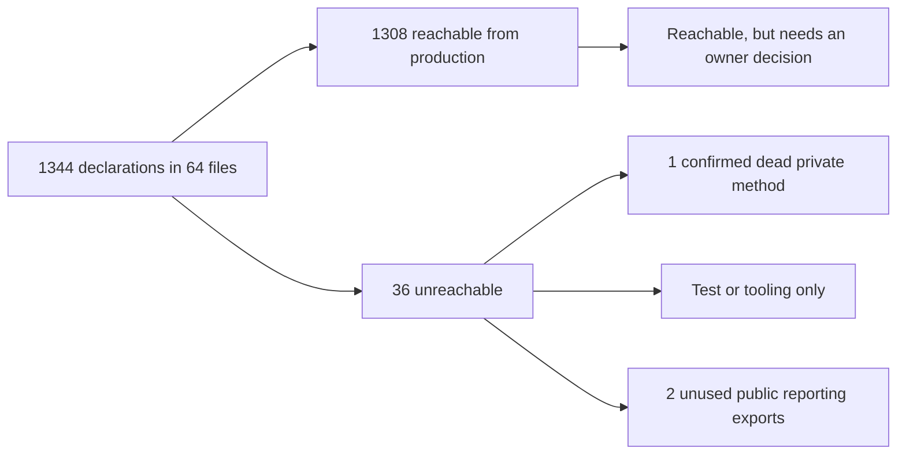

# Dead code audit: API and reporting

  

| Field | Value |
| --- | --- |
| Status | **ISSUES**: dead code exists, and none of it breaks anything today |
| Audited commit | `5006bd1adbec53a60162c82eb41952dbb594d976` |
| Slice | `room/apps/api/**` and `room/packages/reporting/**`, including their tests |
| Output | This report only. No source file was changed. |

## Summary



One symbol is confirmed dead without qualification: the private `DebateService.poll`. Two more items are unused repo-local references. Six are unused or always-true only as far as this repository can show, so they depend on compatibility or intent and are listed apart. No whole file, table, tool or dependency is dead.

The largest open question is a product decision, not a deletion. The web app reaches the API through one multiplexed stream and a few REST routes, which leaves 18 routes with no client in this repository. Those are listed separately in [section D](#d-public-api-routes-with-no-in-repo-client) because this audit cannot see external callers.

**Nothing in this report justifies automatic deletion.** A passing deletion proof shows that a removal did not break the checked build and tests. It does not show the removal is wanted.

| Class | Count | Next step |
| --- | --- | --- |
| [A. Confirmed dead](#a-confirmed-dead-code) | 1 | Remove in a normal reviewed change |
| [B. Unused repo-local references](#b-unused-repo-local-references) | 2 | Confirm intent, then remove |
| [C. Compatibility and intent decisions](#c-compatibility-and-intent-decisions) | 6 | Owner decides. Unused in this repository only. |
| [D. Public routes with no in-repo client](#d-public-api-routes-with-no-in-repo-client) | 18 routes | Owner decides. Do not treat as dead. |
| [E. Used only by tests or tooling](#e-used-only-by-tests-or-tooling) | 6 groups | Mostly intentional. `createRuntimes` is the one candidate. |
| [F. Retained on purpose](#f-retained-on-purpose) | 4 groups | Keep |

## Method

Text search cannot audit this code. Controllers are reached through decorators, the report renderer through a non-literal `import()`, web paths through `${action}` templates, and report previews through server-provided URLs. So the audit used these layers:

1. **Reachability graph.** The [probe](#probe-source) walks TypeScript LanguageService references from production roots: `main.ts`, `AppModule`, route decorators, Nest lifecycle hooks, module-level statements, web references, and the `renderReport` export behind the dynamic import. Test references never count as reachable.
2. **Route tracing.** Each of the 78 route handlers was matched against web callers, including dynamic paths and server-provided URLs, then against tests and docs.
3. **Removal simulation.** The probe recomputes reachability with chosen routes removed, which shows what each removal would strand.
4. **Deletion proof.** A1, B1, C1, C2, C4, C5 and E1 were deleted in a throwaway export of `5006bd1`, then compared with an unmodified export. C6 was tested separately.

The tests ran with provider credentials unset. No provider or paid API was contacted. Dependencies were read from the main checkout, which is at the same commit, because this worktree has no `node_modules`. Nothing was installed.

## A. Confirmed dead code

A private member with no caller. No external code can reach it.

| ID | Location | Symbol | Confidence | Why dynamic use does not preserve it | Evidence | Deletion proof |
| --- | --- | --- | --- | --- | --- | --- |
| A1 | `room/apps/api/src/debate/debate.service.ts:870` | `DebateService.poll` | High | TypeScript `private`, not a Nest hook, no string dispatch. `TS6133` reports it. Commit `a0230b0` deleted its only caller, a `setInterval`. | E1, E2, P1 | Passed |

**Removal impact:** none expected. `reconcile` and `deliverFeedback` stay, and each has other callers.

## B. Unused repo-local references

These match nothing in this repository. They are not private symbols, so confirm they are not reserved for planned work.

| ID | Location | Item | Confidence | Evidence | Deletion proof | Removal impact |
| --- | --- | --- | --- | --- | --- | --- |
| B1 | `room/apps/api/src/app.setup.ts:14` | `'/api/maestro'` guard path | High | E4 | Passed | No controller serves that prefix. `MaestroController` is under `runs/:runId/maestro`, which `/api/runs` already guards. A request to this path would change from the guard's 403 or a 404 to a plain 404. |
| B2 | `room/packages/reporting/src/renderer/report.css:292-298` | `.badge` selector | High for this repository | E20 | Not tested | `render.ts` and `controller.js` never emit the class. The vendored Basecoat `.badge` rules are outside the table-only subset. Editing this file changes the CSS and renderer build hashes, so `build-assets.mjs` must rerun. |

## C. Compatibility and intent decisions

These have no in-repo user, or are always true for today's callers. That is all this audit can establish. Each one needs an owner decision, and none should be removed automatically.

| ID | Location | Item | What was verified | Decision needed | Evidence | Deletion proof |
| --- | --- | --- | --- | --- | --- | --- |
| C1 | `room/packages/reporting/src/contracts.ts:3` | `SCHEMA_VERSION` export | No reference in `apps`, `packages`, `scripts`, `test` or `tests` | It is a public package export and the value `1` is hard-coded at each use. Decide between adopting it at those sites and removing it. | E3, P1 | Passed |
| C2 | `room/packages/reporting/src/contracts.ts:195` | `ReportRun` type export | No reference in the same scope | Public type export. Decide whether consumers should have it. | E3, P1 | Passed |
| C3 | `room/packages/reporting/package.json:11-14` | `./fixtures` subpath export | Nothing imports `@lilbits/reporting/fixtures`. Tests use `../src/fixtures.js` and scripts use `../dist/fixtures.js`. | Public package surface. The package is `private`, but confirm no external use before changing the exports map. | E7 | Not tested |
| C4 | `room/apps/api/src/chat/message.store.ts:180` | `SeatMessageStore.finish`, optional `error` parameter | The only production call, `chat.store.ts:420`, passes two arguments. No test calls it directly. | May be a missing feature, not excess code. A failed turn updates its receipt with no `error`, while `MessageReceipt` has that field. Decide whether the caller should pass the error. | E5, P1 | Passed |
| C5 | `room/apps/api/src/runs/run.store.ts:111` | `RunStore.create`, optional `id` parameter | No production or test call passes a second argument | Optional injection seam. It may be useful for deterministic tests or imports even though nothing uses it now. | E6, P1 | Passed |
| C6 | `room/apps/api/src/chat/chat.store.ts:418` | `if (status !== 'streaming')` guard | True for all four current callers | **Simplification candidate, not dead code.** It is only always true under current callers, and it narrows `TurnStatus` for `finishAttempt` and `SeatMessageStore.finish`. Removing it alone fails typecheck with two `TS2345` errors (G1). Removal would need a signature decision, for example a terminal-only status parameter. | E8, G1 | Removal alone fails |

## E. Used only by tests or tooling

This code has no production path, but deleting it would break something, or it exists to support tests.

| ID | Location | Symbol | Used by | Assessment |
| --- | --- | --- | --- | --- |
| E1 | `room/apps/api/src/chat/runtimes.ts:208` | `createRuntimes` | One call at `runtimes.spec.ts:75` (E9) | **Removal candidate.** Production calls `createParticipantRuntime` directly. The deletion proof passed once the test called that function instead. |
| E2 | `room/apps/api/src/chat/chat.store.ts:613,616,639` | `ChatStore.session`, `toolVersion`, `setSession` | 23 test references (P1) | Test accessors. Production uses `runs.session` and `saveTurnSession`. Removing them means rewriting the specs that call them. E10 shows no production caller; its one hit is the unrelated `MaestroStore.session`. |
| E3 | `room/apps/api/src/reports/report.publisher.ts:73` | `ReportPublisher.idle` | 9 test calls (E11) | Intentional synchronisation point for async tests. Keep. |
| E4 | `chat.service.ts:84`, `debate.service.ts:176`, `maestro.service.ts:143`, `speech.service.ts:209` | `forTest` factories | Tests, `scripts/evaluate-narration.mjs`, `test/scripts/agent-messaging.probe.mjs` (E12) | Intentional. The narration task needs two of them, so they are not test-only. Keep. |
| E5 | `room/packages/reporting/src/fixtures.ts` | All fixtures | Tests and `task reports:scale` (E7) | Intentional. Keep. The package export is a separate question (C3). |
| E6 | `app.setup.ts:6,38`, `repository-browser.controller.ts:16`, `scaffold-seed.ts:95` | `ports`, `raw`, `home`, `root` parameters | Tests only (P1) | Ordinary injection seams. Keep. |

## D. Public API routes with no in-repo client

These are live HTTP endpoints. They are reachable and not confirmed dead, and an absent in-repo client does not justify deleting them. No web app code or script calls them, but a local operator could still use them with `curl`, and this audit cannot see that.

The web app opens exactly one `EventSource`, on `/maestro/room-events`, and that route merges every channel (E13). That explains most of this table.

| Route | Handler | Tests | Docs | Reading |
| --- | --- | --- | --- | --- |
| `GET /api/runs/:runId/state` | `run.controller.ts:48` | Yes | `session-state.md:76` | **Documented contract** |
| `GET /api/runs/:runId/agents/:id/side-conversation` | `run.controller.ts:105` | Yes | `seat-messaging.md:68` | **Documented contract** |
| `GET .../side-conversation/events` | `run.controller.ts:118` | No | `seat-messaging.md:71` | **Documented contract** |
| `GET /api/runs/:anchorRunId/reports/:generationId` | `report.controller.ts:28` | Yes | `reporting.md:99` | **Documented contract** |
| `GET /api/runs/:runId` | `run.controller.ts:32` | Yes | None | Undocumented |
| `GET /api/runs/:runId/correspondence` | `run.controller.ts:64` | Yes | None | Undocumented |
| `POST /api/runs/:runId/agents/:id/turns` | `run.controller.ts:88` | Yes, used as a test driver | None | Undocumented. The web app sends `/messages`. |
| `GET /api/runs/:runId/events` | `run.controller.ts:72` | Service only | None | Undocumented |
| `GET /api/runs/:runId/agents/:id/events` | `run.controller.ts:126` | No | None | Undocumented, superseded by `room-events` |
| `GET /api/runs/:runId/maestro/events` | `maestro.controller.ts:28` | No | None | Undocumented, superseded by `room-events` |
| `GET /api/runs/:runId/artifacts` | `debate.controller.ts:83` | No | None | Undocumented. The list arrives in the workflow snapshot. |
| `POST /api/runs/:runId/actions/propose` | `debate.controller.ts:128` | No | None | Undocumented. Maestro's tool calls the service directly. |
| `/api/agents/*`, 6 routes | `chat.controller.ts:8-28` | 5 of 6, e2e only | None | Closest to retirement, pending an owner decision: a pre-run-scoped API duplicated by `/api/runs/:runId/agents/*` |

Evidence: E13 to E16, and S1 to S3 for what each removal would strand.

**Removal simulation:**

| Scenario | Reachable declarations | Newly stranded beyond the handlers |
| --- | --- | --- |
| Baseline | 1308 | |
| S1: remove `ChatController` | 1301 | Nothing |
| S2: S1 plus the 4 undocumented or side SSE routes | 1296 | `ChatService.correspondenceEvents` |
| S3: every route in this table | 1286 | `correspondenceEvents`, `ChatService.submit`, `ChatService.sideSnapshot` |

S3 is a ceiling, not a recommendation, because it includes the documented routes. It does show that `ChatService.submit` survives only through the routes in this table, and it has 55 test references. Removing the `turns` routes would mean rewriting that test driver.

**Before changing any of these:**

- Confirm nobody uses them outside the repository.
- If `ChatController` goes, remove `'/api/agents'` from `app.setup.ts:14` and migrate `test/chat.e2e-spec.ts`.
- `docs/maestro-debate-plan.md:121` describes an SSE reconnect check. Decide whether `RunController.events` still serves that before removing it.

## F. Retained on purpose

| Item | Location | Why it stays |
| --- | --- | --- |
| Legacy database upgrade | `chat.store.ts:84-110`, `run.store.ts:234`, `state.store.ts:70` | Runs when an older database is opened. Only absent older databases would retire it. |
| Migration audit records | `provider_session_migrations` (`chat.store.ts:664`), `schema_migrations.applied_at`, `state_migrations.applied_at` | Written and never read in production (E17). These are audit records, so write-only is a reasonable design. Tests read the first one. |
| Vendored report assets | `packages/reporting/assets/` | Inputs to `build-assets.mjs`, which the package build runs. |
| 61 exports with no production importer | Listed by the probe | Not dead. The symbols are used in their own file or by tests. Dropping `export` is optional tidying, and those with test references must stay exported. |

## Rejected hypotheses

Each of these looked dead and was checked. They are recorded so nobody repeats the work.

| Hypothesis | Why it failed |
| --- | --- |
| `render.ts` and all its helpers are dead | Loaded through `const renderer = ...; import(renderer)` in `app.module.ts:37-38`. The first graph run reported this false positive, so `renderReport` became an explicit root (E19). |
| Controller methods are dead | They have zero TypeScript references because Nest calls them through decorators. |
| `/start`, `/prepare`, `/compare`, `/pause` and others have no client | Web builds them as `` `/${action}` `` (E18). |
| Report and artifact `preview` and `download` have no client | The web app uses server-provided `previewUrl` and `downloadUrl` values (E18). |
| `@nestjs/platform-express` and `reflect-metadata` are unused | `nest-factory.js:169` loads the adapter, and `@nestjs/common/index.js:7` imports the metadata package. |
| `ws` is unused | The Cartesia SDK's CommonJS build needs it. `speech.service.ts:14-15` explains that its absence would move API keys into query parameters, and `cartesia.connection.spec.ts` guards this. |
| `PanelistDelivery`, `MaestroMessage` and `ChatSnapshot` fields are unused | They are built through casts or returned as JSON. `agent-panel.tsx:132-137` and `maestro-dialog.tsx:83` read them. |
| `RunWorkspaces.version`, `projectIdentity` and `resultNames` are write-only | They are persisted, then validated on load through an untyped value at `workspace-manager.ts:204-245`. |
| `CodexClient.nextId` is write-only | `this.nextId++` also reads it. A probe false positive. |
| `fixtureAttempt`'s `runId` is unused | `measure-scale.mjs` passes it through compiled output, which the type graph cannot see. |
| `'createdAt'`, `'run'`, `'phase'` and similar union members are dead | They are key names inside `Omit<>` and `Pick<>`. |
| `get_private_history` has no dispatcher | Dispatched through `privateHistoryTool.name` at `maestro.service.ts:529`. All 25 distinct tool names have dispatchers. |
| `.recharts-tooltip-wrapper` in `report.css` is unused | The renderer never emits it, but it is named for Recharts, which loads from the CDN at report time. Expected to match at runtime. Not verified here because the library is not installed. |
| The other `report.css` classes are unused | 33 of the 35 class-like tokens appear in `render.ts` or `controller.js`. This is a word-match check. The remaining two are B2 and the row above. |
| `.skipIf` tests are stale | They are macOS sandbox tests enabled by `ROOM_SANDBOX_TESTS`, which `task checks` sets. |
| The `discoverModels` re-export is unused | `chat.service.ts:24` imports it from `runtimes.js`. |

## Check results

| Check | Result |
| --- | --- |
| Reachability probe, `TS6133` family across src and tests | One diagnostic: `poll` |
| `oxlint 1.89.0` with `no-unused-vars`, `no-unreachable`, `no-constant-condition` and others | No unused or unreachable finding. 6 `no-empty` findings, unrelated to dead code. |
| Unused-table check across 39 tables | None without a writer. One without a production reader, see section F. |
| Dependency check on `@bay01/api` | No unused dependency, see rejected hypotheses |
| Deletion proof | All four typechecks exit 0. Baseline: 137 total, 137 passed, 0 failed, 0 skipped. Modified: the same. 0 status differences. Covers A1, B1, C1, C2, C4, C5 and E1. This shows the checked build still passes, not that removal is wanted. |
| Guard removal test (C6) | `guard-removed api tsc exit=2`, two `TS2345` errors. See G1. |
| Source files changed | None. `git status --short` shows only this report. |

## Limitations

- **The deletion proof needs macOS sandbox access.** An independent rerun in a restricted execution context gave 135 passed of 137 on both sides, with zero status differences and passing typechecks. Those two failures came from that context. The orchestrator's rerun with the required sandbox access matched this report: 137 of 137 on both sides. Expect the same two failures if the helper runs without that access.
- **Full suites were not run.** The deletion proof ran the 3 reporting spec files and a selected 9 API spec files. It did not run the e2e suite, the remaining API specs, or web tests. Typecheck covers the full API and reporting packages, including tests, but not `apps/web`. The probe found no web reference to C1 or C2.
- **External clients are invisible.** Section C reports in-repo callers only.
- **Branch-level dead code is sampled.** C6 came from reading code, not from a systematic search, and no coverage data was used. More always-true guards may exist.
- **Field-level analysis is partial.** Report DTO and Zod schema fields were not audited individually. The reporting docs say full DTOs go to publication sidecars, so an unread field may still be intended output. The write-only list, which includes fields such as `CandidateEvidence.sha256`, was triaged by hand for the likeliest candidates, not line by line. No field is classified as dead here.
- **SQL analysis is heuristic.** It is pattern-based, and `SELECT *` hides which columns are read.
- **Script edges are name-based.** Scripts import compiled output, so those edges come from text matches. This errs toward keeping code.
- **`room/test/scripts/agent-messaging.probe.mjs` needs a built API** and is documented as a manual probe. Its imports and `forTest` calls were read, and it was not run.
- **History is shallow.** Most of the code enters history at `cf25ec1`, so older intent is unavailable.
- **An earlier CSS check was wrong.** It reported no unused classes because macOS `wc -l` pads its output, so its comparison never matched. The inline check replaces it and found B2.
- **Discovery stopped on request** once the current findings were checked.

## Reproduce

Run everything from the repository root. `DEP_ROOT` must be a `room/` checkout of this commit with dependencies installed. Scripts are extracted from this report, so nothing here depends on a scratchpad.

```bash
export DEP_ROOT=/path/to/room-with-node_modules
P=$(mktemp -d)
awk '/^```js dead-probe$/{f=1;next} /^```$/{f=0} f' dead/api-reporting.md > "$P/dead-probe.cjs"
awk '/^```python dead-mutate$/{f=1;next} /^```$/{f=0} f' dead/api-reporting.md > "$P/mutate.py"
awk '/^```bash dead-validate$/{f=1;next} /^```$/{f=0} f' dead/api-reporting.md > "$P/validate.sh"

# P1: full probe output
(cd room && node "$P/dead-probe.cjs")

# S1, S2, S3: removal simulations
(cd room && REMOVE_ROUTES='ChatController.*' node "$P/dead-probe.cjs")
(cd room && REMOVE_ROUTES='ChatController.*,RunController.events,RunController.seatEvents,RunController.sideEvents,MaestroController.events' node "$P/dead-probe.cjs")
(cd room && REMOVE_ROUTES='ChatController.*,RunController.events,RunController.seatEvents,RunController.sideEvents,MaestroController.events,RunController.state,RunController.correspondence,RunController.submit,RunController.run,RunController.side,ReportController.get,DebateController.artifacts,DebateController.propose' node "$P/dead-probe.cjs")

# Deletion proof, in a temp directory
bash "$P/validate.sh" "$DEP_ROOT" "$P/mutate.py"

# Table, CSS and oxlint checks, then the column heuristic
awk '/^```bash dead-support$/{f=1;next} /^```$/{f=0} f' dead/api-reporting.md > "$P/support.sh"
awk '/^```js dead-sqlcols$/{f=1;next} /^```$/{f=0} f' dead/api-reporting.md > "$P/sqlcols.mjs"
bash "$P/support.sh"
(cd room && node "$P/sqlcols.mjs")

# G1: remove the C6 guard in a temp copy
awk '/^```bash dead-guard$/{f=1;next} /^```$/{f=0} f' dead/api-reporting.md > "$P/guard.sh"
bash "$P/guard.sh" "$DEP_ROOT"
```

### Probe source

SHA-256 of the extracted file: `847f42d3a63f5e69afc531ac11e71b91b4b1bbadd132c2ea713e048bafab8a2c`

```js dead-probe
#!/usr/bin/env node
// Read-only reachability probe for room/apps/api and room/packages/reporting. Run from room/.
// DEP_ROOT must contain node_modules with typescript@6.0.3 under .pnpm, e.g. a checkout with installed deps.
const path = require('path'), fs = require('fs');
const DEP_ROOT = process.env.DEP_ROOT || process.cwd();
const ts = require(path.join(DEP_ROOT, 'node_modules/.pnpm/typescript@6.0.3/node_modules/typescript'));
const REMOVE = (process.env.REMOVE_ROUTES || '').split(',').filter(Boolean);
const ROOT = process.cwd();
const rel = (f) => path.relative(ROOT, f);
function walk(d, out = []) {
  if (!fs.existsSync(d)) return out;
  for (const e of fs.readdirSync(d, { withFileTypes: true })) {
    if (['node_modules', 'dist', 'coverage'].includes(e.name)) continue;
    const p = path.join(d, e.name);
    if (e.isDirectory()) walk(p, out);
    else if (/\.(ts|tsx|mjs)$/.test(e.name) && !e.name.endsWith('.d.ts')) out.push(path.resolve(p));
  }
  return out;
}
const files = ['apps/api/src', 'apps/api/test', 'packages/reporting/src', 'packages/reporting/test',
  'packages/reporting/scripts', 'apps/web/src', 'apps/web/test', 'scripts', 'test', 'tests'].flatMap((d) => walk(d));
const deps = ['apps/api/node_modules', 'apps/web/node_modules', 'node_modules'].map((d) => path.join(DEP_ROOT, d, '*'));
const options = {
  target: ts.ScriptTarget.ES2023, module: ts.ModuleKind.ESNext, moduleResolution: ts.ModuleResolutionKind.Bundler,
  jsx: ts.JsxEmit.ReactJSX, allowJs: true, noEmit: true, skipLibCheck: true, strict: true,
  experimentalDecorators: true, emitDecoratorMetadata: true, esModuleInterop: true, allowImportingTsExtensions: true,
  types: ['node'], typeRoots: [path.join(DEP_ROOT, 'apps/api/node_modules/@types')], baseUrl: ROOT,
  paths: { '@lilbits/reporting': ['packages/reporting/src/index.ts'],
    '@lilbits/reporting/fixtures': ['packages/reporting/src/fixtures.ts'],
    '@lilbits/reporting/renderer': ['packages/reporting/src/render.ts'],
    '@/*': ['apps/web/src/*'], '*': deps },
};
const host = {
  getCompilationSettings: () => options, getScriptFileNames: () => files, getScriptVersion: () => '1',
  getScriptSnapshot: (f) => (fs.existsSync(f) ? ts.ScriptSnapshot.fromString(fs.readFileSync(f, 'utf8')) : undefined),
  getCurrentDirectory: () => ROOT, getDefaultLibFileName: (o) => ts.getDefaultLibFilePath(o),
  fileExists: ts.sys.fileExists, readFile: ts.sys.readFile, readDirectory: ts.sys.readDirectory,
  directoryExists: ts.sys.directoryExists, getDirectories: ts.sys.getDirectories, realpath: ts.sys.realpath,
};
const ls = ts.createLanguageService(host);
const program = ls.getProgram();
const bucket = (file) => {
  const f = rel(file);
  if (f.startsWith('apps/api/src')) return 'api';
  if (f.startsWith('packages/reporting/src')) return 'reporting';
  if (f.startsWith('apps/web/src')) return 'web';
  if (f.startsWith('packages/reporting/scripts') || f.startsWith('scripts')) return 'tool';
  return 'test';
};
const slice = files.filter((f) => /apps\/api\/src|packages\/reporting\/src/.test(f) && f.endsWith('.ts') && !f.endsWith('render-assets.ts'));
const decls = [];
const byPos = new Map();
for (const f of slice) {
  const sf = program.getSourceFile(f);
  const add = (n, kind, owner, exported) => {
    if (!n.name || !(ts.isIdentifier(n.name) || ts.isStringLiteral(n.name))) return;
    const pos = n.name.getStart(sf);
    const d = { file: f, name: n.name.text, pos, line: sf.getLineAndCharacterOfPosition(pos).line + 1, kind, owner, exported, node: n, sf, test: [], tool: [], reads: 0, writes: 0, id: `${rel(f)}:${pos}` };
    decls.push(d); byPos.set(`${f}:${pos}`, d);
  };
  const exp = (n) => !!(ts.getCombinedModifierFlags(n) & ts.ModifierFlags.Export);
  const members = (list, owner, kind) => {
    for (const m of list) {
      if (ts.isMethodDeclaration(m) || ts.isPropertyDeclaration(m) || ts.isGetAccessor(m) || ts.isSetAccessor(m) || ts.isPropertySignature(m) || ts.isMethodSignature(m) || ts.isEnumMember(m)) add(m, kind, owner, false);
      if (ts.isConstructorDeclaration(m)) for (const p of m.parameters) if (ts.isParameterPropertyDeclaration(p, m)) add(p, 'field', owner, false);
      if (ts.isPropertySignature(m) && m.type && ts.isTypeLiteralNode(m.type)) members(m.type.members, `${owner}.${m.name.getText(sf)}`, kind);
    }
  };
  for (const s of sf.statements) {
    if (ts.isFunctionDeclaration(s)) add(s, 'function', '', exp(s));
    if (ts.isClassDeclaration(s)) { add(s, 'class', '', exp(s)); members(s.members, s.name.text, 'member'); }
    if (ts.isInterfaceDeclaration(s)) { add(s, 'type', '', exp(s)); members(s.members, s.name.text, 'typemember'); }
    if (ts.isTypeAliasDeclaration(s)) { add(s, 'type', '', exp(s)); if (ts.isTypeLiteralNode(s.type)) members(s.type.members, s.name.text, 'typemember'); }
    if (ts.isEnumDeclaration(s)) { add(s, 'enum', '', exp(s)); members(s.members, s.name.text, 'typemember'); }
    if (ts.isVariableStatement(s)) for (const d of s.declarationList.declarations) if (ts.isIdentifier(d.name)) add(d, 'var', '', exp(s));
  }
}
const label = (d) => `${rel(d.file)}:${d.line} ${d.owner ? d.owner + '.' : ''}${d.name}`;
const key = (d) => `${d.owner ? d.owner + '.' : ''}${d.name}`;
const nodeAt = (sf, pos) => { let r = sf; const go = (n) => { if (pos >= n.getStart(sf) && pos < n.end) { r = n; ts.forEachChild(n, go); } }; go(sf); return r; };
const enclosing = (sf, n) => {
  for (let p = n; p; p = p.parent) {
    if (ts.isConstructorDeclaration(p)) { const d = byPos.get(`${sf.fileName}:${p.parent.name.getStart(sf)}`); if (d) return d; }
    if (p.name && p.name.getStart && !ts.isParameter(p)) { const d = byPos.get(`${sf.fileName}:${p.name.getStart(sf)}`); if (d) return d; }
  }
  return null;
};
const ROUTE = /^@(Get|Post|Put|Delete|Patch|Sse|All)\b/;
const HOOK = /^(onModuleInit|onModuleDestroy|onApplicationBootstrap|onApplicationShutdown|beforeApplicationShutdown)$/;
const edges = new Map(decls.map((d) => [d, new Set()]));
const roots = new Set(), toolRoots = new Set();
const calls = new Map();
for (const d of decls) {
  const dec = ts.canHaveDecorators(d.node) ? ts.getDecorators(d.node) || [] : [];
  d.route = dec.map((x) => x.getText(d.sf)).find((t) => ROUTE.test(t));
  if (d.kind === 'member' && (d.route || HOOK.test(d.name)) && !REMOVE.some((r) => r === key(d) || r === `${d.owner}.*`)) roots.add(d);
  if (rel(d.file) === 'apps/api/src/main.ts' || rel(d.file) === 'apps/api/src/app.module.ts') roots.add(d);
  if (rel(d.file) === 'packages/reporting/src/render.ts' && d.name === 'renderReport') roots.add(d);
  const seen = new Set();
  for (const group of ls.findReferences(d.file, d.pos) || []) for (const r of group.references) {
    const id = `${r.fileName}:${r.textSpan.start}`;
    if (r.isDefinition || seen.has(id) || r.fileName.includes('node_modules')) continue;
    seen.add(id);
    const sf = program.getSourceFile(r.fileName);
    if (!sf) continue;
    const n = nodeAt(sf, r.textSpan.start);
    let imported = false;
    for (let p = n; p; p = p.parent) if (ts.isImportDeclaration(p) || ts.isExportDeclaration(p)) imported = true;
    if (imported) continue;
    const b = bucket(r.fileName), at = `${rel(r.fileName)}:${sf.getLineAndCharacterOfPosition(r.textSpan.start).line + 1}`;
    if (b === 'test') { d.test.push(at); }
    else if (b === 'tool') { toolRoots.add(d); d.tool.push(at); }
    else if (b === 'web') { roots.add(d); (d.web = d.web || []).push(at); }
    else {
      r.isWriteAccess ? d.writes++ : d.reads++;
      if (r.fileName !== d.file) d.crossFile = (d.crossFile || 0) + 1;
      const e = enclosing(sf, n);
      if (!e) roots.add(d); else if (e !== d) edges.get(e).add(d);
    }
    if (b !== 'web') {
      const callee = ts.isPropertyAccessExpression(n.parent) && n.parent.name === n ? n.parent : n;
      if (ts.isCallExpression(callee.parent) && callee.parent.expression === callee) {
        const c = calls.get(d) || { prod: 0, prodMax: 0, testMax: 0 };
        const a = callee.parent.arguments.length;
        if (b === 'test') c.testMax = Math.max(c.testMax, a); else { c.prod++; c.prodMax = Math.max(c.prodMax, a); }
        calls.set(d, c);
      }
    }
  }
}
// scripts import compiled dist modules, which the TS program cannot follow
for (const f of walk('scripts').concat(walk('packages/reporting/scripts'))) {
  const text = fs.readFileSync(f, 'utf8');
  for (const d of decls) if (!d.owner && d.exported && d.file.includes('/src/') && new RegExp(`\\b${d.name}\\b`).test(text) && /dist/.test(text)) { toolRoots.add(d); d.tool.push(`text:${rel(f)}`); }
  for (const d of decls) if (d.kind === 'member' && new RegExp(`\\b${d.owner}\\.${d.name}\\b`).test(text)) { toolRoots.add(d); d.tool.push(`text:${rel(f)}`); }
}
const reach = (start) => { const seen = new Set(), stack = [...start]; while (stack.length) { const x = stack.pop(); if (seen.has(x)) continue; seen.add(x); stack.push(...edges.get(x)); } return seen; };
const prod = reach(roots), withTools = reach(new Set([...roots, ...toolRoots]));
console.log(`# scope: files=${slice.length} declarations=${decls.length} roots=${roots.size} productionReachable=${prod.size} REMOVE_ROUTES=${REMOVE.join('|') || 'none'}`);
console.log('\n## unreachable from production (value declarations)');
for (const d of decls.filter((x) => !prod.has(x) && !['type', 'typemember'].includes(x.kind))) console.log(`${label(d)} [${d.kind}] tooling=${withTools.has(d) ? 'yes' : 'no'} testRefs=${d.test.length}${d.test[0] ? ' e.g. ' + d.test[0] : ''}`);
console.log('\n## unreachable from production (types)');
for (const d of decls.filter((x) => !prod.has(x) && x.kind === 'type')) console.log(`${label(d)} tooling=${withTools.has(d) ? 'yes' : 'no'} testRefs=${d.test.length}`);
if (REMOVE.length) process.exit(0);
console.log('\n## type members with no production reference (wire shape: confirm against the web parser)');
for (const d of decls.filter((x) => x.kind === 'typemember' && x.reads + x.writes === 0)) console.log(`${label(d)} web=${(d.web || []).length} testRefs=${d.test.length}`);
console.log('\n## class fields written but never read in production');
for (const d of decls.filter((x) => (x.kind === 'field' || (x.kind === 'member' && ts.isPropertyDeclaration(x.node))) && x.reads === 0)) console.log(`${label(d)} writes=${d.writes} testRefs=${d.test.length}`);
console.log('\n## type members written but never read in production');
for (const d of decls.filter((x) => x.kind === 'typemember' && x.reads === 0 && x.writes > 0)) console.log(`${label(d)} writes=${d.writes} web=${(d.web || []).length} testRefs=${d.test.length}`);
console.log('\n## trailing parameters no production call supplies');
for (const [d, c] of calls) {
  const fn = ts.isVariableDeclaration(d.node) ? d.node.initializer : d.node;
  if (!fn || !fn.parameters || !c.prod) continue;
  const params = fn.parameters.filter((p) => !p.dotDotDotToken);
  if (c.prodMax < params.length) console.log(`${label(d)} params=${params.length} maxProdArgs=${c.prodMax} prodCalls=${c.prod} maxTestArgs=${c.testMax} unused=${params.slice(c.prodMax).map((p) => p.name.getText(d.sf)).join(',')}`);
}
console.log('\n## string-literal union members with no value occurrence in production');
const prodText = slice.map((f) => program.getSourceFile(f));
const count = new Map();
for (const sf of prodText) {
  const visit = (n) => {
    if (ts.isLiteralTypeNode(n)) return;
    if (ts.isStringLiteralLike(n)) count.set(n.text, (count.get(n.text) || 0) + 1);
    ts.forEachChild(n, visit);
  };
  visit(sf);
}
for (const sf of prodText) {
  const visit = (n) => {
    if (ts.isUnionTypeNode(n)) for (const t of n.types) if (ts.isLiteralTypeNode(t) && ts.isStringLiteral(t.literal) && !count.get(t.literal.text)) console.log(`${rel(sf.fileName)}:${sf.getLineAndCharacterOfPosition(t.getStart(sf)).line + 1} '${t.literal.text}'`);
    ts.forEachChild(n, visit);
  };
  visit(sf);
}
console.log('\n## exports with no production importer (alive locally, or kept for tests/tooling)');
for (const d of decls.filter((x) => x.exported && !x.crossFile && !x.web && prod.has(x))) console.log(`${label(d)} [${d.kind}] testRefs=${d.test.length} toolRefs=${d.tool.length}`);
console.log('\n## compiler unused-symbol diagnostics, src and tests');
const unused = ts.createProgram(files.filter((f) => /\.ts$/.test(f) && /apps\/api\/(src|test)|packages\/reporting\/(src|test)/.test(f)), { ...options, noUnusedLocals: true, noUnusedParameters: true });
for (const sf of unused.getSourceFiles()) {
  if (sf.fileName.includes('node_modules') || sf.fileName.endsWith('render-assets.ts') || sf.isDeclarationFile) continue;
  for (const g of unused.getSemanticDiagnostics(sf)) if ([6133, 6138, 6192, 6196, 6198].includes(g.code)) console.log(`${rel(sf.fileName)}:${sf.getLineAndCharacterOfPosition(g.start).line + 1} TS${g.code} ${ts.flattenDiagnosticMessageText(g.messageText, ' ')}`);
}
```

### Deletion proof source

```python dead-mutate
import sys
R = sys.argv[1]
def sub(path, old, new):
    text = open(R + path).read()
    assert old in text, (path, old)
    open(R + path, 'w').write(text.replace(old, new, 1))
sub('/apps/api/src/debate/debate.service.ts', "  private poll() {\n    for (const run of this.chat.listRuns().runs) this.reconcile(run.id);\n    this.deliverFeedback();\n  }\n", "")
sub('/packages/reporting/src/contracts.ts', "export const SCHEMA_VERSION = 1;\n", "")
sub('/packages/reporting/src/contracts.ts', "export type ReportRun = z.infer<typeof runSchema>;\n", "")
sub('/apps/api/src/app.setup.ts', "'/api/providers', '/api/maestro'],", "'/api/providers'],")
sub('/apps/api/src/chat/message.store.ts', "finish(turnId: string, status: 'completed' | 'stopped' | 'failed', error?: string) {", "finish(turnId: string, status: 'completed' | 'stopped' | 'failed') {")
sub('/apps/api/src/chat/message.store.ts', "this.update(receipt(row), status, { error });", "this.update(receipt(row), status);")
sub('/apps/api/src/runs/run.store.ts', "create(kind: RunSnapshot['kind'] = 'ordinary', id: string = randomUUID()): RunSnapshot {\n    return this.transaction(() => {", "create(kind: RunSnapshot['kind'] = 'ordinary'): RunSnapshot {\n    const id = randomUUID();\n    return this.transaction(() => {")
text = open(R + '/apps/api/src/chat/runtimes.ts').read()
open(R + '/apps/api/src/chat/runtimes.ts', 'w').write(text[:text.index('export function createRuntimes(')].rstrip() + '\n')
sub('/apps/api/src/chat/runtimes.ts', "  DEFAULT_MODELS,\n", "")
sub('/apps/api/src/chat/runtimes.ts', "  type SeatId,\n", "")
sub('/apps/api/test/unit/chat/runtimes.spec.ts', "  createRuntimes,\n", "")
sub('/apps/api/test/unit/chat/runtimes.spec.ts', "await createRuntimes('/tmp').b.run(turn);", "await createParticipantRuntime('b', DEFAULT_MODELS.b, '/tmp').run(turn);")
```

```bash dead-validate
#!/usr/bin/env bash
# args: <DEP_ROOT> <extracted mutate.py>. Run from the repository root; every write lands in a temp directory.
set -u
DEPS=$1 MUTATE=$2 WORK=$(mktemp -d)
unset CARTESIA_API_KEY ANTHROPIC_API_KEY OPENAI_API_KEY CODEX_HOME GH_TOKEN ROOM_SANDBOX_TESTS
for T in base mut; do
  mkdir -p "$WORK/$T"
  git archive 5006bd1 room/apps/api room/packages/reporting room/package.json room/pnpm-workspace.yaml room/apps/web/src/index.css room/skills room/docs/reporting-cdn-proof.json | tar -x -C "$WORK/$T"
  R=$WORK/$T/room
  for d in . apps/api packages/reporting; do
    mkdir -p "$R/$d/node_modules"
    for e in $(ls -A "$DEPS/$d/node_modules" | grep -v '^\.'); do ln -s "$DEPS/$d/node_modules/$e" "$R/$d/node_modules/$e"; done
  done
done
python3 "$MUTATE" "$WORK/mut/room"
for T in base mut; do
  R=$WORK/$T/room
  (cd "$R/packages/reporting" && ./node_modules/typescript/bin/tsc -p tsconfig.json --noEmit; echo "$T reporting tsc exit=$?")
  (cd "$R/apps/api" && ./node_modules/typescript/bin/tsc -p tsconfig.json --noEmit; echo "$T api tsc exit=$?")
  (cd "$R/packages/reporting" && node node_modules/vitest/vitest.mjs run --reporter=json --outputFile="$WORK/$T-rep.json" >/dev/null 2>&1)
  (cd "$R/apps/api" && node node_modules/vitest/vitest.mjs run test/unit/chat/runtimes.spec.ts test/unit/chat/messaging.spec.ts test/unit/debate test/unit/runs test/unit/app.setup.spec.ts test/unit/reports --reporter=json --outputFile="$WORK/$T-api.json" >/dev/null 2>&1)
done
WORK=$WORK node -e '
const fs=require("fs"),W=process.env.WORK;
const load=t=>{const o=new Map();for(const k of ["rep","api"]){for(const f of JSON.parse(fs.readFileSync(`${W}/${t}-${k}.json`)).testResults)for(const a of f.assertionResults)o.set(f.name.split("/room/")[1]+" :: "+a.fullName,a.status)}return o};
const b=load("base"),m=load("mut");
const tally=x=>{const c={};for(const s of x.values())c[s]=(c[s]||0)+1;return `total=${x.size} `+Object.keys(c).sort().map(s=>`${s}=${c[s]}`).join(" ")};
console.log("base "+tally(b));console.log("mutated "+tally(m));
console.log("status differences "+[...b].filter(([k,v])=>m.get(k)!==v).length);
for(const [k,v] of b)if(v!=="passed")console.log("base non-passed: "+v+" "+k);
for(const [k,v] of m)if(v!=="passed")console.log("mutated non-passed: "+v+" "+k);'
```

### Supporting check source

```bash dead-support
#!/usr/bin/env bash
# Run from the repository root.
echo '# tables: reads, inserts, updates, deletes in production'
for t in $(rg -no 'CREATE TABLE( IF NOT EXISTS)? [a-z_]+' room/apps/api/src | awk '{print $NF}' | sort -u); do
  echo "$t select=$(rg -n "(FROM|JOIN) $t\b" room/apps/api/src | wc -l | tr -d ' ') insert=$(rg -n "INTO $t\b" room/apps/api/src | wc -l | tr -d ' ') update=$(rg -n "UPDATE $t\b" room/apps/api/src | wc -l | tr -d ' ') delete=$(rg -n "DELETE FROM $t\b" room/apps/api/src | wc -l | tr -d ' ')"
done
echo '# report.css classes absent from the renderer'
for c in $(rg -o '\.[a-zA-Z][a-zA-Z0-9_-]+' room/packages/reporting/src/renderer/report.css | sed 's/^\.//' | sort -u); do
  rg -q -- "\b$c\b" room/packages/reporting/src/render.ts room/packages/reporting/src/renderer/controller.js || echo "unused .$c"
done
echo '# oxlint'
(cd room && "$DEP_ROOT/node_modules/.bin/oxlint" -D no-unused-vars -D no-unreachable -D no-useless-catch -D no-constant-condition -D no-empty -D no-unused-private-class-members apps/api packages/reporting/src packages/reporting/test --ignore-pattern '**/render-assets.ts' 2>&1 | tail -8)
```

```bash dead-guard
#!/usr/bin/env bash
# args: <DEP_ROOT>. Run from the repository root. Removes the guard in a temp copy and typechecks.
DEPS=$1 WORK=$(mktemp -d)
git archive 5006bd1 room/apps/api room/packages/reporting room/package.json | tar -x -C "$WORK"
R=$WORK/room
for d in . apps/api packages/reporting; do
  mkdir -p "$R/$d/node_modules"
  for e in $(ls -A "$DEPS/$d/node_modules" | grep -v '^\.'); do ln -s "$DEPS/$d/node_modules/$e" "$R/$d/node_modules/$e"; done
done
python3 - "$R/apps/api/src/chat/chat.store.ts" <<'PY'
import sys
path = sys.argv[1]
text = open(path).read()
old = """      if (status !== 'streaming') {
        this.runs.state.finishAttempt(id, status, Date.now(), elapsedMs);
        this.messaging.finish(id, status);
      }
"""
new = """      this.runs.state.finishAttempt(id, status, Date.now(), elapsedMs);
      this.messaging.finish(id, status);
"""
assert old in text
open(path, 'w').write(text.replace(old, new))
PY
cd "$R/apps/api" && ./node_modules/typescript/bin/tsc -p tsconfig.json --noEmit; echo "guard-removed api tsc exit=$?"
```

The column heuristic lists columns with at most one read-like use. It is a lead generator, and it produced no finding on its own.

```js dead-sqlcols
import {readFileSync} from 'node:fs';import {execSync} from 'node:child_process';
const files=execSync("rg -l 'CREATE TABLE' apps/api/src",{encoding:'utf8'}).trim().split('\n');
const all=execSync("rg --files apps/api/src -g '*.ts'",{encoding:'utf8'}).trim().split('\n').map(f=>[f,readFileSync(f,'utf8')]);
for(const f of files){const t=readFileSync(f,'utf8');
 for(const m of t.matchAll(/CREATE TABLE IF NOT EXISTS ([a-z_]+)\s*\(([\s\S]*?)\);/g)){
  const [,tb,body]=m;const cols=[];let d=0,c='';for(const ch of body){if(ch=='(')d++;if(ch==')')d--;if(ch==','&&d==0){cols.push(c);c=''}else c+=ch}cols.push(c);
  for(const raw of cols){const col=raw.trim().split(/\s+/)[0];if(!col||/^(PRIMARY|UNIQUE|FOREIGN|CHECK|CONSTRAINT)$/i.test(col))continue;
   const stripped=all.map(([p,s])=>s.replace(/CREATE TABLE IF NOT EXISTS[\s\S]*?\);/g,'')).join('\n');
   const n=(stripped.match(new RegExp('\\b'+col+'\\b','g'))||[]).length;
   const reads=(stripped.match(new RegExp("(row|r|record|value|item|turn|attempt|run|binding|session|existing|current|message|entry|prior|command)\\??\\."+col+"\\b",'g'))||[]).length;
   const sel=(stripped.match(new RegExp("(SELECT|WHERE|AND|ORDER BY|ON|GROUP BY)[^'\"`]*\\b"+col+"\\b",'g'))||[]).length;
   if(reads+sel<=1)console.log(`${tb}.${col} words=${n} accessor=${reads} sqlclause=${sel}`);
  }}}
```

## Recorded output

### P1: probe

Output is abridged to the sections the findings cite. The 138-line write-only section and the 61-line export list are omitted, and the reproduction command prints both.

```text
# scope: files=64 declarations=1344 roots=206 productionReachable=1308 REMOVE_ROUTES=none

## unreachable from production (value declarations)
apps/api/src/chat/chat.service.ts:84 ChatService.forTest [member] tooling=yes testRefs=18 e.g. apps/api/test/chat.e2e-spec.ts:45
apps/api/src/chat/chat.store.ts:613 ChatStore.session [member] tooling=no testRefs=13 e.g. apps/api/test/unit/chat/chat.service.spec.ts:62
apps/api/src/chat/chat.store.ts:616 ChatStore.toolVersion [member] tooling=no testRefs=3 e.g. apps/api/test/unit/chat/chat.service.spec.ts:95
apps/api/src/chat/chat.store.ts:639 ChatStore.setSession [member] tooling=no testRefs=7 e.g. apps/api/test/unit/chat/chat.service.spec.ts:72
apps/api/src/chat/runtimes.ts:208 createRuntimes [function] tooling=no testRefs=1 e.g. apps/api/test/unit/chat/runtimes.spec.ts:75
apps/api/src/debate/debate.service.ts:176 DebateService.forTest [member] tooling=no testRefs=9 e.g. apps/api/test/unit/chat/messaging.spec.ts:206
apps/api/src/debate/debate.service.ts:870 DebateService.poll [member] tooling=no testRefs=0
apps/api/src/maestro/maestro.service.ts:143 MaestroService.forTest [member] tooling=no testRefs=8 e.g. apps/api/test/chat.e2e-spec.ts:68
apps/api/src/reports/report.publisher.ts:73 ReportPublisher.idle [member] tooling=no testRefs=9 e.g. apps/api/test/unit/reports/report.controller.spec.ts:76
apps/api/src/speech/speech.service.ts:209 SpeechService.forTest [member] tooling=yes testRefs=3 e.g. apps/api/test/unit/speech/speech.service.spec.ts:74
packages/reporting/src/contracts.ts:3 SCHEMA_VERSION [var] tooling=no testRefs=0
packages/reporting/src/fixtures.ts:9 now [var] tooling=yes testRefs=0
packages/reporting/src/fixtures.ts:10 tokens [var] tooling=yes testRefs=0
packages/reporting/src/fixtures.ts:18 fixtureAttempt [function] tooling=yes testRefs=8 e.g. packages/reporting/test/metrics.spec.ts:7
packages/reporting/src/fixtures.ts:63 currentSnapshotFixture [function] tooling=yes testRefs=14 e.g. packages/reporting/test/contracts.spec.ts:12
packages/reporting/src/fixtures.ts:132 currentReportFixture [function] tooling=yes testRefs=3 e.g. packages/reporting/test/contracts.spec.ts:10
packages/reporting/src/fixtures.ts:140 aggregateReportFixture [function] tooling=yes testRefs=2 e.g. packages/reporting/test/contracts.spec.ts:11

## unreachable from production (types)
packages/reporting/src/contracts.ts:195 ReportRun tooling=no testRefs=0

## type members with no production reference (wire shape: confirm against the web parser)
apps/api/src/chat/chat.types.ts:19 PanelistDelivery.id web=0 testRefs=0
apps/api/src/chat/chat.types.ts:20 PanelistDelivery.recipient web=0 testRefs=0
apps/api/src/chat/chat.types.ts:22 PanelistDelivery.detail web=0 testRefs=0
apps/api/src/chat/chat.types.ts:51 ChatSnapshot.expression web=0 testRefs=0
apps/api/src/chat/chat.types.ts:52 ChatSnapshot.serverNow web=0 testRefs=0
apps/api/src/maestro/maestro.types.ts:8 MaestroMessage.text web=0 testRefs=4
apps/api/src/maestro/maestro.types.ts:10 MaestroMessage.throughSeq web=0 testRefs=0
apps/api/src/maestro/maestro.types.ts:11 MaestroMessage.feedback web=0 testRefs=2
apps/api/src/maestro/maestro.types.ts:11 MaestroMessage.feedback.eventId web=0 testRefs=0
apps/api/src/maestro/maestro.types.ts:11 MaestroMessage.feedback.read web=0 testRefs=0
apps/api/src/maestro/maestro.types.ts:11 MaestroMessage.feedback.question web=0 testRefs=1
apps/api/src/runs/run.contract.ts:59 Correspondence.runId web=0 testRefs=1
apps/api/src/runs/run.contract.ts:63 Correspondence.payload web=0 testRefs=3
apps/api/src/runs/run.contract.ts:64 Correspondence.createdAt web=0 testRefs=0
apps/api/src/state/state.contract.ts:62 OutcomeRevision.candidates.a web=0 testRefs=0
apps/api/src/state/state.contract.ts:62 OutcomeRevision.candidates.b web=0 testRefs=0
apps/api/src/workspaces/retained-workspaces.ts:17 RetainedWorkspace.path web=0 testRefs=0
apps/api/src/workspaces/retained-workspaces.ts:18 RetainedWorkspace.retainedAt web=0 testRefs=0

## class fields written but never read in production
apps/api/src/providers/codex-client.ts:15 CodexClient.nextId writes=1 testRefs=0

## trailing parameters no production call supplies
apps/api/src/app.setup.ts:6 configureApp params=2 maxProdArgs=1 prodCalls=1 maxTestArgs=2 unused=ports
apps/api/src/app.setup.ts:38 resolvePort params=1 maxProdArgs=0 prodCalls=1 maxTestArgs=1 unused=raw
apps/api/src/chat/message.store.ts:180 SeatMessageStore.finish params=3 maxProdArgs=2 prodCalls=1 maxTestArgs=0 unused=error
apps/api/src/repository-browser/repository-browser.controller.ts:16 defaultBrowserPath params=1 maxProdArgs=0 prodCalls=1 maxTestArgs=1 unused=home
apps/api/src/runs/run.store.ts:111 RunStore.create params=2 maxProdArgs=1 prodCalls=3 maxTestArgs=1 unused=id
apps/api/src/scaffolds/scaffold-seed.ts:95 prepareScaffoldSeed params=3 maxProdArgs=2 prodCalls=1 maxTestArgs=3 unused=root
packages/reporting/src/fixtures.ts:18 fixtureAttempt params=2 maxProdArgs=1 prodCalls=2 maxTestArgs=1 unused=runId

## string-literal union members with no value occurrence in production
apps/api/src/chat/message.store.ts:81 'createdAt'
apps/api/src/maestro/maestro.context.ts:7 'run'
apps/api/src/maestro/maestro.context.ts:7 'correspondence'
apps/api/src/state/state.store.ts:351 'createdAt'
packages/reporting/src/render.ts:41 'toolProfile'
packages/reporting/src/render.ts:41 'phase'

## compiler unused-symbol diagnostics, src and tests
apps/api/src/debate/debate.service.ts:870 TS6133 'poll' is declared but its value is never read.
```

### Simulations

```text
S1: # scope: files=64 declarations=1344 roots=200 productionReachable=1301
apps/api/src/chat/chat.controller.ts:6 ChatController.chat [field] tooling=no testRefs=0
apps/api/src/chat/chat.controller.ts:8 ChatController.list [member] tooling=no testRefs=0
apps/api/src/chat/chat.controller.ts:12 ChatController.snapshot [member] tooling=no testRefs=0
apps/api/src/chat/chat.controller.ts:16 ChatController.stopConversation [member] tooling=no testRefs=0
apps/api/src/chat/chat.controller.ts:20 ChatController.submit [member] tooling=no testRefs=0
apps/api/src/chat/chat.controller.ts:24 ChatController.stop [member] tooling=no testRefs=0
apps/api/src/chat/chat.controller.ts:28 ChatController.events [member] tooling=no testRefs=0

S2: # scope: files=64 declarations=1344 roots=196 productionReachable=1296
apps/api/src/chat/chat.controller.ts:6 ChatController.chat [field] tooling=no testRefs=0
apps/api/src/chat/chat.controller.ts:8 ChatController.list [member] tooling=no testRefs=0
apps/api/src/chat/chat.controller.ts:12 ChatController.snapshot [member] tooling=no testRefs=0
apps/api/src/chat/chat.controller.ts:16 ChatController.stopConversation [member] tooling=no testRefs=0
apps/api/src/chat/chat.controller.ts:20 ChatController.submit [member] tooling=no testRefs=0
apps/api/src/chat/chat.controller.ts:24 ChatController.stop [member] tooling=no testRefs=0
apps/api/src/chat/chat.controller.ts:28 ChatController.events [member] tooling=no testRefs=0
apps/api/src/chat/chat.service.ts:292 ChatService.correspondenceEvents [member] tooling=no testRefs=1 e.g. apps/api/test/unit/chat/messaging.spec.ts:372
apps/api/src/maestro/maestro.controller.ts:28 MaestroController.events [member] tooling=no testRefs=0
apps/api/src/runs/run.controller.ts:72 RunController.events [member] tooling=no testRefs=0
apps/api/src/runs/run.controller.ts:118 RunController.sideEvents [member] tooling=no testRefs=0
apps/api/src/runs/run.controller.ts:126 RunController.seatEvents [member] tooling=no testRefs=0

S3: # scope: files=64 declarations=1344 roots=188 productionReachable=1286
apps/api/src/chat/chat.controller.ts:6 ChatController.chat [field] tooling=no testRefs=0
apps/api/src/chat/chat.controller.ts:8 ChatController.list [member] tooling=no testRefs=0
apps/api/src/chat/chat.controller.ts:12 ChatController.snapshot [member] tooling=no testRefs=0
apps/api/src/chat/chat.controller.ts:16 ChatController.stopConversation [member] tooling=no testRefs=0
apps/api/src/chat/chat.controller.ts:20 ChatController.submit [member] tooling=no testRefs=0
apps/api/src/chat/chat.controller.ts:24 ChatController.stop [member] tooling=no testRefs=0
apps/api/src/chat/chat.controller.ts:28 ChatController.events [member] tooling=no testRefs=0
apps/api/src/chat/chat.service.ts:157 ChatService.sideSnapshot [member] tooling=no testRefs=2 e.g. apps/api/test/unit/chat/messaging.spec.ts:311
apps/api/src/chat/chat.service.ts:292 ChatService.correspondenceEvents [member] tooling=no testRefs=1 e.g. apps/api/test/unit/chat/messaging.spec.ts:372
apps/api/src/chat/chat.service.ts:419 ChatService.submit [member] tooling=no testRefs=55 e.g. apps/api/test/unit/chat/chat.service.spec.ts:52
apps/api/src/debate/debate.controller.ts:83 DebateController.artifacts [member] tooling=no testRefs=0
apps/api/src/debate/debate.controller.ts:128 DebateController.propose [member] tooling=no testRefs=0
apps/api/src/maestro/maestro.controller.ts:28 MaestroController.events [member] tooling=no testRefs=0
apps/api/src/reports/report.controller.ts:28 ReportController.get [member] tooling=no testRefs=0
apps/api/src/runs/run.controller.ts:32 RunController.run [member] tooling=no testRefs=0
apps/api/src/runs/run.controller.ts:48 RunController.state [member] tooling=no testRefs=0
apps/api/src/runs/run.controller.ts:64 RunController.correspondence [member] tooling=no testRefs=0
apps/api/src/runs/run.controller.ts:72 RunController.events [member] tooling=no testRefs=0
apps/api/src/runs/run.controller.ts:88 RunController.submit [member] tooling=no testRefs=0
apps/api/src/runs/run.controller.ts:105 RunController.side [member] tooling=no testRefs=0
apps/api/src/runs/run.controller.ts:118 RunController.sideEvents [member] tooling=no testRefs=0
apps/api/src/runs/run.controller.ts:126 RunController.seatEvents [member] tooling=no testRefs=0
```

### G1: guard removal

```text
src/chat/chat.store.ts(418,41): error TS2345: Argument of type 'TurnStatus' is not assignable to parameter of type '"interrupted" | "completed" | "stopped" | "failed"'.
  Type '"streaming"' is not assignable to type '"interrupted" | "completed" | "stopped" | "failed"'.
src/chat/chat.store.ts(419,33): error TS2345: Argument of type 'TurnStatus' is not assignable to parameter of type '"completed" | "stopped" | "failed"'.
  Type '"streaming"' is not assignable to type '"completed" | "stopped" | "failed"'.
guard-removed api tsc exit=2
```

### Command evidence

Commands run from the repository root. Lines are cut at 170 characters.

#### E1

```console
$ rg -n "\bpoll\b" room/apps/api/src room/apps/api/test
room/apps/api/src/debate/debate.service.ts:870:  private poll() {
```

#### E2

```console
$ git show a0230b0 -- room/apps/api/src/debate/debate.service.ts | rg "^[-+].*(setInterval|clearInterval|this\.poll\(\)|private poll)"
-  private readonly timer: ReturnType<typeof setInterval>;
-    this.timer = setInterval(() => {
-      if (!this.closed) this.poll();
-    if (this.timer) clearInterval(this.timer);
```

#### E3

```console
$ rg -n "SCHEMA_VERSION|\bReportRun\b" room/apps room/packages room/scripts room/test room/tests --glob '!render-assets.ts'
room/packages/reporting/src/contracts.ts:3:export const SCHEMA_VERSION = 1;
room/packages/reporting/src/contracts.ts:195:export type ReportRun = z.infer<typeof runSchema>;
```

#### E4

```console
$ rg -n "api/maestro|Controller\('runs/:runId/maestro'\)" room/apps room/scripts room/test
room/apps/api/src/app.setup.ts:14:    ['/api/agents', '/api/speech', '/api/runs', '/api/providers', '/api/maestro'],
room/apps/api/src/maestro/maestro.controller.ts:6:@Controller('runs/:runId/maestro')
```

#### E5

```console
$ rg -n "\.finish\(" room/apps/api/src/chat/chat.store.ts room/apps/api/src/chat/message.store.ts; rg -n "messaging\.finish|finish\(turnId" room/apps/api/test room/apps/api/src
room/apps/api/src/chat/chat.store.ts:146:        store.finish(String(row.id), 'failed');
room/apps/api/src/chat/chat.store.ts:420:        this.messaging.finish(id, status);
room/apps/api/src/chat/chat.store.ts:420:        this.messaging.finish(id, status);
room/apps/api/src/chat/message.store.ts:180:  finish(turnId: string, status: 'completed' | 'stopped' | 'failed', error?: string) {
```

#### E6

```console
$ rg -n "runs\.create\(|this\.create\(" room/apps/api/src room/apps/api/test | rg -v "maestro|store\.create"
room/apps/api/src/runs/run.store.ts:56:        const run = this.create('ordinary');
room/apps/api/src/runs/run.store.ts:154:      const created = this.create();
room/apps/api/test/unit/state/state.store.spec.ts:354:    const other = chat.runs.create(),
room/apps/api/test/unit/state/state.store.spec.ts:397:    const retained = chat.runs.create('legacy');
room/apps/api/test/unit/reports/report.controller.spec.ts:150:    const other = store.runs.create();
room/apps/api/src/chat/chat.service.ts:238:    return this.store.runs.create();
room/apps/api/test/unit/reports/report.repository.spec.ts:103:    const other = store.runs.create();
room/apps/api/test/unit/reports/report.repository.spec.ts:221:    const noHistory = store.runs.create();
room/apps/api/test/unit/reports/report.repository.spec.ts:298:    const first = store.runs.create(),
room/apps/api/test/unit/reports/report.repository.spec.ts:299:      last = store.runs.create();
room/apps/api/test/unit/chat/messaging.spec.ts:392:      second = store.runs.create().id;
room/apps/api/test/unit/runs/run-foundation.spec.ts:241:    const next = store.runs.create();
```

#### E7

```console
$ rg -n "reporting/fixtures|dist/fixtures|src/fixtures" room/apps room/packages room/scripts room/test room/tests room/docs --glob '!render-assets.ts'
room/packages/reporting/package.json:12:      "types": "./src/fixtures.ts",
room/packages/reporting/package.json:13:      "import": "./dist/fixtures.js"
room/packages/reporting/test/contracts.spec.ts:7:} from '../src/fixtures.js';
room/packages/reporting/test/metrics.spec.ts:2:import { currentSnapshotFixture, fixtureAttempt } from '../src/fixtures.js';
room/packages/reporting/scripts/verify-render-scale.mjs:2:import { currentSnapshotFixture } from '../dist/fixtures.js';
room/packages/reporting/scripts/measure-scale.mjs:9:} from '../dist/fixtures.js';
room/packages/reporting/test/render.spec.ts:4:import { currentReportFixture, aggregateReportFixture } from '../src/fixtures.js';
```

#### E8

```console
$ rg -n "store\.finish\(|this\.finish\(" room/apps/api/src/chat; sed -n 860,864p room/apps/api/src/chat/chat.service.ts; sed -n 413,421p room/apps/api/src/chat/chat.store.ts
room/apps/api/src/chat/chat.service.ts:860:        store.finish(
room/apps/api/src/chat/chat.service.ts:867:          store.finish(id, 'stopped', performance.now() - started);
room/apps/api/src/chat/chat.service.ts:877:          store.finish(id, 'failed', performance.now() - started);
room/apps/api/src/chat/chat.store.ts:146:        store.finish(String(row.id), 'failed');
        store.finish(
          id,
          controller.signal.aborted ? 'stopped' : 'completed',
          performance.now() - started,
        );
  finish(id: string, status: TurnStatus, elapsedMs: number | null = null) {
    this.transaction(() => {
      const turn = this.turn(id);
      if (turn.status !== 'streaming') return;
      this.db.prepare('UPDATE turns SET status=? WHERE id=?').run(status, id);
      if (status !== 'streaming') {
        this.runs.state.finishAttempt(id, status, Date.now(), elapsedMs);
        this.messaging.finish(id, status);
      }
```

#### E9

```console
$ rg -n "createRuntimes|createParticipantRuntime" room/apps/api room/scripts room/test
room/scripts/evaluate-narration.mjs:15:  { createParticipantRuntime },
room/scripts/evaluate-narration.mjs:54:    createParticipantRuntime(binding.role, binding.config, workspace);
room/scripts/evaluate-narration.mjs:56:    a: createParticipantRuntime('a', DEFAULT_MODELS.a, workspace),
room/scripts/evaluate-narration.mjs:57:    b: createParticipantRuntime('b', DEFAULT_MODELS.b, workspace),
room/apps/api/src/maestro/maestro.service.ts:24:import { createParticipantRuntime } from '../chat/runtimes.js';
room/apps/api/src/maestro/maestro.service.ts:124:    createParticipantRuntime('maestro', config, workspace);
room/apps/api/src/chat/chat.service.ts:24:import { createParticipantRuntime, discoverModels } from './runtimes.js';
room/apps/api/src/chat/chat.service.ts:69:  ) => createParticipantRuntime(binding.role, binding.config, binding.workspace);
room/apps/api/src/chat/runtimes.ts:180:export function createParticipantRuntime(
room/apps/api/src/chat/runtimes.ts:208:export function createRuntimes(
room/apps/api/src/chat/runtimes.ts:216:    a: createParticipantRuntime('a', selections.a, workspace),
room/apps/api/src/chat/runtimes.ts:217:    b: createParticipantRuntime('b', selections.b, workspace),
room/apps/api/test/unit/chat/runtimes.spec.ts:25:  createRuntimes,
room/apps/api/test/unit/chat/runtimes.spec.ts:26:  createParticipantRuntime,
room/apps/api/test/unit/chat/runtimes.spec.ts:75:  await createRuntimes('/tmp').b.run(turn);
room/apps/api/test/unit/chat/runtimes.spec.ts:108:  const runtime = createParticipantRuntime('a', DEFAULT_MODELS.b, '/tmp');
room/apps/api/test/unit/chat/runtimes.spec.ts:121:  await createParticipantRuntime('maestro', DEFAULT_MODELS.b, '/tmp').run(context());
```

#### E10

```console
$ rg -n "\.session\(|\.toolVersion\(|\.setSession\(" room/apps/api/src room/scripts room/test | rg -v "runs\.session|side\.session|this\.session\("; rg -c "\.session\(|\.toolVersion\(|\.setSession\(" room/apps/api/test/unit/chat
room/apps/api/src/maestro/maestro.service.ts:461:          const session = this.store.session(runId, binding.fingerprint);
room/apps/api/test/unit/chat/chat.store.spec.ts:13
room/apps/api/test/unit/chat/messaging.spec.ts:3
room/apps/api/test/unit/chat/chat.service.spec.ts:4
```

#### E11

```console
$ rg -n "\.idle\(" room/apps/api/src room/scripts room/test; rg -c "\.idle\(" room/apps/api/test
room/apps/api/test/unit/reports/report.controller.spec.ts:1
room/apps/api/test/unit/reports/report.publisher.spec.ts:8
```

#### E12

```console
$ rg -n "forTest" room/scripts room/test; rg -c "forTest" room/apps/api/test
room/scripts/evaluate-narration.mjs:59:  const chat = ChatService.forTest(store, runtimes, workspace, { runtimeFactory });
room/scripts/evaluate-narration.mjs:78:  const speech = SpeechService.forTest(async () => socket);
room/test/scripts/agent-messaging.probe.mjs:32:const chat = ChatService.forTest(
room/test/scripts/agent-messaging.probe.mjs:74:  debate = DebateService.forTest(chat, manager);
room/apps/api/test/chat.e2e-spec.ts:2
room/apps/api/test/unit/state/state.http.spec.ts:3
room/apps/api/test/unit/state/maestro-state.spec.ts:2
room/apps/api/test/unit/runs/run-foundation.spec.ts:1
room/apps/api/test/unit/maestro/maestro.service.spec.ts:8
room/apps/api/test/unit/speech/speech.service.spec.ts:3
room/apps/api/test/unit/chat/chat.service.spec.ts:5
room/apps/api/test/unit/chat/messaging.spec.ts:5
room/apps/api/test/unit/debate/debate.service.spec.ts:7
room/apps/api/test/unit/chat/peer-delivery.spec.ts:2
```

#### E13

```console
$ rg -n "EventSource|text/event-stream|getReader" room/apps/web/src -g '*.ts' -g '*.tsx'; rg -n "/api/agents" room/apps/web room/scripts room/test room/docs room/../README.md; rg -c "/api/agents" room/apps/api/test
room/apps/web/src/lib/speech-queue.ts:198:          const reader = response.body.getReader();
room/apps/web/src/lib/room-events.ts:4:  stream?: EventSource;
room/apps/web/src/lib/room-events.ts:26:      const stream = new EventSource(`/api/runs/${encodeURIComponent(runId)}/maestro/room-events`);
room/apps/api/test/chat.e2e-spec.ts:13
```

#### E14

```console
$ rg -n --fixed-strings -e "/events" room/apps/web/src room/apps/api/test room/scripts room/test; rg -n --fixed-strings -e "/correspondence" -e "actions/propose" room/apps/web/src room/apps/api/test room/scripts
room/apps/api/test/chat.e2e-spec.ts:204:      .get('/api/runs/' + run.body.id + '/correspondence')
room/apps/api/test/chat.e2e-spec.ts:306:      .get(`/api/runs/${runId}/correspondence?after=-1`)
```

#### E15

```console
$ rg -n --fixed-strings -e "/artifacts'" -e '/artifacts`' room/apps/web/src room/apps/api/test room/scripts; rg -n --fixed-strings -e "agents/\${id}/turns'" -e '/turns`' room/apps/web/src
room/apps/web/src/hooks/use-maestro.ts:157:      await api(`/api/runs/${encodeURIComponent(id)}/maestro/turns`, parseMaestroTurn, {
```

#### E16

```console
$ rg -n '/state\?|GET /side-conversation|GET /:id`' room/docs/session-state.md room/docs/seat-messaging.md room/docs/reporting.md
room/docs/reporting.md:99:| `GET /:id`             | Generation status and captured membership                        |
room/docs/seat-messaging.md:68:| `GET /side-conversation` | The separate side snapshot. |
room/docs/seat-messaging.md:71:| `GET /side-conversation/events` | Initial side snapshot and subsequent updates. |
room/docs/session-state.md:76:- `GET /api/runs/:runId/state?after=0&limit=100` returns run metadata, the latest
```

#### E17

```console
$ rg -n "provider_session_migrations" room/apps/api/src room/apps/api/test
room/apps/api/test/unit/chat/chat.store.spec.ts:64:      db.prepare('SELECT old_session,new_session FROM provider_session_migrations').all(),
room/apps/api/test/unit/chat/chat.store.spec.ts:78:        .prepare('SELECT old_session,new_session FROM provider_session_migrations ORDER BY id')
room/apps/api/src/chat/chat.store.ts:126:      CREATE TABLE IF NOT EXISTS provider_session_migrations(id INTEGER PRIMARY KEY,agent TEXT NOT NULL,old_session TEXT NOT NULL
room/apps/api/src/chat/chat.store.ts:664:          'INSERT INTO provider_session_migrations(agent,old_session,new_session,reason,created_at) VALUES (?,?,?,?,?)',
```

#### E18

```console
$ rg -n "previewUrl|downloadUrl" room/apps/web/src/components/run-reports.tsx room/apps/api/src/reports/report.publisher.ts; rg -n '`/\$\{action\}`' room/apps/web/src/hooks/use-run-setup.tsx
room/apps/api/src/reports/report.publisher.ts:125:      previewUrl: base + '/preview',
room/apps/api/src/reports/report.publisher.ts:126:      downloadUrl: base + '/download',
room/apps/web/src/components/run-reports.tsx:434:                <a href={item.downloadUrl} download>
room/apps/web/src/components/run-reports.tsx:506:            <a href={currentPreview.downloadUrl} download>
room/apps/web/src/components/run-reports.tsx:514:            src={currentPreview.previewUrl}
726:          `/${action}`,
```

#### E19

```console
$ sed -n 34,40p room/apps/api/src/app.module.ts; sed -n 23,25p room/apps/api/src/reports/report.publisher.ts; sed -n 151,152p room/apps/api/src/reports/report.publisher.ts
    {
      provide: REPORT_RUNTIME,
      useValue: async () => {
        const renderer = '@lilbits/reporting/renderer';
        return import(renderer);
      },
    },
export interface ReportRuntime {
  renderReport: ReportRenderer;
  reportAssets: ReportAssets;
      const { renderReport, reportAssets: assets } = await this.runtime();
      const { html } = renderReport(data, assets);
```

#### E20

```console
$ rg -n 'badge' room/packages/reporting/src/render.ts room/packages/reporting/src/renderer/controller.js room/packages/reporting/test; echo '--- css'; rg -n '^\.badge' room/packages/reporting/src/renderer/report.css; echo '--- subset filter'; rg -n -F '.table' room/packages/reporting/scripts/build-assets.mjs
--- css
292:.badge {
--- subset filter
52:        /^\s*\.table(?:\b|-)/.test(rule),
```
