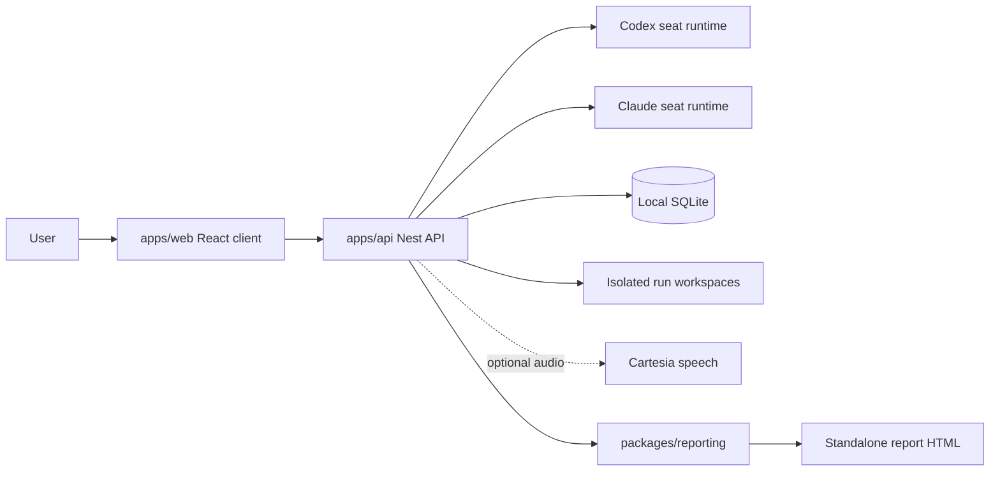

# Arena room cartography (2026-11-02 22:47 CST)

## Scope and reading guide

This map covers the 351 Git-tracked files under `room/` in the enclosing repository `/Users/sidnewby/Prog/arena`. The snapshot is commit `357f82e8daae`. The inventory was captured before this document was created. The parent repository README and Taskfile were read for context, but they are outside the target directory and are not listed here.

For each file, the table gives its primary role, job, and the evidence used to describe it. “High” means the code, test case, or document heading states the job directly. “Medium” means the role comes mostly from the file type, path, or asset name. These descriptions map intended responsibility. They do not prove that a file is reachable at runtime or unused.

## System outline

The room is a local-first two-seat conversation and debate workspace. The React client in `apps/web/` sends prompts, setup, and controls to the Nest API in `apps/api/`. The API owns provider sessions, SQLite state, run workspaces, tools, speech, and report publication. The shared `packages/reporting/` package validates report data, computes metrics, and renders standalone HTML. The tests cover client behavior, API boundaries, persistence, provider rules, workspaces, and generated reports.

## Rubric used for each file

| Field | Question it answers | Evidence rule |
|---|---|---|
| Role | What kind of responsibility does the file own? | Use the repository boundary first: runtime, test, docs, guidance, config, tooling, asset, or evidence. |
| Job | What does this file do for the project? | Use exported symbols, test cases, a document title, configuration keys, or the asset name. State one concrete responsibility. |
| Evidence | What fact supports the description, and what nearby code or test can you follow next? | Name exports, imports, a matching test, a heading, or the path and file type. Do not infer a full call graph from a filename. |
| Confidence | How directly does the repository state the job? | High for implementation symbols, test cases, or clear titles. Medium for assets and metadata identified mainly by path. |

JEV handled only the first, coarse role judgment. It returned typed labels and probabilities, not explanations. The local inspection supplies each job and its evidence. Follow the imports, matching tests, and package boundaries in the evidence column to continue exploring. JEV confidence is a probability distribution’s concentration, not a correctness score.

## JEV pilot

- Model: `jev-1.14.0`, one Choice per tracked path, grouped into 8 repository-area requests.
- Coverage: 351 files and 351 judgments.
- Usage: 196,103 input tokens and 40,315 output tokens. At $0.042 per million input tokens and $0 output, the estimated total is $0.00823633.
- Each request included tracked relative paths, file size/type, and a short redacted excerpt for text files. Binary font/image contents, ignored files, local `.room` state, and credentials were excluded.
- The requests stayed within Jev’s documented 64K default per-request context. Jev supports 262K long-context requests, but the area batches did not need that slower, lower-accuracy mode ([model and context limits](https://docs.typesafe.ai/go/models)).
- No labeled ground-truth set was prepared, so this run does not establish classification accuracy. It establishes full inventory coverage and produces reviewable role candidates. The locally mapped roles below use paths and repository evidence, not the raw model choice alone.

### JEV role suggestions

| Suggested role | Files |
|---|---:|
| `runtime_source` | 129 |
| `asset_or_license` | 75 |
| `automated_test` | 65 |
| `dependency_config` | 22 |
| `agent_guidance` | 16 |
| `project_documentation` | 14 |
| `upstream_reference` | 14 |
| `build_or_dev_tooling` | 10 |
| `generated_or_evidence` | 3 |
| `repository_metadata` | 3 |

JEV returned 15 answers with confidence below 0.65. The largest ambiguities were between upstream reference and agent guidance, configuration and repository metadata, and static assets and runtime source. The local role below resolves those boundaries from path and file evidence.

### Low-confidence judgments and local resolution

| File | JEV suggestion | Mapped role | Local evidence |
|---|---|---|---|
| [`.agents/skills/scaffold-ui/references/sources.json`](../.agents/skills/scaffold-ui/references/sources.json) | `upstream_reference` (0.61) | Agent and design guidance | Lists upstream repositories and revisions used by the local scaffold UI skill. |
| [`.impeccable/config.json`](../.impeccable/config.json) | `dependency_config` (0.52) | Agent and design guidance | Sets the Impeccable design tool build path. |
| [`apps/api/nest-cli.json`](../apps/api/nest-cli.json) | `build_or_dev_tooling` (0.49) | Build, dependency, and editor configuration | Sets Nest CLI source root and compiler options. |
| [`apps/api/src/chat/panel-presence.ts`](../apps/api/src/chat/panel-presence.ts) | `runtime_source` (0.62) | API runtime | Exports room tool definitions and pose/presence helpers consumed by the API runtime. |
| [`apps/api/src/chat/panelist-delivery.ts`](../apps/api/src/chat/panelist-delivery.ts) | `runtime_source` (0.48) | API runtime | Exports peer addressing constraints and panelist prompt instructions. |
| [`apps/api/vitest.config.e2e.ts`](../apps/api/vitest.config.e2e.ts) | `dependency_config` (0.51) | Build, dependency, and editor configuration | Configures the API end-to-end test runner. |
| [`apps/api/vitest.config.ts`](../apps/api/vitest.config.ts) | `dependency_config` (0.52) | Build, dependency, and editor configuration | Configures the API unit-test runner. |
| [`apps/web/src/themes/fonts.css`](../apps/web/src/themes/fonts.css) | `runtime_source` (0.48) | Web runtime | Declares font-face rules used by the room theme stylesheet. |
| [`docs/ui-standards/upstream/shadcn/design-system-page.md`](../docs/ui-standards/upstream/shadcn/design-system-page.md) | `upstream_reference` (0.61) | Vendored UI reference | A vendored shadcn design reference, identified by title and upstream path. |
| [`docs/ui-standards/upstream/shadcn/mcp.md`](../docs/ui-standards/upstream/shadcn/mcp.md) | `upstream_reference` (0.61) | Vendored UI reference | A vendored guide to the shadcn MCP server, identified by title and upstream path. |
| [`docs/ui-standards/upstream/shadcn/rules/base-vs-radix.md`](../docs/ui-standards/upstream/shadcn/rules/base-vs-radix.md) | `agent_guidance` (0.56) | Vendored UI reference | A vendored component API comparison, identified by title and upstream path. |
| [`docs/ui-standards/upstream/shadcn/rules/styling.md`](../docs/ui-standards/upstream/shadcn/rules/styling.md) | `agent_guidance` (0.59) | Vendored UI reference | A vendored shadcn styling reference, identified by title and upstream path. |
| [`packages/reporting/assets/provenance.json`](../packages/reporting/assets/provenance.json) | `generated_or_evidence` (0.53) | Generated evidence and provenance | Records digests and source details for generated report assets. |
| [`packages/reporting/src/render-assets.ts`](../packages/reporting/src/render-assets.ts) | `runtime_source` (0.64) | Shared reporting runtime | Exports the asset payload that the standalone report renderer embeds. |
| [`premium-ui.json`](../premium-ui.json) | `repository_metadata` (0.30) | Agent and design guidance | Records native Select/Listbox ownership for the project design rules. |

## Repository guidance and configuration (25 files)

| File | Primary role | Job | Evidence | Confidence |
|---|---|---|---|---|
| [`.agents/skills/cartesia-api/SKILL.md`](../.agents/skills/cartesia-api/SKILL.md) | Agent and design guidance | Provides agent instructions for “Cartesia Voice & Speech APIs”. | Heading: “Cartesia Voice & Speech APIs”. | High |
| [`.agents/skills/cartesia-api/references/resources.md`](../.agents/skills/cartesia-api/references/resources.md) | Agent and design guidance | Provides a focused reference for the local skill “cartesia-api”. | Heading: “Cartesia API — resources for agents”. | High |
| [`.agents/skills/scaffold-ui/SKILL.md`](../.agents/skills/scaffold-ui/SKILL.md) | Agent and design guidance | Provides agent instructions for “Scaffold UI”. | Heading: “Scaffold UI”. | High |
| [`.agents/skills/scaffold-ui/references/radix.md`](../.agents/skills/scaffold-ui/references/radix.md) | Agent and design guidance | Provides a focused reference for the local skill “scaffold-ui”. | Heading: “Radix in this scaffold”. | High |
| [`.agents/skills/scaffold-ui/references/sources.json`](../.agents/skills/scaffold-ui/references/sources.json) | Agent and design guidance | Records the upstream repositories, revisions, and source files used by the local scaffold UI guide. | Top-level settings include `reviewedAt`, `sources`, `id`, `repository`. | Medium |
| [`.gitignore`](../.gitignore) | Repository metadata | Excludes local runtime data, build output, and other generated files from Git. | File path and format. | Medium |
| [`.impeccable/config.json`](../.impeccable/config.json) | Agent and design guidance | Configures the Impeccable design review tool for this project. | File path and format. | Medium |
| [`.impeccable/design.json`](../.impeccable/design.json) | Agent and design guidance | Stores structured design-system settings for the Impeccable workflow. | Top-level settings include `schemaVersion`, `generatedAt`, `title`, `extensions`. | Medium |
| [`.impeccable/lacquer-room.md`](../.impeccable/lacquer-room.md) | Agent and design guidance | Records the approved Black Lacquer visual direction for the Arena room. | Heading: “Room surface”. | High |
| [`.node-version`](../.node-version) | Build, dependency, and editor configuration | Pins the Node.js version expected by the workspace. | File path and format. | Medium |
| [`.oxfmtrc.jsonc`](../.oxfmtrc.jsonc) | Build, dependency, and editor configuration | Configures Oxc formatting rules for the repository. | Top-level settings include `singleQuote`, `printWidth`, `ignorePatterns`. | Medium |
| [`.oxlintrc.json`](../.oxlintrc.json) | Build, dependency, and editor configuration | Configures Oxc lint rules for the repository. | Top-level settings include `plugins`, `categories`, `correctness`, `suspicious`. | Medium |
| [`.vscode/extensions.json`](../.vscode/extensions.json) | Build, dependency, and editor configuration | Provides project editor recommendations and settings for VS Code. | Top-level settings include `recommendations`. | Medium |
| [`.vscode/settings.json`](../.vscode/settings.json) | Build, dependency, and editor configuration | Provides project editor recommendations and settings for VS Code. | Top-level settings include `editor.defaultFormatter`, `editor.formatOnSave`, `files.associations`. | Medium |
| [`AGENTS.md`](../AGENTS.md) | Project guidance and design | Sets repository-specific working, testing, and UI guidance for coding agents. | Heading: “Project conventions”. | High |
| [`CLAUDE.md`](../CLAUDE.md) | Project guidance and design | Points Claude Code at the project-specific agent guidance. | Heading: “CLAUDE.md”. | High |
| [`DESIGN.md`](../DESIGN.md) | Project guidance and design | Defines the visual system, design constraints, and component ownership for the room UI. | Heading: “Design System: arena”. | High |
| [`HANDOFF-panel-expression.md`](../HANDOFF-panel-expression.md) | Project guidance and design | Records the expression and panel-presence implementation handoff, decisions, and next-step context. | Heading: “Handoff: agent-owned panels and screen expression”. | High |
| [`PRODUCT.md`](../PRODUCT.md) | Project guidance and design | Records current product behavior, runtime boundaries, and accepted constraints. | Heading: “arena”. | High |
| [`package.json`](../package.json) | Build, dependency, and editor configuration | Declares the workspace scripts, package manager, engine constraints, and development dependencies. | Top-level settings include `name`, `private`, `scripts`, `dev`. | Medium |
| [`pnpm-lock.yaml`](../pnpm-lock.yaml) | Build, dependency, and editor configuration | Pins the exact dependency graph used by the pnpm workspace. | Top-level settings include `lockfileVersion`, `importers`, `.`, `configDependencies`. | Medium |
| [`pnpm-workspace.yaml`](../pnpm-workspace.yaml) | Build, dependency, and editor configuration | Defines the workspace package globs and dependency/version policies. | Top-level settings include `packages`, `catalog`, `typescript`, `@types/node`. | Medium |
| [`premium-ui.json`](../premium-ui.json) | Agent and design guidance | Records component ownership constraints for the premium UI conventions. | Top-level settings include `ownership`, `Select/Listbox`. | Medium |
| [`skills-lock.json`](../skills-lock.json) | Repository metadata | Records the pinned versions and sources for installed skills. | Top-level settings include `version`, `skills`, `cartesia-api`, `source`. | Medium |
| [`skills/panel-presence/SKILL.md`](../skills/panel-presence/SKILL.md) | Agent and design guidance | Provides agent instructions for “Panel presence”. | Heading: “Panel presence”. | High |

## API tests and configuration (45 files)

| File | Primary role | Job | Evidence | Confidence |
|---|---|---|---|---|
| [`apps/api/nest-cli.json`](../apps/api/nest-cli.json) | Build, dependency, and editor configuration | Configures Nest CLI compilation and source-root behavior for the API. | Top-level settings include `collection`, `sourceRoot`, `compilerOptions`, `deleteOutDir`. | Medium |
| [`apps/api/package.json`](../apps/api/package.json) | Build, dependency, and editor configuration | Declares the workspace scripts, package manager, engine constraints, and development dependencies. | Top-level settings include `name`, `version`, `private`, `license`. | Medium |
| [`apps/api/test/app.e2e-spec.ts`](../apps/api/test/app.e2e-spec.ts) | Automated verification | Covers the “GET /api/health (e2e)” test suite, including “returns 200 with status ok”. | Test case: “returns 200 with status ok”. | High |
| [`apps/api/test/chat.e2e-spec.ts`](../apps/api/test/chat.e2e-spec.ts) | Automated verification | Covers the “Local room API boundaries” test suite, including “returns durable message receipts and supports cancelling a queued follow-up over HTTP”. | Test case: “returns durable message receipts and supports cancelling a queued follow-up over HTTP”. | High |
| [`apps/api/test/unit/app.setup.spec.ts`](../apps/api/test/unit/app.setup.spec.ts) | Automated verification | Covers the “resolvePort” test suite, including “defaults when PORT is unset or blank”. | Test case: “defaults when PORT is unset or blank”. | High |
| [`apps/api/test/unit/chat/chat.service.spec.ts`](../apps/api/test/unit/chat/chat.service.spec.ts) | Automated verification | Covers the “Room chat” test suite, including “streams snapshots, persists replies and sessions, and never displays the human prompt”. | Test case: “streams snapshots, persists replies and sessions, and never displays the human prompt”. | High |
| [`apps/api/test/unit/chat/chat.store.spec.ts`](../apps/api/test/unit/chat/chat.store.spec.ts) | Automated verification | Covers the test case “migrates existing poses and sessions, increments repeated poses, and retains revisions after restart”. | Test case: “migrates existing poses and sessions, increments repeated poses, and retains revisions after restart”. | High |
| [`apps/api/test/unit/chat/codex.runtime.spec.ts`](../apps/api/test/unit/chat/codex.runtime.spec.ts) | Automated verification | Covers the “Codex room tool sessions” test suite, including “registers expression tools on new sessions”. | Test case: “registers expression tools on new sessions”. | High |
| [`apps/api/test/unit/chat/messaging.spec.ts`](../apps/api/test/unit/chat/messaging.spec.ts) | Automated verification | Covers the “Durable seat messages” test suite, including “acknowledges immediately and dispatches queued input FIFO from terminal events”. | Test case: “acknowledges immediately and dispatches queued input FIFO from terminal events”. | High |
| [`apps/api/test/unit/chat/panel-expression.spec.ts`](../apps/api/test/unit/chat/panel-expression.spec.ts) | Automated verification | Covers the “Panel expressions” test suite, including “binds effects to the caller and supplies bounded defaults and truthful acceptance”. | Test case: “binds effects to the caller and supplies bounded defaults and truthful acceptance”. | High |
| [`apps/api/test/unit/chat/peer-delivery.spec.ts`](../apps/api/test/unit/chat/peer-delivery.spec.ts) | Automated verification | Covers the “Panelist delivery ledger” test suite, including “forwards the immutable exact completed source once and assigns attribution on the server”. | Test case: “forwards the immutable exact completed source once and assigns attribution on the server”. | High |
| [`apps/api/test/unit/chat/runtimes.spec.ts`](../apps/api/test/unit/chat/runtimes.spec.ts) | Automated verification | Covers the test case “uses a subscription-authorized stream and the same room addressing schema”. | Test case: “uses a subscription-authorized stream and the same room addressing schema”. | High |
| [`apps/api/test/unit/criteria/criteria-generation.spec.ts`](../apps/api/test/unit/criteria/criteria-generation.spec.ts) | Automated verification | Covers the “criteria generation” test suite, including “binds an editable suggestion to the exact supplied setup”. | Test case: “binds an editable suggestion to the exact supplied setup”. | High |
| [`apps/api/test/unit/debate/debate.controller.spec.ts`](../apps/api/test/unit/debate/debate.controller.spec.ts) | Automated verification | Covers the “Debate artifact HTTP boundary” test suite, including “serves executable HTML only with an opaque sandbox and no network capability”. | Test case: “serves executable HTML only with an opaque sandbox and no network capability”. | High |
| [`apps/api/test/unit/debate/debate.service.spec.ts`](../apps/api/test/unit/debate/debate.service.spec.ts) | Automated verification | Covers the “Reviewed debate lifecycle” test suite, including “keeps saved outputs readable after the managed workspace location changes without adopting old paths”. | Test case: “keeps saved outputs readable after the managed workspace location changes without adopting old paths”. | High |
| [`apps/api/test/unit/health/health.controller.spec.ts`](../apps/api/test/unit/health/health.controller.spec.ts) | Automated verification | Covers the “HealthController” test suite, including “reports ok with uptime and an ISO timestamp”. | Test case: “reports ok with uptime and an ISO timestamp”. | High |
| [`apps/api/test/unit/maestro/maestro.service.spec.ts`](../apps/api/test/unit/maestro/maestro.service.spec.ts) | Automated verification | Covers the “Private Maestro chat” test suite, including “keeps private prompts and responses outside public A/B correspondence”. | Test case: “keeps private prompts and responses outside public A/B correspondence”. | High |
| [`apps/api/test/unit/preflight/preflight.spec.ts`](../apps/api/test/unit/preflight/preflight.spec.ts) | Automated verification | Covers the “run preflight” test suite, including “resolves an actual source commit without creating destination directories”. | Test case: “resolves an actual source commit without creating destination directories”. | High |
| [`apps/api/test/unit/providers/provider-capabilities.spec.ts`](../apps/api/test/unit/providers/provider-capabilities.spec.ts) | Automated verification | Covers the test case “discovers every Codex catalog page only after verifying ChatGPT authentication”. | Test case: “discovers every Codex catalog page only after verifying ChatGPT authentication”. | High |
| [`apps/api/test/unit/reports/report.controller.spec.ts`](../apps/api/test/unit/reports/report.controller.spec.ts) | Automated verification | Covers the “report HTTP contract” test suite, including “serves the source index before generation lookup and requires a known anchor and local origin”. | Test case: “serves the source index before generation lookup and requires a known anchor and local origin”. | High |
| [`apps/api/test/unit/reports/report.publisher.spec.ts`](../apps/api/test/unit/reports/report.publisher.spec.ts) | Automated verification | Covers the “immutable report publication” test suite, including “publishes four verified immutable files and deduplicates retries”. | Test case: “publishes four verified immutable files and deduplicates retries”. | High |
| [`apps/api/test/unit/reports/report.repository.spec.ts`](../apps/api/test/unit/reports/report.repository.spec.ts) | Automated verification | Covers the “full consistent export reader” test suite, including “reads more than 100 task/outcome/attempt revisions without exporting private fields or changing run revision”. | Exports `fixture`; imports `node:fs`, `node:os`. | High |
| [`apps/api/test/unit/repository-browser/repository-browser.spec.ts`](../apps/api/test/unit/repository-browser/repository-browser.spec.ts) | Automated verification | Covers the test case “lists only visible directories with navigation and git marker”. | Test case: “lists only visible directories with navigation and git marker”. | High |
| [`apps/api/test/unit/runs/run-foundation.spec.ts`](../apps/api/test/unit/runs/run-foundation.spec.ts) | Automated verification | Covers the “Run and binding foundation” test suite, including “copies a setup atomically and reuses its receipt on retry”. | Test case: “copies a setup atomically and reuses its receipt on retry”. | High |
| [`apps/api/test/unit/scaffolds/scaffold-discovery.spec.ts`](../apps/api/test/unit/scaffolds/scaffold-discovery.spec.ts) | Automated verification | Covers the “scaffold discovery” test suite, including “lists explicitly described templates and strips unrelated metadata”. | Test case: “lists explicitly described templates and strips unrelated metadata”. | High |
| [`apps/api/test/unit/scaffolds/scaffold-routing.spec.ts`](../apps/api/test/unit/scaffolds/scaffold-routing.spec.ts) | Automated verification | Covers the “Scaffold catalog HTTP routing” test suite, including “routes the static catalog before the run ID while keeping run lookup available”. | Test case: “routes the static catalog before the run ID while keeping run lookup available”. | High |
| [`apps/api/test/unit/scaffolds/scaffold-seed.spec.ts`](../apps/api/test/unit/scaffolds/scaffold-seed.spec.ts) | Automated verification | Covers the “scaffold seeds” test suite, including “rejects links and preserves scaffold selection in task parsing”. | Test case: “rejects links and preserves scaffold selection in task parsing”. | High |
| [`apps/api/test/unit/speech/cartesia.connection.spec.ts`](../apps/api/test/unit/speech/cartesia.connection.spec.ts) | Automated verification | Covers the test case “uses the official CJS SDK with Bearer header auth and no credentials in its URL”. | Test case: “uses the official CJS SDK with Bearer header auth and no credentials in its URL”. | High |
| [`apps/api/test/unit/speech/narration.spec.ts`](../apps/api/test/unit/speech/narration.spec.ts) | Automated verification | Covers the “Saved narration” test suite, including “preserves conditions, numbers, uncertainty, and actions through segmentation”. | Test case: “preserves conditions, numbers, uncertainty, and actions through segmentation”. | High |
| [`apps/api/test/unit/speech/speech.service.spec.ts`](../apps/api/test/unit/speech/speech.service.spec.ts) | Automated verification | Covers the “Cartesia speech boundary” test suite, including “rejects caller text including attempts to override the fixed voice test”. | Test case: “rejects caller text including attempts to override the fixed voice test”. | High |
| [`apps/api/test/unit/state/maestro-state.spec.ts`](../apps/api/test/unit/state/maestro-state.spec.ts) | Automated verification | Covers the “Maestro shared state and private terminal recovery” test suite, including “drains a privately completed terminal before restart interruption reconciliation and does not replay provider execution”. | Test case: “drains a privately completed terminal before restart interruption reconciliation and does not replay provider execution”. | High |
| [`apps/api/test/unit/state/provider-usage.spec.ts`](../apps/api/test/unit/state/provider-usage.spec.ts) | Automated verification | Covers the “provider usage normalization” test suite, including “subtracts thread totals across all model calls instead of using the latest response”. | Test case: “subtracts thread totals across all model calls instead of using the latest response”. | High |
| [`apps/api/test/unit/state/state.http.spec.ts`](../apps/api/test/unit/state/state.http.spec.ts) | Automated verification | Covers the “session state HTTP commands” test suite, including “accepts task/candidate/Maestro commands and requires successful source completion before exact user confirmation”. | Test case: “accepts task/candidate/Maestro commands and requires successful source completion before exact user confirmation”. | High |
| [`apps/api/test/unit/state/state.store.spec.ts`](../apps/api/test/unit/state/state.store.spec.ts) | Automated verification | Covers the “durable session state” test suite, including “keeps accepted attempts and attribution atomic, then preserves unknown versus zero through restart”. | Test case: “keeps accepted attempts and attribution atomic, then preserves unknown versus zero through restart”. | High |
| [`apps/api/test/unit/tools/tool-broker.spec.ts`](../apps/api/test/unit/tools/tool-broker.spec.ts) | Automated verification | Covers the test case “rejects paths, undeclared arguments and unsupported tools before opening files”. | Test case: “rejects paths, undeclared arguments and unsupported tools before opening files”. | High |
| [`apps/api/test/unit/workspaces/evidence-folder.spec.ts`](../apps/api/test/unit/workspaces/evidence-folder.spec.ts) | Automated verification | Covers the test case “freezes plain folder bytes for both seats without private, generated, or linked files”. | Test case: “freezes plain folder bytes for both seats without private, generated, or linked files”. | High |
| [`apps/api/test/unit/workspaces/locker-evidence.spec.ts`](../apps/api/test/unit/workspaces/locker-evidence.spec.ts) | Automated verification | Covers the test case “supports spaces in standalone and quoted file paths”. | Test case: “supports spaces in standalone and quoted file paths”. | High |
| [`apps/api/test/unit/workspaces/project-directory.spec.ts`](../apps/api/test/unit/workspaces/project-directory.spec.ts) | Automated verification | Covers the test case “initializes an empty project once and uses its commit for isolated worktrees”. | Test case: “initializes an empty project once and uses its commit for isolated worktrees”. | High |
| [`apps/api/test/unit/workspaces/retained-workspaces.spec.ts`](../apps/api/test/unit/workspaces/retained-workspaces.spec.ts) | Automated verification | Covers the test case “lists retained workspaces and records keep decisions without changing workspace files”. | Test case: “lists retained workspaces and records keep decisions without changing workspace files”. | High |
| [`apps/api/test/unit/workspaces/workspace-lifecycle.spec.ts`](../apps/api/test/unit/workspaces/workspace-lifecycle.spec.ts) | Automated verification | Covers the test case “preserves actual dirty content with fresh history, refuses changed results, and safely removes only the original”. | Test case: “preserves actual dirty content with fresh history, refuses changed results, and safely removes only the original”. | High |
| [`apps/api/test/unit/workspaces/workspace-manager.spec.ts`](../apps/api/test/unit/workspaces/workspace-manager.spec.ts) | Automated verification | Covers the test case “provisions separate scratch workspaces idempotently and retains their contents across a new manager”. | Test case: “provisions separate scratch workspaces idempotently and retains their contents across a new manager”. | High |
| [`apps/api/tsconfig.build.json`](../apps/api/tsconfig.build.json) | Build, dependency, and editor configuration | Sets TypeScript options for the production API build. | Top-level settings include `extends`, `compilerOptions`, `rootDir`, `include`. | Medium |
| [`apps/api/tsconfig.json`](../apps/api/tsconfig.json) | Build, dependency, and editor configuration | Sets TypeScript compilation scope and options for api. | Top-level settings include `compilerOptions`, `module`, `moduleResolution`, `resolvePackageJsonExports`. | Medium |
| [`apps/api/vitest.config.e2e.ts`](../apps/api/vitest.config.e2e.ts) | Build, dependency, and editor configuration | Configures the API Vitest suite, path resolution, and test environment. | File path and format. | Medium |
| [`apps/api/vitest.config.ts`](../apps/api/vitest.config.ts) | Build, dependency, and editor configuration | Configures the API Vitest suite, path resolution, and test environment. | File path and format. | Medium |

## API runtime (61 files)

| File | Primary role | Job | Evidence | Confidence |
|---|---|---|---|---|
| [`apps/api/src/app.module.ts`](../apps/api/src/app.module.ts) | API runtime | Registers the Nest controllers, services, and provider adapters that make up the local API. | Exports `AppModule`; imports `./reports/report.controller.js`, `./reports/report.service.js`. | High |
| [`apps/api/src/app.setup.ts`](../apps/api/src/app.setup.ts) | API runtime | Applies the shared HTTP setup and resolves the API listen port before the app starts. | Exports `DEFAULT_PORT`, `configureApp`, `resolvePort`; imports `@nestjs/common`, `express`. | High |
| [`apps/api/src/chat/chat.controller.ts`](../apps/api/src/chat/chat.controller.ts) | API runtime | Exposes chat, message, panelist, and stream endpoints to the web client. | Exports `ChatController`; imports `@nestjs/common`, `./chat.service.js`. | High |
| [`apps/api/src/chat/chat.service.ts`](../apps/api/src/chat/chat.service.ts) | API runtime | Coordinates agent turns, delivery, runtime cancellation, persistence, and speech for the two seats. | Exports `ChatService`; imports `./side-conversation.service.js`, `./message.contract.js`. | High |
| [`apps/api/src/chat/chat.store.ts`](../apps/api/src/chat/chat.store.ts) | API runtime | Persists main chat snapshots, provider sessions, poses, turns, and delivery state in SQLite. | Exports `TurnRow`, `QueuedDelivery`, `ChatStore`; imports `./side-conversation.store.js`, `./message.store.js`. | High |
| [`apps/api/src/chat/chat.types.ts`](../apps/api/src/chat/chat.types.ts) | API runtime | Defines the shared API types for seats, poses, turns, delivery, and chat snapshots. | Exports `AgentId`, `Pose`, `TurnStatus`, `DeliveryStatus`, …; imports `./message.contract.js`, `../speech/narration.js`. | High |
| [`apps/api/src/chat/codex.runtime.ts`](../apps/api/src/chat/codex.runtime.ts) | API runtime | Starts signed-in Codex turns and translates provider events, tools, cancellation, and usage into room events. | Exports `codexReady`, `runCodex`; imports `./runtime-cancellation.js`, `../state/provider-usage.js`. | High |
| [`apps/api/src/chat/message.contract.ts`](../apps/api/src/chat/message.contract.ts) | API runtime | Defines message intents, delivery states, receipts, and workflow invalidation payloads. | Exports `MESSAGE_INTENTS`, `MessageIntent`, `MESSAGE_STATUSES`, `MessageStatus`, …; imports `../runs/run.contract.js`. | High |
| [`apps/api/src/chat/message.store.ts`](../apps/api/src/chat/message.store.ts) | API runtime | Stores durable messages addressed to a seat and their delivery receipts. | Exports `SeatMessageStore`; imports `node:crypto`, `node:sqlite`. | High |
| [`apps/api/src/chat/panel-expression.ts`](../apps/api/src/chat/panel-expression.ts) | API runtime | Defines and validates temporary expression requests that agents can set or clear. | Exports `EXPRESSION_MOODS`, `EXPRESSION_COOLDOWN`, `expressionInput`, `EXPRESS_DESCRIPTION`, …; imports `node:crypto`, `zod`. | High |
| [`apps/api/src/chat/panel-presence.ts`](../apps/api/src/chat/panel-presence.ts) | API runtime | Defines the agent tools and instructions for setting a panel pose or facing target. | Exports `ROOM_TOOL_VERSION`, `PANEL_TARGETS`, `PanelTarget`, `FACE_PANEL_DESCRIPTION`, …; imports `node:fs`, `./chat.types.js`. | High |
| [`apps/api/src/chat/panelist-delivery.ts`](../apps/api/src/chat/panelist-delivery.ts) | API runtime | Defines peer addressing, recipient rules, handoff limits, and the prompt given to panelists. | Exports `PANELISTS`, `MAX_PEER_DEPTH`, `MAX_PEER_INBOX`, `ADDRESS_PANELIST_DESCRIPTION`, …; imports `./chat.types.js`, `../runs/run.contract.js`. | High |
| [`apps/api/src/chat/runtime-cancellation.ts`](../apps/api/src/chat/runtime-cancellation.ts) | API runtime | Defines the error used when a provider cannot confirm that a cancellation took effect. | Exports `UnconfirmedCancellationError`. | High |
| [`apps/api/src/chat/runtime-tools.ts`](../apps/api/src/chat/runtime-tools.ts) | API runtime | Builds the tool schemas and instructions available to participant runtimes. | Exports `RuntimeToolDefinition`, `runtimeTools`, `runtimeInstructions`, `toolInputSchema`; imports `../runs/run.contract.js`, `zod`. | High |
| [`apps/api/src/chat/runtimes.ts`](../apps/api/src/chat/runtimes.ts) | API runtime | Creates provider-specific participant runtimes for Codex and Claude while preserving seat identity. | Exports `runAnthropic`, `createParticipantRuntime`, `createRuntimes`; imports `./runtime-cancellation.js`, `../state/provider-usage.js`. | High |
| [`apps/api/src/chat/side-conversation.contract.ts`](../apps/api/src/chat/side-conversation.contract.ts) | API runtime | Defines the separate side-conversation message, turn, and snapshot shapes. | Exports `SideTurnStatus`, `SideMessage`, `SideConversationSnapshot`; imports `../runs/run.contract.js`. | High |
| [`apps/api/src/chat/side-conversation.service.ts`](../apps/api/src/chat/side-conversation.service.ts) | API runtime | Runs text-only side chats with isolated session state and no main-task tools. | Exports `SideConversationService`; imports `./runtime-cancellation.js`, `node:fs`. | High |
| [`apps/api/src/chat/side-conversation.store.ts`](../apps/api/src/chat/side-conversation.store.ts) | API runtime | Persists side-conversation sessions, turns, and messages separately from main chat. | Exports `SideConversationStore`; imports `node:crypto`, `node:sqlite`. | High |
| [`apps/api/src/criteria/criteria-generation.ts`](../apps/api/src/criteria/criteria-generation.ts) | API runtime | Builds and validates Maestro-generated success criteria for a proposed run setup. | Exports `CriteriaInput`, `CriteriaRequest`, `CriteriaSuggestion`, `prepareCriteriaRequest`, …; imports `@nestjs/common`, `node:crypto`. | High |
| [`apps/api/src/debate/debate.controller.ts`](../apps/api/src/debate/debate.controller.ts) | API runtime | Exposes run preparation, debate lifecycle, artifact, and workflow-history endpoints. | Exports `DebateController`; imports `@nestjs/common`, `express`. | High |
| [`apps/api/src/debate/debate.service.ts`](../apps/api/src/debate/debate.service.ts) | API runtime | Prepares independent seat workspaces, runs candidates, and records their outputs and lifecycle. | Exports `DebateService`; imports `../workspaces/project-directory.js`, `../workspaces/workspace-manager.js`. | High |
| [`apps/api/src/debate/workflow.store.ts`](../apps/api/src/debate/workflow.store.ts) | API runtime | Defines and persists the saved task, stage, participant, and artifact workflow records. | Exports `WorkflowStage`, `WorkflowRecord`, `object`, `parseTask`, …; imports `../runs/provider-config.js`, `@nestjs/common`. | High |
| [`apps/api/src/health/health.controller.ts`](../apps/api/src/health/health.controller.ts) | API runtime | Provides the API health response used by startup checks and readiness probes. | Exports `Health`, `HealthController`; imports `@nestjs/common`. | High |
| [`apps/api/src/maestro/maestro.context.ts`](../apps/api/src/maestro/maestro.context.ts) | API runtime | Builds bounded correspondence context and read tools for Maestro’s private analysis. | Exports `DebateReader`, `correspondencePage`, `captureContext`, `contextTools`, …; imports `@nestjs/common`, `../chat/chat.service.js`. | High |
| [`apps/api/src/maestro/maestro.controller.ts`](../apps/api/src/maestro/maestro.controller.ts) | API runtime | Exposes Maestro’s private chat and stream endpoints. | Exports `MaestroController`; imports `@nestjs/common`, `./maestro.service.js`. | High |
| [`apps/api/src/maestro/maestro.service.ts`](../apps/api/src/maestro/maestro.service.ts) | API runtime | Runs private Maestro turns, supplies run-analysis tools, and keeps its messages separate from A/B correspondence. | Exports `MAESTRO_RUN_TOOLS`, `MaestroRunToolProvider`, `MaestroService`; imports `../criteria/criteria-generation.js`, `../state/state.store.js`. | High |
| [`apps/api/src/maestro/maestro.store.ts`](../apps/api/src/maestro/maestro.store.ts) | API runtime | Persists Maestro sessions, terminal output, and private chat records in SQLite. | Exports `MaestroTerminal`, `MaestroStore`; imports `node:sqlite`, `node:fs`. | High |
| [`apps/api/src/maestro/maestro.types.ts`](../apps/api/src/maestro/maestro.types.ts) | API runtime | Defines the saved message, turn, session, and snapshot types used by Maestro. | Exports `MaestroMessage`, `MaestroSnapshot`, `PartialRevision`, `MaestroTurn`, …; imports `../runs/run.contract.js`, `../chat/chat.types.js`. | High |
| [`apps/api/src/main.ts`](../apps/api/src/main.ts) | API runtime | Creates the Nest application, applies shared setup, and starts the API listener. | Imports `@nestjs/core`, `./app.module.js`, `./app.setup.js`. | Medium |
| [`apps/api/src/preflight/preflight.controller.ts`](../apps/api/src/preflight/preflight.controller.ts) | API runtime | Checks source, model, evidence, and destination readiness before a run starts. | Exports `PreflightResult`, `inspectPreflight`, `PreflightController`; imports `../workspaces/project-directory.js`, `../workspaces/evidence-folder.js`. | High |
| [`apps/api/src/providers/anthropic-auth.ts`](../apps/api/src/providers/anthropic-auth.ts) | API runtime | Checks that Claude is signed in through an eligible subscription and resolves supported effort settings. | Exports `anthropicReady`, `assertAnthropicSubscription`, `anthropicEffort`; imports `node:child_process`, `@anthropic-ai/claude-agent-sdk`. | High |
| [`apps/api/src/providers/codex-client.ts`](../apps/api/src/providers/codex-client.ts) | API runtime | Communicates with the local Codex command-line client and parses its event stream. | Exports `CodexClient`; imports `node:child_process`, `node:readline`. | High |
| [`apps/api/src/providers/provider-capabilities.ts`](../apps/api/src/providers/provider-capabilities.ts) | API runtime | Discovers the available subscribed models and advertised effort levels for each provider. | Exports `discoverModels`; imports `@anthropic-ai/claude-agent-sdk`, `../runs/run.contract.js`. | High |
| [`apps/api/src/providers/provider-environment.ts`](../apps/api/src/providers/provider-environment.ts) | API runtime | Constructs a controlled provider environment and serializes provider protocol data. | Exports `providerEnvironment`, `codexEnvironment`, `protocolObject`; imports `node:fs`, `node:os`. | High |
| [`apps/api/src/reports/report.controller.ts`](../apps/api/src/reports/report.controller.ts) | API runtime | Exposes report discovery, generation, preview, and download endpoints. | Exports `REPORT_CSP`, `ReportController`; imports `@nestjs/common`, `express`. | High |
| [`apps/api/src/reports/report.publisher.ts`](../apps/api/src/reports/report.publisher.ts) | API runtime | Publishes verified report files through an immutable, restart-reconcilable boundary. | Exports `ReportRuntime`, `PublicationBoundary`, `ReportPublisher`; imports `@nestjs/common`, `node:fs/promises`. | High |
| [`apps/api/src/reports/report.repository.ts`](../apps/api/src/reports/report.repository.ts) | API runtime | Selects source run facts, canonicalizes report requests, and computes stable hashes. | Exports `sha256`, `canonicalRequest`, `sourceFactsHash`, `ReportSelectionException`, …; imports `@nestjs/common`, `node:crypto`. | High |
| [`apps/api/src/reports/report.service.ts`](../apps/api/src/reports/report.service.ts) | API runtime | Coordinates report selection, metric data capture, generation, and serving. | Exports `REPORT_RUNTIME`, `ReportService`; imports `@nestjs/common`, `node:os`. | High |
| [`apps/api/src/repository-browser/repository-browser.controller.ts`](../apps/api/src/repository-browser/repository-browser.controller.ts) | API runtime | Lists and opens eligible local directories for run evidence selection. | Exports `RepositoryBrowserPage`, `defaultBrowserPath`, `createFolder`, `browseRepositories`, …; imports `@nestjs/common`, `node:fs`. | High |
| [`apps/api/src/runs/provider-config.ts`](../apps/api/src/runs/provider-config.ts) | API runtime | Parses and validates provider bindings saved with a run. | Exports `parseProviderConfig`; imports `@nestjs/common`, `./run.contract.js`. | High |
| [`apps/api/src/runs/run.contract.ts`](../apps/api/src/runs/run.contract.ts) | API runtime | Defines the shared run, participant, seat, provider, model-effort, and artifact contracts. | Exports `DEBATE_SEATS`, `SeatId`, `ParticipantRole`, `ProviderId`, …. | High |
| [`apps/api/src/runs/run.controller.ts`](../apps/api/src/runs/run.controller.ts) | API runtime | Exposes provider catalog, run setup, readiness, and active-turn endpoints. | Exports `RunController`, `ProviderController`; imports `@nestjs/common`, `../chat/chat.service.js`. | High |
| [`apps/api/src/runs/run.store.ts`](../apps/api/src/runs/run.store.ts) | API runtime | Coordinates durable run state across task, outcome, usage, provider, and workflow stores. | Exports `RunStore`; imports `../reports/report.repository.js`, `./provider-config.js`. | High |
| [`apps/api/src/scaffolds/scaffold-discovery.controller.ts`](../apps/api/src/scaffolds/scaffold-discovery.controller.ts) | API runtime | Finds explicitly described scaffolds and exposes their catalog to setup screens. | Exports `ScaffoldMetadata`, `ScaffoldCatalog`, `discoverScaffolds`, `ScaffoldDiscoveryController`; imports `@nestjs/common`, `node:fs`. | High |
| [`apps/api/src/scaffolds/scaffold-seed.ts`](../apps/api/src/scaffolds/scaffold-seed.ts) | API runtime | Validates and snapshots a selected scaffold before it seeds an isolated run workspace. | Exports `scaffoldRoot`, `templateDigest`, `prepareScaffoldSeed`; imports `node:crypto`, `node:child_process`. | High |
| [`apps/api/src/speech/narration.ts`](../apps/api/src/speech/narration.ts) | API runtime | Turns saved reply text into concise speech-safe narration segments and filters source-code-heavy replies. | Exports `Narration`, `containsSourceCode`, `narration`; imports `node:crypto`. | High |
| [`apps/api/src/speech/speech.controller.ts`](../apps/api/src/speech/speech.controller.ts) | API runtime | Streams speech requests and audio events to the web client with bounded connection behavior. | Exports `SpeechController`; imports `../chat/chat.service.js`, `@nestjs/common`. | High |
| [`apps/api/src/speech/speech.service.ts`](../apps/api/src/speech/speech.service.ts) | API runtime | Owns the Cartesia connection, authenticated synthesis requests, and per-seat audio streaming. | Exports `SPEECH_MODEL`, `SPEECH_RATE`, `SPEECH_VOICES`, `SpeechReference`, …; imports `@nestjs/common`, `node:crypto`. | High |
| [`apps/api/src/state/provider-usage.ts`](../apps/api/src/state/provider-usage.ts) | API runtime | Normalizes provider token observations and tracks Codex usage deltas across resumed sessions. | Exports `codexTokens`, `CodexUsageTracker`, `anthropicUsage`; imports `node:crypto`, `../chat/chat.types.js`. | High |
| [`apps/api/src/state/state.contract.ts`](../apps/api/src/state/state.contract.ts) | API runtime | Validates outcome proposals, confirmations, evidence, and persisted outcome revisions. | Exports `decisionSchema`, `Decision`, `proposalSchema`, `confirmationSchema`, …; imports `@nestjs/common`, `zod`. | High |
| [`apps/api/src/state/state.store.ts`](../apps/api/src/state/state.store.ts) | API runtime | Persists reviewed run outcomes and proposal history. | Exports `StateStore`; imports `@nestjs/common`, `node:crypto`. | High |
| [`apps/api/src/state/state.tools.ts`](../apps/api/src/state/state.tools.ts) | API runtime | Defines the runtime tools through which a participant can propose a structured outcome. | Exports `outcomeTools`; imports `zod`, `../chat/runtime-tools.js`. | High |
| [`apps/api/src/tools/command-sandbox.ts`](../apps/api/src/tools/command-sandbox.ts) | API runtime | Runs bounded commands inside an owned workspace with platform-specific containment. | Exports `CommandResult`, `CommandOptions`, `sandboxProfile`, `CommandSandbox`; imports `node:child_process`, `node:fs`. | High |
| [`apps/api/src/tools/tool-broker.ts`](../apps/api/src/tools/tool-broker.ts) | API runtime | Checks tool permissions and paths before reading, searching, writing, patching, or publishing workspace data. | Exports `ToolProfile`, `BrokerToolDefinition`, `ToolBroker`; imports `node:path`, `node:fs`. | High |
| [`apps/api/src/workspaces/evidence-folder.ts`](../apps/api/src/workspaces/evidence-folder.ts) | API runtime | Validates a user-selected evidence folder and snapshots eligible files for both candidates. | Exports `validateEvidenceFolder`, `prepareEvidenceSeed`; imports `node:child_process`, `node:crypto`. | High |
| [`apps/api/src/workspaces/locker-evidence.ts`](../apps/api/src/workspaces/locker-evidence.ts) | API runtime | Resolves project-locker references from user prompts and verifies the referenced evidence paths. | Exports `resolveLockerEvidence`, `evidencePathExamples`, `verifyEvidenceReferences`; imports `node:child_process`, `node:fs`. | High |
| [`apps/api/src/workspaces/project-directory.ts`](../apps/api/src/workspaces/project-directory.ts) | API runtime | Initializes a new local project only when its directory is safe to claim. | Exports `projectPath`, `canInitializeProject`, `initializeProject`; imports `node:child_process`, `node:crypto`. | High |
| [`apps/api/src/workspaces/retained-workspaces.ts`](../apps/api/src/workspaces/retained-workspaces.ts) | API runtime | Lists retained run workspaces and records keep or remove decisions. | Exports `RetainedWorkspace`, `RetainedWorkspaces`; imports `node:crypto`, `node:fs`. | High |
| [`apps/api/src/workspaces/workspace-lifecycle.ts`](../apps/api/src/workspaces/workspace-lifecycle.ts) | API runtime | Preserves candidate outputs and history safely when a run workspace is kept or removed. | Exports `PreservedResult`, `WorkspaceLifecycle`; imports `node:child_process`, `node:crypto`. | High |
| [`apps/api/src/workspaces/workspace-manager.ts`](../apps/api/src/workspaces/workspace-manager.ts) | API runtime | Creates separate candidate workspaces and validates containment for their files and artifacts. | Exports `WorkspaceSeat`, `WorkspaceLocationError`, `WorkspaceSource`, `SeatWorkspace`, …; imports `node:crypto`, `node:child_process`. | High |
| [`apps/api/src/workspaces/workspace-paths.ts`](../apps/api/src/workspaces/workspace-paths.ts) | API runtime | Resolves the application’s user-data and managed workspace locations. | Exports `workspacePaths`; imports `node:os`, `node:path`. | High |

## Web tests, entry, and configuration (24 files)

| File | Primary role | Job | Evidence | Confidence |
|---|---|---|---|---|
| [`apps/web/components.json`](../apps/web/components.json) | Build, dependency, and editor configuration | Configures local shadcn component aliases and styling paths. | Top-level settings include `style`, `rsc`, `tsx`, `tailwind`. | Medium |
| [`apps/web/index.html`](../apps/web/index.html) | Web runtime | Provides the Vite-served document root and mount element for the React application. | File path and format. | Medium |
| [`apps/web/package.json`](../apps/web/package.json) | Build, dependency, and editor configuration | Declares the workspace scripts, package manager, engine constraints, and development dependencies. | Top-level settings include `name`, `version`, `private`, `type`. | Medium |
| [`apps/web/test/maestro-completion.test.mjs`](../apps/web/test/maestro-completion.test.mjs) | Automated verification | Covers the test case “criteria completion waits for its assistant turn and releases its shared stream listener”. | Test case: “criteria completion waits for its assistant turn and releases its shared stream listener”. | High |
| [`apps/web/test/maestro.test.mjs`](../apps/web/test/maestro.test.mjs) | Automated verification | Covers the test case “preserves private authors, partial text, and the analysis boundary as debate advances”. | Test case: “preserves private authors, partial text, and the analysis boundary as debate advances”. | High |
| [`apps/web/test/messaging.test.mjs`](../apps/web/test/messaging.test.mjs) | Automated verification | Covers the test case “a queued receipt is accepted without a turn id and stays separate from spoken replies”. | Test case: “a queued receipt is accepted without a turn id and stays separate from spoken replies”. | High |
| [`apps/web/test/model-names.test.mjs`](../apps/web/test/model-names.test.mjs) | Automated verification | Covers the test case “uses short names for the configured model families and version variants”. | Test case: “uses short names for the configured model families and version variants”. | High |
| [`apps/web/test/outcomes.test.mjs`](../apps/web/test/outcomes.test.mjs) | Automated verification | Covers the test case “a confirmation sends the reviewed amendments with the proposal and expected revision”. | Test case: “a confirmation sends the reviewed amendments with the proposal and expected revision”. | High |
| [`apps/web/test/panel-hit-targets.browser.mjs`](../apps/web/test/panel-hit-targets.browser.mjs) | Automated verification | Drives the browser to verify that panel controls have usable pointer hit targets. | Exports `verifyPanelHitTargets`. | Medium |
| [`apps/web/test/panelist-delivery.test.mjs`](../apps/web/test/panelist-delivery.test.mjs) | Automated verification | Covers the test case “preserves addressed source and incoming reply attribution without copying their text”. | Test case: “preserves addressed source and incoming reply attribution without copying their text”. | High |
| [`apps/web/test/reply-markdown.test.mjs`](../apps/web/test/reply-markdown.test.mjs) | Automated verification | Covers the test case “renders response headings, emphasis, lists, links, and inline code semantically”. | Test case: “renders response headings, emphasis, lists, links, and inline code semantically”. | High |
| [`apps/web/test/reports.test.mjs`](../apps/web/test/reports.test.mjs) | Automated verification | Covers the test case “date scope uses local calendar midnights across daylight saving”. | Test case: “date scope uses local calendar midnights across daylight saving”. | High |
| [`apps/web/test/retained-workspaces.test.mjs`](../apps/web/test/retained-workspaces.test.mjs) | Automated verification | Covers the test case “reads retained workspaces and explicit keep decisions”. | Test case: “reads retained workspaces and explicit keep decisions”. | High |
| [`apps/web/test/room-events.test.mjs`](../apps/web/test/room-events.test.mjs) | Automated verification | Covers the test case “shares one connection, releases hidden tabs, and restores all channels when shown”. | Test case: “shares one connection, releases hidden tabs, and restores all channels when shown”. | High |
| [`apps/web/test/run-presentation.test.mjs`](../apps/web/test/run-presentation.test.mjs) | Automated verification | Covers the test case “a fresh run is setup with no outcome panels or claim that participants are running”. | Test case: “a fresh run is setup with no outcome panels or claim that participants are running”. | High |
| [`apps/web/test/run-scope.test.mjs`](../apps/web/test/run-scope.test.mjs) | Automated verification | Covers the test case “a partial Both retry keeps its original request, revision, and completed destination”. | Test case: “a partial Both retry keeps its original request, revision, and completed destination”. | High |
| [`apps/web/test/run-workflow.test.mjs`](../apps/web/test/run-workflow.test.mjs) | Automated verification | Covers the test case “reads a reviewable source commit and keeps setup editable only before work”. | Test case: “reads a reviewable source commit and keeps setup editable only before work”. | High |
| [`apps/web/test/speech-lifecycle.browser.mjs`](../apps/web/test/speech-lifecycle.browser.mjs) | Automated verification | Mounts the app in a browser and checks speech opt-in, active audio, stop, and unmount cleanup. | Exports `mountSpeechChecks`; imports `react`, `react-dom/client`. | High |
| [`apps/web/test/speech-queue.test.mjs`](../apps/web/test/speech-queue.test.mjs) | Automated verification | Covers the test case “history and active replies are baselined; completed replies are emitted once”. | Test case: “history and active replies are baselined; completed replies are emitted once”. | High |
| [`apps/web/test/start-debate.test.mjs`](../apps/web/test/start-debate.test.mjs) | Automated verification | Covers the test case “one start action saves selected models and folder, prepares, then starts using returned revisions”. | Test case: “one start action saves selected models and folder, prepares, then starts using returned revisions”. | High |
| [`apps/web/tsconfig.app.json`](../apps/web/tsconfig.app.json) | Build, dependency, and editor configuration | Sets TypeScript compilation scope and options for web. | Top-level settings include `compilerOptions`, `tsBuildInfoFile`, `target`, `lib`. | Medium |
| [`apps/web/tsconfig.json`](../apps/web/tsconfig.json) | Build, dependency, and editor configuration | Sets TypeScript compilation scope and options for web. | Top-level settings include `files`, `references`, `compilerOptions`, `paths`. | Medium |
| [`apps/web/tsconfig.node.json`](../apps/web/tsconfig.node.json) | Build, dependency, and editor configuration | Sets TypeScript compilation scope and options for web. | Top-level settings include `compilerOptions`, `tsBuildInfoFile`, `target`, `lib`. | Medium |
| [`apps/web/vite.config.ts`](../apps/web/vite.config.ts) | Build, dependency, and editor configuration | Configures the web development/build pipeline and API proxy. | File path and format. | Medium |

## Web public assets (61 files)

| File | Primary role | Job | Evidence | Confidence |
|---|---|---|---|---|
| [`apps/web/public/assets/anthropic.svg`](../apps/web/public/assets/anthropic.svg) | Static asset and license | Vector mark for anthropic provider identity. | File type and directory placement. | Medium |
| [`apps/web/public/assets/openai.svg`](../apps/web/public/assets/openai.svg) | Static asset and license | Vector mark for openai provider identity. | File type and directory placement. | Medium |
| [`apps/web/public/favicon.svg`](../apps/web/public/favicon.svg) | Static asset and license | Provides the browser tab icon for the room application. | File type and directory placement. | Medium |
| [`apps/web/public/fonts/antic-0.ttf`](../apps/web/public/fonts/antic-0.ttf) | Static asset and license | Bundled antic font file used by selectable room themes. | File type and directory placement. | Medium |
| [`apps/web/public/fonts/architects-daughter-0.ttf`](../apps/web/public/fonts/architects-daughter-0.ttf) | Static asset and license | Bundled architects daughter font file used by selectable room themes. | File type and directory placement. | Medium |
| [`apps/web/public/fonts/barlow-condensed-0.ttf`](../apps/web/public/fonts/barlow-condensed-0.ttf) | Static asset and license | Bundled barlow condensed font file used by selectable room themes. | File type and directory placement. | Medium |
| [`apps/web/public/fonts/barlow-condensed-1.ttf`](../apps/web/public/fonts/barlow-condensed-1.ttf) | Static asset and license | Bundled barlow condensed font file used by selectable room themes. | File type and directory placement. | Medium |
| [`apps/web/public/fonts/barlow-condensed-2.ttf`](../apps/web/public/fonts/barlow-condensed-2.ttf) | Static asset and license | Bundled barlow condensed font file used by selectable room themes. | File type and directory placement. | Medium |
| [`apps/web/public/fonts/barlow-condensed-3.ttf`](../apps/web/public/fonts/barlow-condensed-3.ttf) | Static asset and license | Bundled barlow condensed font file used by selectable room themes. | File type and directory placement. | Medium |
| [`apps/web/public/fonts/barlow-condensed-4.ttf`](../apps/web/public/fonts/barlow-condensed-4.ttf) | Static asset and license | Bundled barlow condensed font file used by selectable room themes. | File type and directory placement. | Medium |
| [`apps/web/public/fonts/dm-sans-0.ttf`](../apps/web/public/fonts/dm-sans-0.ttf) | Static asset and license | Bundled dm sans font file used by selectable room themes. | File type and directory placement. | Medium |
| [`apps/web/public/fonts/fira-code-0.ttf`](../apps/web/public/fonts/fira-code-0.ttf) | Static asset and license | Bundled fira code font file used by selectable room themes. | File type and directory placement. | Medium |
| [`apps/web/public/fonts/geist-0.ttf`](../apps/web/public/fonts/geist-0.ttf) | Static asset and license | Bundled geist font file used by selectable room themes. | File type and directory placement. | Medium |
| [`apps/web/public/fonts/geist-mono-0.ttf`](../apps/web/public/fonts/geist-mono-0.ttf) | Static asset and license | Bundled geist mono font file used by selectable room themes. | File type and directory placement. | Medium |
| [`apps/web/public/fonts/ibm-plex-mono-0.ttf`](../apps/web/public/fonts/ibm-plex-mono-0.ttf) | Static asset and license | Bundled ibm plex mono font file used by selectable room themes. | File type and directory placement. | Medium |
| [`apps/web/public/fonts/inter-0.ttf`](../apps/web/public/fonts/inter-0.ttf) | Static asset and license | Bundled inter font file used by selectable room themes. | File type and directory placement. | Medium |
| [`apps/web/public/fonts/jetbrains-mono-0.ttf`](../apps/web/public/fonts/jetbrains-mono-0.ttf) | Static asset and license | Bundled jetbrains mono font file used by selectable room themes. | File type and directory placement. | Medium |
| [`apps/web/public/fonts/libre-baskerville-0.ttf`](../apps/web/public/fonts/libre-baskerville-0.ttf) | Static asset and license | Bundled libre baskerville font file used by selectable room themes. | File type and directory placement. | Medium |
| [`apps/web/public/fonts/licenses/antic.txt`](../apps/web/public/fonts/licenses/antic.txt) | Static asset and license | License notice for the bundled antic font family. | File path and format. | Medium |
| [`apps/web/public/fonts/licenses/architectsdaughter.txt`](../apps/web/public/fonts/licenses/architectsdaughter.txt) | Static asset and license | License notice for the bundled architectsdaughter font family. | File path and format. | Medium |
| [`apps/web/public/fonts/licenses/barlowcondensed.txt`](../apps/web/public/fonts/licenses/barlowcondensed.txt) | Static asset and license | License notice for the bundled barlowcondensed font family. | File path and format. | Medium |
| [`apps/web/public/fonts/licenses/dmsans.txt`](../apps/web/public/fonts/licenses/dmsans.txt) | Static asset and license | License notice for the bundled dmsans font family. | File path and format. | Medium |
| [`apps/web/public/fonts/licenses/firacode.txt`](../apps/web/public/fonts/licenses/firacode.txt) | Static asset and license | License notice for the bundled firacode font family. | File path and format. | Medium |
| [`apps/web/public/fonts/licenses/geist.txt`](../apps/web/public/fonts/licenses/geist.txt) | Static asset and license | License notice for the bundled geist font family. | File path and format. | Medium |
| [`apps/web/public/fonts/licenses/geistmono.txt`](../apps/web/public/fonts/licenses/geistmono.txt) | Static asset and license | License notice for the bundled geistmono font family. | File path and format. | Medium |
| [`apps/web/public/fonts/licenses/ibmplexmono.txt`](../apps/web/public/fonts/licenses/ibmplexmono.txt) | Static asset and license | License notice for the bundled ibmplexmono font family. | File path and format. | Medium |
| [`apps/web/public/fonts/licenses/inter.txt`](../apps/web/public/fonts/licenses/inter.txt) | Static asset and license | License notice for the bundled inter font family. | File path and format. | Medium |
| [`apps/web/public/fonts/licenses/jetbrainsmono.txt`](../apps/web/public/fonts/licenses/jetbrainsmono.txt) | Static asset and license | License notice for the bundled jetbrainsmono font family. | File path and format. | Medium |
| [`apps/web/public/fonts/licenses/librebaskerville.txt`](../apps/web/public/fonts/licenses/librebaskerville.txt) | Static asset and license | License notice for the bundled librebaskerville font family. | File path and format. | Medium |
| [`apps/web/public/fonts/licenses/lora.txt`](../apps/web/public/fonts/licenses/lora.txt) | Static asset and license | License notice for the bundled lora font family. | File path and format. | Medium |
| [`apps/web/public/fonts/licenses/merriweather.txt`](../apps/web/public/fonts/licenses/merriweather.txt) | Static asset and license | License notice for the bundled merriweather font family. | File path and format. | Medium |
| [`apps/web/public/fonts/licenses/montserrat.txt`](../apps/web/public/fonts/licenses/montserrat.txt) | Static asset and license | License notice for the bundled montserrat font family. | File path and format. | Medium |
| [`apps/web/public/fonts/licenses/opensans.txt`](../apps/web/public/fonts/licenses/opensans.txt) | Static asset and license | License notice for the bundled opensans font family. | File path and format. | Medium |
| [`apps/web/public/fonts/licenses/outfit.txt`](../apps/web/public/fonts/licenses/outfit.txt) | Static asset and license | License notice for the bundled outfit font family. | File path and format. | Medium |
| [`apps/web/public/fonts/licenses/oxanium.txt`](../apps/web/public/fonts/licenses/oxanium.txt) | Static asset and license | License notice for the bundled oxanium font family. | File path and format. | Medium |
| [`apps/web/public/fonts/licenses/playfairdisplay.txt`](../apps/web/public/fonts/licenses/playfairdisplay.txt) | Static asset and license | License notice for the bundled playfairdisplay font family. | File path and format. | Medium |
| [`apps/web/public/fonts/licenses/plusjakartasans.txt`](../apps/web/public/fonts/licenses/plusjakartasans.txt) | Static asset and license | License notice for the bundled plusjakartasans font family. | File path and format. | Medium |
| [`apps/web/public/fonts/licenses/poppins.txt`](../apps/web/public/fonts/licenses/poppins.txt) | Static asset and license | License notice for the bundled poppins font family. | File path and format. | Medium |
| [`apps/web/public/fonts/licenses/quicksand.txt`](../apps/web/public/fonts/licenses/quicksand.txt) | Static asset and license | License notice for the bundled quicksand font family. | File path and format. | Medium |
| [`apps/web/public/fonts/licenses/roboto.txt`](../apps/web/public/fonts/licenses/roboto.txt) | Static asset and license | License notice for the bundled roboto font family. | File path and format. | Medium |
| [`apps/web/public/fonts/licenses/robotomono.txt`](../apps/web/public/fonts/licenses/robotomono.txt) | Static asset and license | License notice for the bundled robotomono font family. | File path and format. | Medium |
| [`apps/web/public/fonts/licenses/sourcecodepro.txt`](../apps/web/public/fonts/licenses/sourcecodepro.txt) | Static asset and license | License notice for the bundled sourcecodepro font family. | File path and format. | Medium |
| [`apps/web/public/fonts/licenses/sourceserif4.txt`](../apps/web/public/fonts/licenses/sourceserif4.txt) | Static asset and license | License notice for the bundled sourceserif4 font family. | File path and format. | Medium |
| [`apps/web/public/fonts/licenses/spacemono.txt`](../apps/web/public/fonts/licenses/spacemono.txt) | Static asset and license | License notice for the bundled spacemono font family. | File path and format. | Medium |
| [`apps/web/public/fonts/licenses/ubuntumono.txt`](../apps/web/public/fonts/licenses/ubuntumono.txt) | Static asset and license | License notice for the bundled ubuntumono font family. | File path and format. | Medium |
| [`apps/web/public/fonts/lora-0.ttf`](../apps/web/public/fonts/lora-0.ttf) | Static asset and license | Bundled lora font file used by selectable room themes. | File type and directory placement. | Medium |
| [`apps/web/public/fonts/merriweather-0.ttf`](../apps/web/public/fonts/merriweather-0.ttf) | Static asset and license | Bundled merriweather font file used by selectable room themes. | File type and directory placement. | Medium |
| [`apps/web/public/fonts/montserrat-0.ttf`](../apps/web/public/fonts/montserrat-0.ttf) | Static asset and license | Bundled montserrat font file used by selectable room themes. | File type and directory placement. | Medium |
| [`apps/web/public/fonts/open-sans-0.ttf`](../apps/web/public/fonts/open-sans-0.ttf) | Static asset and license | Bundled open sans font file used by selectable room themes. | File type and directory placement. | Medium |
| [`apps/web/public/fonts/outfit-0.ttf`](../apps/web/public/fonts/outfit-0.ttf) | Static asset and license | Bundled outfit font file used by selectable room themes. | File type and directory placement. | Medium |
| [`apps/web/public/fonts/oxanium-0.ttf`](../apps/web/public/fonts/oxanium-0.ttf) | Static asset and license | Bundled oxanium font file used by selectable room themes. | File type and directory placement. | Medium |
| [`apps/web/public/fonts/playfair-display-0.ttf`](../apps/web/public/fonts/playfair-display-0.ttf) | Static asset and license | Bundled playfair display font file used by selectable room themes. | File type and directory placement. | Medium |
| [`apps/web/public/fonts/plus-jakarta-sans-0.ttf`](../apps/web/public/fonts/plus-jakarta-sans-0.ttf) | Static asset and license | Bundled plus jakarta sans font file used by selectable room themes. | File type and directory placement. | Medium |
| [`apps/web/public/fonts/poppins-0.ttf`](../apps/web/public/fonts/poppins-0.ttf) | Static asset and license | Bundled poppins font file used by selectable room themes. | File type and directory placement. | Medium |
| [`apps/web/public/fonts/quicksand-0.ttf`](../apps/web/public/fonts/quicksand-0.ttf) | Static asset and license | Bundled quicksand font file used by selectable room themes. | File type and directory placement. | Medium |
| [`apps/web/public/fonts/roboto-0.ttf`](../apps/web/public/fonts/roboto-0.ttf) | Static asset and license | Bundled roboto font file used by selectable room themes. | File type and directory placement. | Medium |
| [`apps/web/public/fonts/roboto-mono-0.ttf`](../apps/web/public/fonts/roboto-mono-0.ttf) | Static asset and license | Bundled roboto mono font file used by selectable room themes. | File type and directory placement. | Medium |
| [`apps/web/public/fonts/source-code-pro-0.ttf`](../apps/web/public/fonts/source-code-pro-0.ttf) | Static asset and license | Bundled source code pro font file used by selectable room themes. | File type and directory placement. | Medium |
| [`apps/web/public/fonts/source-serif-4-0.ttf`](../apps/web/public/fonts/source-serif-4-0.ttf) | Static asset and license | Bundled source serif font file used by selectable room themes. | File type and directory placement. | Medium |
| [`apps/web/public/fonts/space-mono-0.ttf`](../apps/web/public/fonts/space-mono-0.ttf) | Static asset and license | Bundled space mono font file used by selectable room themes. | File type and directory placement. | Medium |
| [`apps/web/public/fonts/ubuntu-mono-0.ttf`](../apps/web/public/fonts/ubuntu-mono-0.ttf) | Static asset and license | Bundled ubuntu mono font file used by selectable room themes. | File type and directory placement. | Medium |

## Web runtime (63 files)

| File | Primary role | Job | Evidence | Confidence |
|---|---|---|---|---|
| [`apps/web/src/App.tsx`](../apps/web/src/App.tsx) | Web runtime | Composes the main room screen, seat panels, run workflow, Maestro, and supporting controls. | Exports `App`; imports `react`, `radix-ui`. | High |
| [`apps/web/src/arena.css`](../apps/web/src/arena.css) | Web runtime | Defines the room’s panel layout, sizing, and live activity presentation. | Styles `/* The stage owns perspective; intermediate D`, `--slab-depth: 36px; perspective: 1800px; pers`, `transform-style: preserve-3d; pointer-events:`. | Medium |
| [`apps/web/src/components/agent-panel.tsx`](../apps/web/src/components/agent-panel.tsx) | Web runtime | Renders one seat’s conversation, live status, pose controls, and message composer. | Exports `AgentPanel`; imports `react`, `lucide-react`. | High |
| [`apps/web/src/components/expression-lab.css`](../apps/web/src/components/expression-lab.css) | Web runtime | Styles the expression-lab controls and state preview. | Styles `.expression-lab`, `position: fixed; z-index: 20; right: 22px; bo`, `cursor: pointer; padding: 10px 14px; } .expre`. | Medium |
| [`apps/web/src/components/expression-lab.tsx`](../apps/web/src/components/expression-lab.tsx) | Web runtime | Provides an interactive UI for trying panel expressions and their timing. | Exports `ExpressionLab`; imports `react`, `@/components/ui/button`. | High |
| [`apps/web/src/components/maestro-dialog.css`](../apps/web/src/components/maestro-dialog.css) | Web runtime | Styles Maestro’s private chat dialog and analysis controls. | Styles `.maestro-trigger-working`, `width: 5px; height: 5px; background: currentC`, `box-shadow: 0 0 0 1px #e3b341, 0 0 14px color`. | Medium |
| [`apps/web/src/components/maestro-dialog.tsx`](../apps/web/src/components/maestro-dialog.tsx) | Web runtime | Renders Maestro’s private observer chat and its separate run-analysis controls. | Exports `MaestroDialog`; imports `react`, `radix-ui`. | High |
| [`apps/web/src/components/outcome-review.tsx`](../apps/web/src/components/outcome-review.tsx) | Web runtime | Shows proposed run outcomes and lets the user review or confirm revisions. | Exports `OutcomeReview`; imports `react`, `@/components/ui/button`. | High |
| [`apps/web/src/components/panel-expression.css`](../apps/web/src/components/panel-expression.css) | Web runtime | Styles the agent panel expression overlays and their motion states. | Styles `.panel-gesture`, `position: relative; width: 100%; height: 100%`, `--activity-settle: 500ms; } .agent-b`. | Medium |
| [`apps/web/src/components/reply-markdown.ts`](../apps/web/src/components/reply-markdown.ts) | Web runtime | Configures safe rendering for streamed agent Markdown and links. | Exports `ReplyMarkdown`; imports `react`, `react-markdown`. | High |
| [`apps/web/src/components/retained-workspaces.css`](../apps/web/src/components/retained-workspaces.css) | Web runtime | Styles retained-workspace inventory and cleanup controls. | Styles `.retained-workspaces`, `display: grid; gap: 0.75rem; } .retained-work`, `display: flex; align-items: center; justify-c`. | Medium |
| [`apps/web/src/components/retained-workspaces.tsx`](../apps/web/src/components/retained-workspaces.tsx) | Web runtime | Shows saved candidate workspaces and controls for keeping or cleaning their artifacts. | Exports `RetainedWorkspaces`; imports `react`, `@/components/ui/button`. | High |
| [`apps/web/src/components/run-artifacts.tsx`](../apps/web/src/components/run-artifacts.tsx) | Web runtime | Displays completed candidate outputs and the controls for review and publication. | Exports `RunArtifacts`; imports `react`, `lucide-react`. | High |
| [`apps/web/src/components/run-reports.css`](../apps/web/src/components/run-reports.css) | Web runtime | Styles report selection, comparison, preview, and download views. | Styles `.report-field`, `display: flex; flex-direction: column; gap: 6`, `min-height: 38px; padding: 7px 9px; border: 1`. | Medium |
| [`apps/web/src/components/run-reports.tsx`](../apps/web/src/components/run-reports.tsx) | Web runtime | Lets users select runs and view or download generated comparison reports. | Exports `RunReports`; imports `react`, `@lilbits/reporting`. | High |
| [`apps/web/src/components/run-setup.css`](../apps/web/src/components/run-setup.css) | Web runtime | Styles the run setup and provider-selection screens. | Styles `.maestro-tabs`, `display: flex; min-height: 0; flex: 1; flex-d`, `display: flex; gap: 16px; padding: 0 30px; bo`. | Medium |
| [`apps/web/src/components/run-setup.tsx`](../apps/web/src/components/run-setup.tsx) | Web runtime | Collects run question, evidence folder, seat models, criteria, and launch settings. | Exports `RunSeatModel`, `RepositoryBrowser`; imports `react`, `@/components/ui/button`. | High |
| [`apps/web/src/components/scaffold-picker.tsx`](../apps/web/src/components/scaffold-picker.tsx) | Web runtime | Lets the user choose a validated project scaffold for a new run. | Exports `ScaffoldPicker`; imports `react`, `@/lib/agents`. | High |
| [`apps/web/src/components/side-conversation.css`](../apps/web/src/components/side-conversation.css) | Web runtime | Styles the isolated side-conversation dialog. | Styles `.side-dialog`, `position: fixed; inset: 50% auto auto 50%; tr`, `display: flex; justify-content: space-between`. | Medium |
| [`apps/web/src/components/side-conversation.tsx`](../apps/web/src/components/side-conversation.tsx) | Web runtime | Renders each seat’s isolated side chat and the reviewed copy-to-main-draft action. | Exports `SideConversation`; imports `react`, `radix-ui`. | High |
| [`apps/web/src/components/speech-controls.css`](../apps/web/src/components/speech-controls.css) | Web runtime | Styles speech opt-in, voice selection, and playback controls. | Styles `.speech-controls`, `display: grid; gap: 3px; max-width: 460px; } `, `display: flex; flex-wrap: wrap; gap: 4px; } .`. | Medium |
| [`apps/web/src/components/speech-controls.tsx`](../apps/web/src/components/speech-controls.tsx) | Web runtime | Controls speech opt-in, voice settings, and playback interruption. | Exports `SpeechControls`; imports `@/lib/agents`, `lucide-react`. | High |
| [`apps/web/src/components/theme-controls.css`](../apps/web/src/components/theme-controls.css) | Web runtime | Styles the display and conversation theme controls. | Styles `.theme-overlay`, `position: fixed; inset: 0; background: rgb(0 `, `position: fixed; right: 0; top: 0; height: 10`. | Medium |
| [`apps/web/src/components/theme-controls.tsx`](../apps/web/src/components/theme-controls.tsx) | Web runtime | Edits display and conversation themes independently. | Exports `ThemeControls`; imports `react`, `radix-ui`. | High |
| [`apps/web/src/components/ui/bubble.tsx`](../apps/web/src/components/ui/bubble.tsx) | Web runtime | Defines the shared message-bubble presentation component. | Imports `react`, `class-variance-authority`, `cn`. | High |
| [`apps/web/src/components/ui/button.tsx`](../apps/web/src/components/ui/button.tsx) | Web runtime | Defines button variants and sizing for the local UI component set. | Imports `react`, `class-variance-authority`, `cn`. | High |
| [`apps/web/src/components/ui/card.tsx`](../apps/web/src/components/ui/card.tsx) | Web runtime | Defines the shared card container and its header, body, and footer pieces. | Imports `react`, `cn`. | High |
| [`apps/web/src/components/ui/input-group.tsx`](../apps/web/src/components/ui/input-group.tsx) | Web runtime | Defines composed input controls with embedded buttons and addons. | Imports `react`, `class-variance-authority`, `cn`. | High |
| [`apps/web/src/components/ui/input.tsx`](../apps/web/src/components/ui/input.tsx) | Web runtime | Defines the shared text input presentation. | Imports `react`, `cn`. | High |
| [`apps/web/src/components/ui/message-scroller.tsx`](../apps/web/src/components/ui/message-scroller.tsx) | Web runtime | Wraps the message-scroller primitive used to keep conversation threads navigable. | Imports `react`, `@shadcn/react/message-scroller`, `cn`. | High |
| [`apps/web/src/components/ui/message.tsx`](../apps/web/src/components/ui/message.tsx) | Web runtime | Defines shared message row and content components. | Imports `react`, `cn`. | High |
| [`apps/web/src/components/ui/textarea.tsx`](../apps/web/src/components/ui/textarea.tsx) | Web runtime | Defines the shared multiline text input presentation. | Imports `react`, `cn`. | High |
| [`apps/web/src/hooks/use-agents.ts`](../apps/web/src/hooks/use-agents.ts) | Web runtime | Owns client state and stream subscriptions for agent turns and room messages. | Exports `AgentState`, `useAgents`; imports `@/lib/room-events`, `react`. | High |
| [`apps/web/src/hooks/use-maestro.ts`](../apps/web/src/hooks/use-maestro.ts) | Web runtime | Owns Maestro chat state, cancellation, and its private event stream. | Exports `useMaestro`; imports `react`, `@/lib/agents`. | High |
| [`apps/web/src/hooks/use-panel-expression.ts`](../apps/web/src/hooks/use-panel-expression.ts) | Web runtime | Sends panel expression requests and tracks accepted or expired expression state. | Exports `usePanelExpression`; imports `react`, `@/lib/panel-expression`. | High |
| [`apps/web/src/hooks/use-panel-motion.ts`](../apps/web/src/hooks/use-panel-motion.ts) | Web runtime | Maps live turn events and expressions to the panel’s animated activity cues. | Exports `usePanelMotion`; imports `react`, `@/lib/panel-motion`. | High |
| [`apps/web/src/hooks/use-run-setup.tsx`](../apps/web/src/hooks/use-run-setup.tsx) | Web runtime | Persists and validates the editable run setup before preparation or launch. | Exports `useRunSetup`; imports `react`, `lucide-react`. | High |
| [`apps/web/src/hooks/use-side-conversation.ts`](../apps/web/src/hooks/use-side-conversation.ts) | Web runtime | Owns side-chat state, message submission, cancellation, and stream updates. | Exports `useSideConversation`; imports `react`, `@/lib/agents`. | High |
| [`apps/web/src/hooks/use-speech.ts`](../apps/web/src/hooks/use-speech.ts) | Web runtime | Connects speech settings and playback lifecycle to saved replies and audio streams. | Exports `useSpeech`; imports `react`, `./use-agents`. | High |
| [`apps/web/src/index.css`](../apps/web/src/index.css) | Web runtime | Loads the base Tailwind and shadcn styles and defines the global room theme tokens. | Styles `@custom-variant dark (&:is(.dark *)); @theme `, `--font-heading: var(--font-sans); --font-sans`, `color-scheme: dark; --font-sans: 'Geist Varia`. | Medium |
| [`apps/web/src/lib/agents.ts`](../apps/web/src/lib/agents.ts) | Web runtime | Defines seat/provider identities and validates agent, model, and delivery data from the API. | Exports `agentIds`, `AgentId`, `Pose`, `AgentInfo`, …; imports `./speech-queue`, `./messaging.ts`. | High |
| [`apps/web/src/lib/maestro.ts`](../apps/web/src/lib/maestro.ts) | Web runtime | Defines Maestro client data shapes and parses private chat and run context responses. | Exports `MaestroMessage`, `MaestroSnapshot`, `parseCurrentRun`, `parseMaestroSnapshot`, …; imports `./room-events.ts`. | High |
| [`apps/web/src/lib/messaging.ts`](../apps/web/src/lib/messaging.ts) | Web runtime | Parses delivery receipts and side-conversation records shared across client features. | Exports `parseMessageReceipt`, `parseHumanMessages`, `parseWorkflowInvalidation`, `parseSideSnapshot`, …; imports `../../../api/src/chat/message.contract.ts`, `../../../api/src/chat/side-conversation.contract.ts`. | High |
| [`apps/web/src/lib/outcomes.ts`](../apps/web/src/lib/outcomes.ts) | Web runtime | Defines and parses run outcome proposals, decisions, and revision status. | Exports `selections`, `goalStatuses`, `criterionResults`, `Decision`, …. | High |
| [`apps/web/src/lib/panel-expression.ts`](../apps/web/src/lib/panel-expression.ts) | Web runtime | Defines expression state and validation shared by the panel animation system. | Exports `expressionMoods`, `ExpressionMood`, `PanelExpression`, `ExpressionSnapshot`, …. | High |
| [`apps/web/src/lib/panel-motion.ts`](../apps/web/src/lib/panel-motion.ts) | Web runtime | Converts current activity and expression state into panel motion timelines. | Exports `ActivityFrame`, `ActivityCue`, `ActivityTimeline`, `expressionMotion`, …; imports `./panel-expression`, `./agents`. | High |
| [`apps/web/src/lib/reports.ts`](../apps/web/src/lib/reports.ts) | Web runtime | Builds report selections and date filters for saved run comparisons. | Exports `reportPath`, `localDateRange`, `filterReportRuns`, `reportSources`, …; imports `@lilbits/reporting`, `./run-workflow`. | High |
| [`apps/web/src/lib/retained-workspaces.ts`](../apps/web/src/lib/retained-workspaces.ts) | Web runtime | Parses retained workspace and preserved-result records returned by the API. | Exports `RetainedWorkspace`, `RetainedInventory`, `PreservedResult`, `parsePreservedResult`, …. | High |
| [`apps/web/src/lib/room-events.ts`](../apps/web/src/lib/room-events.ts) | Web runtime | Shares and manages EventSource subscriptions for room update channels. | Exports `Channel`, `subscribeRoomEvents`. | High |
| [`apps/web/src/lib/run-presentation.ts`](../apps/web/src/lib/run-presentation.ts) | Web runtime | Derives the view state shown for a run from its setup and workflow state. | Exports `runPresentation`; imports `./run-workflow.ts`. | High |
| [`apps/web/src/lib/run-scope.ts`](../apps/web/src/lib/run-scope.ts) | Web runtime | Keeps delivery batches, catalog refreshes, and async responses scoped to the correct run. | Exports `SendScope`, `DeliveryBatch`, `ScopedCatalog`, `deliveryMatches`, …; imports `./agents.ts`, `./messaging.ts`. | High |
| [`apps/web/src/lib/run-workflow.ts`](../apps/web/src/lib/run-workflow.ts) | Web runtime | Defines and validates provider catalogs, run tasks, artifacts, and workflow records. | Exports `parseProvider`, `parseProviderCatalog`, `parseTask`, `parseArtifact`, …; imports `../../../api/src/runs/run.contract.ts`, `./agents.ts`. | High |
| [`apps/web/src/lib/speech-queue.ts`](../apps/web/src/lib/speech-queue.ts) | Web runtime | Queues narration by speaker, tracks played replies, and handles interruption without replay. | Exports `Speaker`, `Narration`, `SpeechReply`, `SpeechSegment`, …; imports `./agents.ts`. | High |
| [`apps/web/src/lib/start-debate.ts`](../apps/web/src/lib/start-debate.ts) | Web runtime | Validates and sequences the save, prepare, and start steps for a run. | Exports `isSimpleDebate`, `startDebate`; imports `./agents.ts`, `./run-workflow.ts`. | High |
| [`apps/web/src/lib/utils.ts`](../apps/web/src/lib/utils.ts) | Web runtime | Provides the shared class-name merge helper used by local UI components. | Imports `cn`. | High |
| [`apps/web/src/main.tsx`](../apps/web/src/main.tsx) | Web runtime | Mounts the React application into the page document. | Imports `react`, `react-dom/client`, `./App.tsx`. | Medium |
| [`apps/web/src/themes/LICENSE-tweakcn`](../apps/web/src/themes/LICENSE-tweakcn) | Web runtime | Carries the license notice for the bundled tweakcn theme presets. | File path and format. | Medium |
| [`apps/web/src/themes/fonts.css`](../apps/web/src/themes/fonts.css) | Web runtime | Declares the local font faces used by selectable room themes. | Styles `font-family: 'Antic'; font-style: normal; fon`, `font-family: 'Architects Daughter'; font-styl`, `font-family: 'Barlow Condensed'; font-style: `. | Medium |
| [`apps/web/src/themes/fonts.json`](../apps/web/src/themes/fonts.json) | Web runtime | Lists the bundled fonts available to the theme controls. | File path and format. | Medium |
| [`apps/web/src/themes/theme.ts`](../apps/web/src/themes/theme.ts) | Web runtime | Loads, validates, and applies saved theme choices with defaults for unavailable storage. | Exports `ThemeState`, `defaultTheme`, `themePresets`, `validTokens`, …; imports `./tweakcn-presets.json`. | High |
| [`apps/web/src/themes/tweakcn-presets.json`](../apps/web/src/themes/tweakcn-presets.json) | Web runtime | Stores the bundled tweakcn color presets applied by the room theme system. | Top-level settings include `id`, `name`, `tokens`, `font-sans`. | Medium |
| [`apps/web/src/vendor/shadcn-LICENSE.md`](../apps/web/src/vendor/shadcn-LICENSE.md) | Web runtime | Carries the upstream license notice for the bundled shadcn Tailwind styles. | Heading: “shadcn-LICENSE.md”. | High |
| [`apps/web/src/vendor/shadcn-tailwind.css`](../apps/web/src/vendor/shadcn-tailwind.css) | Web runtime | Contains the pinned Tailwind utilities used by the local shadcn components. | Styles `@keyframes accordion-down`, `from`, `height: 0; } to`. | Medium |

## Provider assets (3 files)

| File | Primary role | Job | Evidence | Confidence |
|---|---|---|---|---|
| [`assets/anthropic.svg`](../assets/anthropic.svg) | Static asset and license | Vector mark for anthropic provider identity. | File type and directory placement. | Medium |
| [`assets/claude.svg`](../assets/claude.svg) | Static asset and license | Vector mark for claude provider identity. | File type and directory placement. | Medium |
| [`assets/openai.svg`](../assets/openai.svg) | Static asset and license | Vector mark for openai provider identity. | File type and directory placement. | Medium |

## Project documentation and evidence (10 files)

| File | Primary role | Job | Evidence | Confidence |
|---|---|---|---|---|
| [`docs/agent-interruption-rnd.md`](../docs/agent-interruption-rnd.md) | Project documentation and evidence | Documents “Agent messaging while work continues”, covering “Finding”, “Where input is blocked”, “Provider experiments”, “Recommended behavior”. | Heading: “Agent messaging while work continues”. | High |
| [`docs/cartesia-tts.md`](../docs/cartesia-tts.md) | Project documentation and evidence | Documents “Cartesia speech in arena”, covering “Browser lifecycle regression”, “Saved narration”, “Configuration and startup”, “Verification in this task”. | Heading: “Cartesia speech in arena”. | High |
| [`docs/cross-run-reporting-plan.md`](../docs/cross-run-reporting-plan.md) | Project documentation and evidence | Documents “Build reproducible reports across runs”, covering “Decisions from this discussion”, “Read the architecture”, “Define the generation choices”, “Establish the comparison rules”. | Heading: “Build reproducible reports across runs”. | High |
| [`docs/maestro-debate-plan.md`](../docs/maestro-debate-plan.md) | Project documentation and evidence | Documents “Build model-independent debate runs with Maestro”, covering “How to read this”, “Program checklist”, “Separate role identity from model configuration (P1)”, “Give each debate seat its own workspace and tools (P2)”. | Heading: “Build model-independent debate runs with Maestro”. | High |
| [`docs/maestro-wizard-workspaces-plan.md`](../docs/maestro-wizard-workspaces-plan.md) | Project documentation and evidence | Documents “Maestro setup and workspace lifecycle plan”, covering “Desired result”, “Current behavior”, “Proposed user experience”, “Data and lifecycle contracts”. | Heading: “Maestro setup and workspace lifecycle plan”. | High |
| [`docs/model-response-plan.md`](../docs/model-response-plan.md) | Project documentation and evidence | Documents “Improve model replies and spoken narration”, covering “Goal”, “Decisions”, “Delivery sequence”, “Parallel work”. | Heading: “Improve model replies and spoken narration”. | High |
| [`docs/reporting-cdn-proof.json`](../docs/reporting-cdn-proof.json) | Generated evidence and provenance | Stores captured evidence for the reporting CDN proof. It records observed asset delivery details; it is not runtime code. | Top-level settings include `schemaVersion`, `testedDate`, `purpose`, `dependencies`. | Medium |
| [`docs/reporting.md`](../docs/reporting.md) | Project documentation and evidence | Documents “Saved run reports”, covering “Read and share a report”, “Files and limits”, “HTTP surface”. | Heading: “Saved run reports”. | High |
| [`docs/seat-messaging.md`](../docs/seat-messaging.md) | Project documentation and evidence | Documents “Messaging seats while they work”, covering “Saved messages and stopping”, “Side conversations”, “HTTP and event contract”. | Heading: “Messaging seats while they work”. | High |
| [`docs/session-state.md`](../docs/session-state.md) | Project documentation and evidence | Documents “Session state”, covering “Timings and usage”, “State and outcome APIs”. | Heading: “Session state”. | High |

## Vendored UI references (26 files)

| File | Primary role | Job | Evidence | Confidence |
|---|---|---|---|---|
| [`docs/ui-standards/upstream/shadcn/LICENSE`](../docs/ui-standards/upstream/shadcn/LICENSE) | Vendored UI reference | Carries the upstream license notice for the bundled UI reference. | File path and format. | Medium |
| [`docs/ui-standards/upstream/shadcn/SKILL.md`](../docs/ui-standards/upstream/shadcn/SKILL.md) | Vendored UI reference | Provides upstream guidance on “shadcn/ui” for the local UI reference set. | Heading: “shadcn/ui”. | High |
| [`docs/ui-standards/upstream/shadcn/agents/openai.yml`](../docs/ui-standards/upstream/shadcn/agents/openai.yml) | Vendored UI reference | Agent metadata shipped with the vendored shadcn guidance. | Top-level settings include `interface`, `display_name`, `short_description`, `icon_small`. | Medium |
| [`docs/ui-standards/upstream/shadcn/assets/shadcn-small.png`](../docs/ui-standards/upstream/shadcn/assets/shadcn-small.png) | Vendored UI reference | Illustration distributed with the vendored shadcn reference (shadcn-small.png). | File type and directory placement. | Medium |
| [`docs/ui-standards/upstream/shadcn/assets/shadcn.png`](../docs/ui-standards/upstream/shadcn/assets/shadcn.png) | Vendored UI reference | Illustration distributed with the vendored shadcn reference (shadcn.png). | File type and directory placement. | Medium |
| [`docs/ui-standards/upstream/shadcn/assets/showcase/color-pair.tsx`](../docs/ui-standards/upstream/shadcn/assets/showcase/color-pair.tsx) | Vendored UI reference | Example component used by the vendored shadcn reference to demonstrate color pair. | Exports `ColorPair`; imports `react`, `@/lib/utils`. | Medium |
| [`docs/ui-standards/upstream/shadcn/assets/showcase/preview-states.css`](../docs/ui-standards/upstream/shadcn/assets/showcase/preview-states.css) | Vendored UI reference | Example styles for the vendored shadcn component state showcase. | Styles `/* Add to the app's global CSS after the dark`, `@media (hover: hover)`, `&:hover`. | Medium |
| [`docs/ui-standards/upstream/shadcn/assets/showcase/state-matrix.tsx`](../docs/ui-standards/upstream/shadcn/assets/showcase/state-matrix.tsx) | Vendored UI reference | Example component used by the vendored shadcn reference to demonstrate state matrix. | Exports `StateMatrix`, `previewState`; imports `react`, `@/lib/utils`. | Medium |
| [`docs/ui-standards/upstream/shadcn/cli.md`](../docs/ui-standards/upstream/shadcn/cli.md) | Vendored UI reference | Provides upstream guidance on “shadcn CLI Reference” for the local UI reference set. | Heading: “shadcn CLI Reference”. | High |
| [`docs/ui-standards/upstream/shadcn/customization.md`](../docs/ui-standards/upstream/shadcn/customization.md) | Vendored UI reference | Provides upstream guidance on “Customization & Theming” for the local UI reference set. | Exports `ConfirmDialog`; imports `next-themes`. | High |
| [`docs/ui-standards/upstream/shadcn/design-system-page.md`](../docs/ui-standards/upstream/shadcn/design-system-page.md) | Vendored UI reference | Provides upstream guidance on “The Design System Page” for the local UI reference set. | Heading: “The Design System Page”. | High |
| [`docs/ui-standards/upstream/shadcn/design-system.md`](../docs/ui-standards/upstream/shadcn/design-system.md) | Vendored UI reference | Provides upstream guidance on “Design Systems from DESIGN.md” for the local UI reference set. | Heading: “Design Systems from DESIGN.md”. | High |
| [`docs/ui-standards/upstream/shadcn/evals/evals.json`](../docs/ui-standards/upstream/shadcn/evals/evals.json) | Vendored UI reference | Evaluation data shipped with the vendored shadcn reference. | Top-level settings include `skill_name`, `evals`, `id`, `prompt`. | Medium |
| [`docs/ui-standards/upstream/shadcn/mcp.md`](../docs/ui-standards/upstream/shadcn/mcp.md) | Vendored UI reference | Provides upstream guidance on “shadcn MCP Server” for the local UI reference set. | Heading: “shadcn MCP Server”. | High |
| [`docs/ui-standards/upstream/shadcn/registry.md`](../docs/ui-standards/upstream/shadcn/registry.md) | Vendored UI reference | Provides upstream guidance on “Registry Authoring and Addresses” for the local UI reference set. | Heading: “Registry Authoring and Addresses”. | High |
| [`docs/ui-standards/upstream/shadcn/rules/base-vs-radix.md`](../docs/ui-standards/upstream/shadcn/rules/base-vs-radix.md) | Vendored UI reference | Provides upstream guidance on “Base vs Radix” for the local UI reference set. | Heading: “Base vs Radix”. | High |
| [`docs/ui-standards/upstream/shadcn/rules/chat.md`](../docs/ui-standards/upstream/shadcn/rules/chat.md) | Vendored UI reference | Provides upstream guidance on “Chat & Messaging” for the local UI reference set. | Heading: “Chat & Messaging”. | High |
| [`docs/ui-standards/upstream/shadcn/rules/composition.md`](../docs/ui-standards/upstream/shadcn/rules/composition.md) | Vendored UI reference | Provides upstream guidance on “Component Composition” for the local UI reference set. | Heading: “Component Composition”. | High |
| [`docs/ui-standards/upstream/shadcn/rules/forms.md`](../docs/ui-standards/upstream/shadcn/rules/forms.md) | Vendored UI reference | Provides upstream guidance on “Forms & Inputs” for the local UI reference set. | Heading: “Forms & Inputs”. | High |
| [`docs/ui-standards/upstream/shadcn/rules/icons.md`](../docs/ui-standards/upstream/shadcn/rules/icons.md) | Vendored UI reference | Provides upstream guidance on “Icons” for the local UI reference set. | Heading: “Icons”. | High |
| [`docs/ui-standards/upstream/shadcn/rules/styling.md`](../docs/ui-standards/upstream/shadcn/rules/styling.md) | Vendored UI reference | Provides upstream guidance on “Styling & Customization” for the local UI reference set. | Heading: “Styling & Customization”. | High |
| [`docs/ui-standards/upstream/shadcn/scripts/showcase-coverage.mjs`](../docs/ui-standards/upstream/shadcn/scripts/showcase-coverage.mjs) | Vendored UI reference | Provides upstream guidance on “showcase-coverage.mjs” for the local UI reference set. | File path and format. | Medium |
| [`docs/ui-standards/upstream/tailwind-design-system/LICENSE`](../docs/ui-standards/upstream/tailwind-design-system/LICENSE) | Vendored UI reference | Carries the upstream license notice for the bundled UI reference. | File path and format. | Medium |
| [`docs/ui-standards/upstream/tailwind-design-system/SKILL.md`](../docs/ui-standards/upstream/tailwind-design-system/SKILL.md) | Vendored UI reference | Provides upstream guidance on “Tailwind Design System (v4)” for the local UI reference set. | Heading: “Tailwind Design System (v4)”. | High |
| [`docs/ui-standards/upstream/tailwind-design-system/references/advanced-patterns.md`](../docs/ui-standards/upstream/tailwind-design-system/references/advanced-patterns.md) | Vendored UI reference | Provides upstream guidance on “Tailwind Design System: Advanced Patterns” for the local UI reference set. | Exports `DialogOverlay`, `DialogContent`, `ThemeProvider`, `useTheme`, …; imports `@radix-ui/react-dialog`, `@/lib/utils`. | High |
| [`docs/ui-standards/upstream/tailwind-design-system/references/details.md`](../docs/ui-standards/upstream/tailwind-design-system/references/details.md) | Vendored UI reference | Provides upstream guidance on “tailwind-design-system — detailed patterns and worked examples” for the local UI reference set. | Exports `ButtonProps`, `Button`, `Card`, `CardHeader`, …; imports `@radix-ui/react-slot`, `class-variance-authority`. | High |

## Shared reporting package (24 files)

| File | Primary role | Job | Evidence | Confidence |
|---|---|---|---|---|
| [`packages/reporting/assets/README.md`](../packages/reporting/assets/README.md) | Project documentation and evidence | Explains the reporting asset bundle, its provenance, and build process. | Heading: “Trusted report assets”. | High |
| [`packages/reporting/assets/provenance.json`](../packages/reporting/assets/provenance.json) | Generated evidence and provenance | Records source and digest metadata for the reporting asset bundle. | Top-level settings include `version`, `themeSource`, `themeAdapterHash`, `cssHash`. | Medium |
| [`packages/reporting/assets/vendor/barlow-LICENSE.txt`](../packages/reporting/assets/vendor/barlow-LICENSE.txt) | Static asset and license | License notice for the reporting asset barlow. | File path and format. | Medium |
| [`packages/reporting/assets/vendor/barlow-condensed.ttf`](../packages/reporting/assets/vendor/barlow-condensed.ttf) | Static asset and license | Font embedded in generated reports: barlow condensed. | File type and directory placement. | Medium |
| [`packages/reporting/assets/vendor/basecoat-1.1.0.css.txt`](../packages/reporting/assets/vendor/basecoat-1.1.0.css.txt) | Static asset and license | Vendored report-rendering asset “basecoat-1.1.0.css.txt”, included by the reporting build. | File path and format. | Medium |
| [`packages/reporting/assets/vendor/basecoat-LICENSE.md`](../packages/reporting/assets/vendor/basecoat-LICENSE.md) | Static asset and license | License notice for the reporting asset basecoat. | Heading: “basecoat-LICENSE.md”. | High |
| [`packages/reporting/assets/vendor/geist-LICENSE.txt`](../packages/reporting/assets/vendor/geist-LICENSE.txt) | Static asset and license | License notice for the reporting asset geist. | File path and format. | Medium |
| [`packages/reporting/assets/vendor/geist.ttf`](../packages/reporting/assets/vendor/geist.ttf) | Static asset and license | Font embedded in generated reports: geist. | File type and directory placement. | Medium |
| [`packages/reporting/package.json`](../packages/reporting/package.json) | Build, dependency, and editor configuration | Declares the @lilbits/reporting package scripts, exports, and dependencies. | Top-level settings include `name`, `version`, `private`, `type`. | Medium |
| [`packages/reporting/scripts/build-assets.mjs`](../packages/reporting/scripts/build-assets.mjs) | Build and development tooling | Builds and verifies the pinned assets embedded in standalone reports. | File path and format. | Medium |
| [`packages/reporting/scripts/measure-scale.mjs`](../packages/reporting/scripts/measure-scale.mjs) | Build and development tooling | Measures report metric preparation at fixed fixture sizes. | File path and format. | Medium |
| [`packages/reporting/scripts/verify-render-scale.mjs`](../packages/reporting/scripts/verify-render-scale.mjs) | Build and development tooling | Measures report HTML rendering at fixed fixture sizes and checks output limits. | File path and format. | Medium |
| [`packages/reporting/src/contracts.ts`](../packages/reporting/src/contracts.ts) | Shared reporting runtime | Defines versioned report input, output, and metric-policy contracts with runtime validation. | Exports `SCHEMA_VERSION`, `METRIC_POLICY_VERSION`, `REPORT_LIMITS`, `reportSelectionSchema`, …; imports `zod`. | High |
| [`packages/reporting/src/fixtures.ts`](../packages/reporting/src/fixtures.ts) | Shared reporting runtime | Provides deterministic single-run and aggregate report fixtures for tests and scale checks. | Exports `fixtureAttempt`, `currentSnapshotFixture`, `currentReportFixture`, `aggregateReportFixture`; imports `./metrics.js`, `./contracts.js`. | High |
| [`packages/reporting/src/index.ts`](../packages/reporting/src/index.ts) | Shared reporting runtime | Re-exports the supported reporting package contracts, metrics, and renderer. | Imports `./contracts.js`, `./metrics.js`. | High |
| [`packages/reporting/src/metrics.ts`](../packages/reporting/src/metrics.ts) | Shared reporting runtime | Normalizes provider usage and derives distributions, paired deltas, and report data. | Exports `normalizeUsage`, `distribution`, `pairedDelta`, `deriveReportData`; imports `./contracts.js`. | High |
| [`packages/reporting/src/render-assets.ts`](../packages/reporting/src/render-assets.ts) | Shared reporting runtime | Exports the CSS, fonts, and other trusted assets embedded in standalone reports. | Exports `reportAssets`; imports `./contracts.js`. | High |
| [`packages/reporting/src/render.ts`](../packages/reporting/src/render.ts) | Shared reporting runtime | Renders validated report data as standalone HTML with escaped user content. | Exports `renderReport`; imports `./contracts.js`, `./contracts.js`. | High |
| [`packages/reporting/src/renderer/controller.js`](../packages/reporting/src/renderer/controller.js) | Shared reporting runtime | Handles report-page browser behavior for the generated standalone HTML. | File path and format. | Medium |
| [`packages/reporting/src/renderer/report.css`](../packages/reporting/src/renderer/report.css) | Shared reporting runtime | Styles the standalone report’s layout, charts, and tables. | Styles `*`, `box-sizing: border-box; border-color: var(--b`, `scrollbar-gutter: stable; scrollbar-color: va`. | Medium |
| [`packages/reporting/test/contracts.spec.ts`](../packages/reporting/test/contracts.spec.ts) | Automated verification | Checks report request and response validation, deterministic fixtures, privacy exclusions, and date rules. | Test case: “validates deterministic current and aggregate fixtures”. | High |
| [`packages/reporting/test/metrics.spec.ts`](../packages/reporting/test/metrics.spec.ts) | Automated verification | Checks provider usage normalization and report metric aggregation, including partial and cumulative observations. | Test case: “does not add duplicate or cumulative Codex observations and respects latest reset”. | High |
| [`packages/reporting/test/render.spec.ts`](../packages/reporting/test/render.spec.ts) | Automated verification | Checks standalone HTML rendering, stable values, null handling, and safe escaping. | Test case: “renders identical frozen metric data for charts and static semantic tables”. | High |
| [`packages/reporting/tsconfig.json`](../packages/reporting/tsconfig.json) | Build, dependency, and editor configuration | Sets TypeScript compilation options for the shared reporting package. | File path and format. | Medium |

## Repository tooling and tests (9 files)

| File | Primary role | Job | Evidence | Confidence |
|---|---|---|---|---|
| [`scripts/check-test-layout.mjs`](../scripts/check-test-layout.mjs) | Build and development tooling | Checks that test files follow the repository’s required test-directory layout. | File path and format. | Medium |
| [`scripts/evaluate-narration.mjs`](../scripts/evaluate-narration.mjs) | Build and development tooling | Runs the saved narration evaluation against the configured providers. | File path and format. | Medium |
| [`scripts/free-ports.mjs`](../scripts/free-ports.mjs) | Build and development tooling | Finds and stops listeners on the development web and API ports. | File path and format. | Medium |
| [`scripts/start-with-cartesia.mjs`](../scripts/start-with-cartesia.mjs) | Build and development tooling | Loads the speech credential in memory and starts the API with Cartesia configured. | File path and format. | Medium |
| [`scripts/wait-for-api.mjs`](../scripts/wait-for-api.mjs) | Build and development tooling | Waits for the API health endpoint before allowing the web server to start. | Exports `waitForApi`; imports `node:timers/promises`, `node:url`. | Medium |
| [`test/scripts/agent-messaging.probe.mjs`](../test/scripts/agent-messaging.probe.mjs) | Build and development tooling | Provides a manual probe for seat-to-seat message delivery behavior. | File path and format. | Medium |
| [`test/scripts/wait-for-api.test.mjs`](../test/scripts/wait-for-api.test.mjs) | Automated verification | Covers the test case “waits through unavailable and incorrect health responses before allowing Vite to start”. | Test case: “waits through unavailable and incorrect health responses before allowing Vite to start”. | High |
| [`tests/panel-expression.test.mjs`](../tests/panel-expression.test.mjs) | Automated verification | Covers the test case “every callable emote survives parsing, replacement and expiry”. | Test case: “every callable emote survives parsing, replacement and expiry”. | High |
| [`tests/panel-motion.test.mjs`](../tests/panel-motion.test.mjs) | Automated verification | Covers the test case “historical replies and heartbeats stay still; a live turn attends, speaks and settles once”. | Test case: “historical replies and heartbeats stay still; a live turn attends, speaks and settles once”. | High |

## Limits and follow-up

Git tracking does not prove runtime reachability. This document does not classify files as dead or unused, and it does not claim that older plan documents describe current behavior. Follow code references and tests before removing or changing a file. The map can support a later dead-code pass, architecture diagram, or per-feature ownership query.

JEV’s output and exact request JSON were retained in `/private/tmp/arena-room-cartography-results.json` and the `arena-room-cartography-*-request.json` files. The checked-in document keeps the usage and result summary, not the source excerpts sent to TypeSafe.
