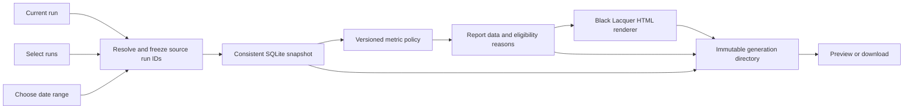

# Build reproducible reports across runs

Status: accepted for implementation on 2026-10-30. The user authorized verification, commit, sync, merge, and task cleanup.
Baseline: `b93efa29733e849e9f46d94fded393cdae8b8474`.

Build saved reports that compare recorded model outcomes, tokens, and time. Keep one
run as one session. Support the current run, manually selected runs, and runs
selected by date range. Every generation produces one portable HTML report and
supporting JSON in the owning run's `report` directory. Preserve each generation.

## Decisions from this discussion

- Keep CDN-powered Recharts with a readable summary and tables when offline.
- Support both manual selection and date-range selection for aggregates.
- Match Black Lacquer as the fixed report appearance. Do not follow application
  theme changes, add a theme picker, or support all tweakcn presets.
- Use plain HTML for the report document. Prefer Basecoat's CSS-only components
  for report controls and tables, with the project's Black Lacquer tokens.
- Keep React limited to Recharts chart roots in the exported document. Keep the
  existing React/shadcn/Radix components for generation controls inside the app.
- Treat an aggregate as one combined report with per-run details. Batch generation
  of a separate HTML file for every selected run is a later feature.
- This plan does not authorize a scheduler, provider calls, publishing reports to
  a third-party service, or changing the previous feature's source records.

## Read the architecture



Read original SQLite facts once. Normalize and aggregate them in pure code. Render
only the resulting report model. Do not calculate a metric independently in a
chart, fallback table, tooltip, or browser filter.

Do not aggregate saved reports into new reports. Generations can overlap in their
source runs; adding their totals would count the same work more than once.

## Define the generation choices

The app's report controls offer these modes.

| Mode | Source selection | Result |
| --- | --- | --- |
| Current run | The owning run only | One standalone comparison and its run details |
| Selected runs | Explicit run IDs, aided by model/date filters | One aggregate with the selected runs listed |
| Date range | All matching runs in a chosen interval, with explicit exclusions | One aggregate with resolved membership listed |

Resolve dates against `runs.created_at`, not the date a report happens to be
generated. Store the input time zone and resolved UTC interval with an inclusive
start and exclusive end. Model filters use recorded attempts/candidate identities,
not the model currently occupying A or B. Preserve opponents in the captured data
when selecting runs involving a model.

In v1, model search/filtering helps construct an explicit manual run-ID selection.
It does not silently constrain date-range membership. Date mode includes all runs
in the interval except its explicit exclusions. Label these two behaviors in the
UI; a future server-side model predicate needs an explicit schema addition.

Freeze the actual run IDs and all source facts at snapshot capture. Retain the
selection expression as provenance, but never re-evaluate it when opening a saved
report. A new report can reuse the exact run IDs or refresh a saved date filter.
These are different commands and must have different labels.

The owning run is the artifact's anchor. It need not belong to an aggregate's
source set. Do not add it to the denominator unless it was actually selected.

Generate a report for an in-progress or unjudged run if requested, but label the
snapshot incomplete. A generated file's ready status does not mean the debate is
complete, judged, or solved. Report generation never confirms an outcome.

## Establish the comparison rules

Use separate eligibility decisions for outcome, token, timing, and pairwise
comparisons. A missing metric must not remove otherwise useful facts or silently
become zero. Every exclusion has a stable reason code and a count.

### Attribute work to immutable participants

- Group by provider and exact model ID. Retain effort, instruction/tool versions,
  task revision, phase, trigger, and binding as comparison dimensions.
- Keep a stable model key and a separate configuration key. Default comparisons
  split effort/tool/instruction configurations; pooling requires an explicit
  mixed-configuration label. Read `binding_policies` for tool profile rather than
  assuming that every attempt already stores that field.
- Task revision numbers are local to a run. Preserve them as provenance, not a
  cross-run task identity. Use a versioned exact-content task-definition hash for
  identical sanitized task inputs, with question/criteria visible in drill-down.
  Different hashes do not prove the tasks differ in difficulty, and matching
  hashes do not establish a controlled experiment.
- Resolve a judged candidate through the confirmation's candidate turn and binding.
  Never assign that outcome using current run-seat configuration.
- Keep known legacy authors visible in detail, but exclude unknown exact-model
  attribution from model rankings. Do not infer Opus/Sol identity from a seat.
- Same-model A/B comparisons retain two candidate/attempt records and one run
  outcome. Exclude them from inter-model preference rates.
- Warn when candidates predate the assessed goal or have differing phases or
  configurations. The existing outcome API does not prove those were matched
  experimental conditions. Show descriptive results, not a controlled-benchmark claim.

### Compare outcomes without inventing model solve rates

Choose one latest confirmed outcome per source run at capture. For the primary
current-goal cohort, require its task revision to match the captured current task.
Show stale confirmations, proposals, and unjudged runs separately.

Judging coverage buckets are mutually exclusive, in this order: current-task
confirmation, stale confirmation, proposal without any confirmation, no outcome.
A newer pending proposal is a separate flag that can coexist with a confirmation.
Do not count that run in both the confirmed and proposals-only buckets.

| Metric | Definition and denominator |
| --- | --- |
| Confirmed selection distribution | Count A, B, tie, combined, neither, and inconclusive once per eligible run |
| Model decisive preference rate | Selected candidate participations divided by selected plus losing participations in decisive A/B outcomes between different models |
| Run goal status | Solved, partial, unresolved, and awaiting-validation across eligible confirmed runs |
| Model involvement | Participations in tie/combined/neither/inconclusive runs, shown separately rather than assigned fractional wins |
| Judging coverage | Eligible current-task confirmations, stale confirmations, proposals only, and unjudged runs out of all selected runs |

The existing criterion assessments and `goalStatus` belong to a shared decision.
They do not establish a per-model criterion pass rate or independent solve rate.
Do not show either in v1. A later schema change can add candidate-specific
assessments if that becomes a product requirement.

Show the numerator, denominator, task mix, opponent, and sample size alongside a
preference percentage. Do not label one model universally best. Split or filter
effort, phase, tool profile, and model versions rather than silently pooling them.

### Normalize tokens and retain measurement scope

Choose a single authoritative scoped observation per attempt; observations are
snapshots, not additive events. Preserve source, scope, coverage, and completeness.

Unit 0 must freeze the following selection policy in fixtures. Capture the stored
observation sequence as well as its body. For a Codex attempt, inspect only the
known `codex.thread.total` series and its counter-reset variant, in stored order.
If the latest counter state is reset or cumulative/unknown, its normalized turn
total is unknown; do not fall back to an earlier optimistic scoped count. Otherwise
use the latest scoped count. A complete observation with the same token vector
can supply completeness over a later partial duplicate. A later different partial
vector remains partial. For Claude, use `anthropic.result.usage` for scoped
main-loop usage; never substitute modelUsage or cost observations. Unknown source
families produce unknown normalized usage until a versioned adapter supports them.

These are resources attributed to the selected model's attempt, not proof that
every token was generated by that exact model. Preserve actual-model evidence
when available; Claude main-loop observations currently have `actualModel: null`.

- Codex normalized input is its inclusive input count. Cached input is a subset.
- Claude normalized input is uncached input plus cache-read plus cache-write,
  only when all components are known. Preserve its provider-native fields too.
- Normalized total is normalized input plus output when both are known.
  Reasoning is an output subset and is never added again.
- Never add cumulative model usage, cumulative estimated cost, or cumulative API
  duration to a turn. The current collector cannot produce reliable Claude
  per-turn all-model cost or usage breakdown from every resumed result.
- Complete known totals, observed partial totals, and unknown counts are separate.
  Label partial sums as observed usage, not complete resource consumption.
- Keep main-loop and all-model-call coverage identifiable. Cross-coverage token
  counts may be displayed descriptively, but do not generate a token-efficiency
  winner or automatic percentage delta from unlike coverage.

Offer two resource views. Candidate comparison uses the exact output turns named
by the confirmation. Total run burden includes all captured attempts, retries,
failures, and discussion, with Maestro shown separately. Keep independent work,
comparison/discussion, and judging phases separate by default.

For pairwise resource cells, extract exactly one A/B pair from each chosen
confirmation's candidate references, and join each to its captured attempt.
Group cells by ordered model/configuration pair, phase, and measurement coverage.
Current-run reports may show a completed proposal's candidates as provisional;
they never enter confirmed aggregate outcome rates. With no referenced candidate
pair, show attempt/run burden rather than guessing a pair from the latest chats.

### Compare time and deltas honestly

Use monotonic `elapsedMs` for measured execution duration. Derive queue delay from
valid requested/start timestamps and first-visible-text latency from its own
timestamps. Keep provider-reported time separate. Crashed end times remain unknown.

Sum attempt durations only under the label summed execution time. Parallel A/B
work overlaps, so this is not run wall time. For a timeline, show actual captured
intervals and an explicitly labeled observed span; do not claim a full run wall
duration if the workflow boundaries are unavailable. Human waits are not model time.

Show count, median, and a distribution/range. For p95 require at least 20 known
observations, use nearest rank `ceil(0.95*n)`, and label small samples. This threshold
is a presentation policy, not proof of statistical reliability.

Within a matched run, percentage delta is `(candidate - reference) / reference`.
Suppress it if the reference is zero, either measurement is unknown, or scope or
phase is incompatible. Across runs, compute paired deltas from shared eligible
run IDs, then summarize the pairs. Do not compare two unrelated cohort medians
as if they were paired evidence. Mark all aggregate comparisons observational.

## Design the report's visual hierarchy

Use Black Lacquer's canonical tokens in `apps/web/src/index.css`, the default
`lacquer` identity in `themes/theme.ts`, and the maintained intent in `DESIGN.md`.
Extract one versioned, allowlisted token adapter at build time. Do not hand-maintain
a second palette or read the viewer's localStorage theme. Freeze the adapter and
CSS hashes in each report. The first renderer has one appearance, Black Lacquer.

Keep square corners, near-black material, quiet separators, Geist body text,
Barlow Condensed headings, and the existing chart palette. Embed approved existing
font assets or provide deliberate local fallbacks; never leave `/fonts/...` URLs
that fail outside the app. Compile report CSS ahead of time and inline it.

Basecoat is the recommended HTML component layer. Compile only the structures
used by the report and apply the generated Black Lacquer tokens after them. Use
native buttons, selects, tables, anchors, and details; do not load its whole JS
bundle or add another select primitive for v1. The app's generation controls keep
their existing shadcn/Radix owners. Basecoat's Chart component is not used.

Recharts is a progressive chart layer, not the report's document owner. Render
headings, key findings, limitations, and semantic tables before any CDN code runs.
Mount charts into separate roots. Do not hydrate React 19 application markup with
the isolated report's React 18 runtime. Do not run Babel or Tailwind Play CDN in
the exported page.

| Section | Current-run visual | Aggregate visual | Required companion |
| --- | --- | --- | --- |
| Decision | Selected candidates and confirmed goal status | Stacked selection distribution and judging coverage | Counts and exact denominator |
| Tokens | Paired horizontal bars with non-overlapping input/output components | Per-model distribution or aligned bars, separated by scope | Coverage, unknowns, and source labels |
| Time | A/B/Maestro timeline and paired candidate durations | Per-model dot/box distribution with median and eligible p95 | Known n and omitted timing count |
| Important deltas | Direct annotations on comparable paired bars | Matched-run delta plot against an explicitly selected reference model | Pair count and baseline definition |
| Pairings | Candidate evidence and configuration details | Opponent matrix with preference rate and sample count | Same-model and non-decisive categories separate |
| Audit | Goal, criterion evidence, phases, and output hashes | Per-run drill-down table and exclusions | Snapshot and metric-policy provenance |

Prioritize the first four sections in v1; add the opponent matrix and trends only
after the same metric layer can supply them without special calculations.
Keep generated takeaways deterministic and tied to metric IDs, such as a known
paired duration delta. Do not make an LLM call to invent the report narrative.

Use stable full-model color/marker mappings from the Black Lacquer chart palette,
not A/B seat colors. Pair color with labels or shapes. Keep units, important
deltas, unknowns, and sample sizes visible without hover. Chart tooltips must
reconcile with the accessible table. Support narrow screens, keyboard access,
long model names, empty cohorts, and blocked-CDN states.

## Save an immutable generation

Use the existing server-owned control root. An ordinary run can own a report
without prepared A/B workspaces. A retained run may be read as a report source;
generation must not change its goal, configuration, attempts, or outcomes.

```text
$ROOM_CONTROL_HOME/workbench/runs/<anchorRunId>/report/
  <generationId>/
    index.html          Single-file user deliverable
    snapshot.json       Safe, captured source facts
    report-data.json    Normalized metrics and chart/table view models
    manifest.json       Versions, selection, hashes, and dependencies
```

The HTML embeds the complete compact report view model. It must not fetch sibling
JSON files, localhost APIs, or the live database. Supporting files are optional
for viewing the HTML, but necessary for audit and reproducible generation.

The manifest records generation/anchor IDs, selection mode/expression/resolved run
IDs, capture time and time zone, source task/outcome revisions, schema and metric
policy versions, renderer build/version, theme adapter hash, dependency URLs and
SRI digests, output hashes, source-facts hash, and any exclusions.

Keep an exact snapshot-file hash and a semantic source-facts hash. The latter
excludes only generation-envelope IDs and capture timestamps, not timestamps
belonging to measured source facts. Preserve a metric/render fingerprint so two
generations with the same facts and policies can be recognized without collapsing
their separate publication records.

Do not create a self-hash cycle. Embed provenance that does not depend on the HTML
hash; render and hash HTML/data first, then write the manifest. Store the manifest
hash in the report's SQLite record rather than hashing the manifest inside itself.

The exact first export DTO is a privacy boundary. Allowlist question/criteria,
approved structured decisions, identifiers, configurations, commit references,
numeric telemetry, tool names/status/timing, and provenance. Omit private Maestro
messages, full prompts/grounding, continuation IDs, local workspace paths, tool
arguments/results, raw error text, and artifact bodies. Never spread arbitrary
stored JSON into a report. Reports remain local files unless the user shares them.

## Define module contracts before builders branch

Use versioned schemas with runtime validation at input/file boundaries. The
reporting package owns independent, allowlisted export DTOs, not copied mutable
API snapshots. Its runtime must not import NestJS, SQLite, or provider SDK code.
The API snapshot adapter may use existing state types internally and map enums
exhaustively into the versioned report DTO. Do not import `state.contract.ts`
into the shared/browser runtime; it currently also imports NestJS. Freeze this
dependency direction before builders branch.

```ts
type ReportSelection =
  | { kind: 'current' }
  | { kind: 'manual'; runIds: string[] }
  | {
      kind: 'date-range'; fromInclusive: string; toExclusive: string;
      timeZone: string; excludeRunIds: string[];
    };

interface ReportRequest {
  requestId: string;
  selection: ReportSelection;
}

// Each type is a validated DTO with explicit unknown/coverage fields.
captureReportSnapshot(anchorRunId: RunId, selection: ReportSelection): ReportSnapshot;
deriveReportData(snapshot: ReportSnapshot, policy: MetricPolicy): ReportData;
renderReport(data: ReportData, assets: ReportAssets): RenderedReport;
publishReport(request: AcceptedReportRequest): Promise<ReportGeneration>;
```

`ReportSnapshot` owns selected safe source rows and revision references.
`ReportData` owns normalized per-attempt/per-run/model facts, metric numerators,
denominators, sample/coverage counts, exclusions, chart series, detail rows, and
the default view. `RenderedReport` owns HTML; the API publisher computes file
hashes with the server's existing crypto facilities. A chart receives
`ReportData`; it does not receive SQLite access or raw usage observations.

Suggested layout uses a small `packages/reporting` package for shared contracts,
pure metrics, and renderer source/assets. The API owns the SQLite snapshot reader
and publication registry under `apps/api/src/reports`. Keep the new package's build
setup and shared schemas under one integration owner; only then split modules.

## Capture and publish safely

1. Validate the anchor, request, filters, and source IDs server-side. Deduplicate
   and canonically order run IDs. Look up an existing request ID before resolving
   a date selection again. Same request/body returns the same generation; conflicting
   reuse returns 409. A deliberate new request creates a new saved generation.
   Request identity is unique by `(anchorRunId, requestId)`. An identical retry of
   a failed generation returns that same failure; the UI creates an explicitly new
   generation/request to capture newer data.
2. Register intent in the existing SQLite database. Use a small durable report
   registry with queued/building/ready/failed states and one in-process worker;
   do not introduce Redis, a scheduler, or another database.
3. Resolve membership and read all relevant source rows in one consistent, short
   SQLite read transaction on the owning connection. Use a read transaction rather
   than the current `BEGIN IMMEDIATE` write helper. Materialize validated source
   facts, then release the transaction before normalization, rendering, or I/O.
4. Read full applicable history directly. The public state API caps task/outcome
   history at 100 and pages attempts, so it is not a complete export reader.
5. Write snapshot/data/HTML to an exclusively owned sibling staging directory.
   Flush and hash files, write the manifest, then atomically rename the completed
   directory. Mark the SQLite record ready only after integrity validation.
6. Serve/list only ready generations. On restart, reconcile a complete renamed
   directory idempotently. Mark incomplete builds failed and retain a useful
   error code. Do not silently recapture newer live data as the same generation.
   A queued job interrupted before capture becomes `restart-before-capture`.
   An interrupted building job without a complete published directory becomes
   `restart-during-generation`. Neither resumes from current source state.
7. Keep old generations immutable. Regenerating from saved facts is separate from
   making a new snapshot of the same runs. Never execute scripts found in a saved
   artifact to regenerate it; use the identified, trusted renderer build.

The v1 app control creates new generations and lists existing ones. Exact
snapshot regeneration is a generator/test capability; a separate rerender UI
and public endpoint are not required for this release.

Metric regeneration requires the original metric-policy implementation. A missing
policy version fails explicitly rather than using current formulas. A renderer
version/hash alone does not preserve executable historical code. Byte-identical
historical HTML regeneration is supported only when the original trusted build
and assets remain available; otherwise retain the already saved original HTML.
A newer trusted renderer can create a separate generation from saved facts with
explicit provenance and new versions, never overwrite or impersonate the old one.

There is no distributed transaction between SQLite and files. Fault tests must
cover directory publication before the ready update, partial staging, duplicate
requests, and recovery repeated twice. Remove only staging directories identified
as owned by the failed generation. Never change debate run revision as a side
effect of report generation.

## Expose generation and viewing

- `POST /api/runs/:anchorRunId/reports` accepts `ReportRequest`, returns the
  generation resource with a stable ID and status, normally 202 while building.
- `GET /api/runs/:anchorRunId/reports` lists bounded generation history.
- `GET /api/runs/:anchorRunId/reports/:generationId` returns status and metadata.
- `GET .../:generationId/preview` serves the isolated HTML document.
- `GET .../:generationId/download` downloads the standalone `index.html`.
- `GET .../:generationId/files/:name` serves only the fixed JSON filenames.

Clients never send filesystem paths. All routes preserve existing local-origin
checks. Add a separate report preview policy rather than weakening candidate
artifact preview, whose CSP and size limit currently prohibit CDN report scripts.
Use an opaque sandboxed iframe without same-origin permission. Permit only the
approved pinned CDN script host, inline compiled report assets, and embedded
fonts. Forbid report connections, forms, arbitrary images, base URLs, and navigation
capabilities. Use exact dependency integrity attributes and `no-referrer`.

Escape embedded JSON against closing-script and Unicode separator injection.
Render user text as text. Never evaluate report content as code. A loaded report
requires no access to the application, subscription credentials, or browser storage.

## Pin the browser dependency set

The compatibility probe verified this separate chart runtime from `file://`.

| Dependency | Pinned version | Role |
| --- | --- | --- |
| React | 18.3.1 | Recharts component runtime |
| ReactDOM | 18.3.1 | Mount chart roots |
| ReactIs | 18.3.1 | Required by the actual Recharts UMD bundle |
| Recharts | 3.10.1 | Interactive chart components |
| Basecoat CSS | 1.1.0 candidate | Compile an inspected subset into the report, not a network requirement |

Do not change the app's React version. The report is isolated from it. Keep CDN
URLs and SRI hashes in one reviewed dependency manifest. Keep compiled report
CSS, its small controller, static tables, and approved font data inline. If CDN
loading fails, the summary and all numeric table content remain readable. Hide
or disable only chart-specific interactions, with a clear inline explanation.

Basecoat was checked against its current official introduction, installation,
and customization documentation. It accepts shadcn-compatible CSS variables and
plain HTML, with optional vanilla JS. Franken UI was considered; its UIkit/Lit
layer adds another behavior system that this report does not currently need.

## Divide the work among builders

Land or locally verify the contract/fixtures first. Then use up to three parallel
builders in separate worktrees. Do not run extra agents simply to fill slots.
Implementation follows the accepted scope and contracts in this plan.

| Unit | Owner and file boundary | Dependencies | Acceptance evidence |
| --- | --- | --- | --- |
| 0. Freeze schemas and fixtures | Integration owner; package manifests, schemas, fixture files, Taskfile wiring | This plan accepted | Validated sample current/aggregate DTOs; metric reconciliation examples |
| A. Snapshot and metrics | Data builder; API snapshot reader and `packages/reporting` metric modules | 0 | Real SQLite >100-history fixture; normalization/eligibility tests; deterministic output |
| B. Black Lacquer report renderer | Renderer builder; report HTML/CSS/chart assets and renderer tests | 0 | Synthetic fixtures render from `file://`; offline tables; visual match; no JSX/runtime build requirement |
| C. Publication and API | Storage builder; report registry, staging/integrity/recovery and controller | 0; integrate A/B contracts | Actual HTTP generation; crash matrix; no mutation of source records |
| D. App controls and integration | Integration/UI owner; separate RunReports component and hook, small entry in Maestro | A/B/C | Current/manual/date generation, history, preview/download, stale/run-switch handling |

The integration owner alone edits shared manifests, root Taskfile, package exports,
or contract schemas during fan-out. Builders request contract changes through that
owner, who updates fixtures and both consumers before continuing. After A/B/C,
use one integration pass, followed by independent verification of the exact head.

The renderer builder may use synthetic fixtures immediately. It must not invent
metric formulas or treat fixture numbers as measured model performance. API/storage
work can use a deterministic renderer stub until B supplies the real renderer.

## Verify before calling the feature complete

- [ ] Reconcile every displayed total/rate/delta to fixture rows, including ties,
  combined/neither/inconclusive, same-model seats, stale/unjudged goals, and revisions.
- [ ] Test model changes, legacy unknown identity, mismatched goal/phase, duplicate
  usage updates, cache/thinking overlap, null versus zero, partial failure usage,
  retries, parallel timing, and small-sample quantiles.
- [ ] Test manual and date selection, DST boundaries, empty sets, explicit
  exclusions, duplicate IDs, overlapping report generations, and anchor not in cohort.
- [ ] Test one consistent SQLite snapshot while source records can change; export
  more than 100 attempts/task/outcome revisions without truncating source history.
- [ ] Inject real SQLite/file failures around every publication boundary; retry
  and restart twice, with no duplicate ready records or recaptured source facts.
- [ ] Open the HTML alone from `file://` after moving it away from its JSON siblings.
  Verify online charts and cold-cache offline summary/tables; test JS disabled.
- [ ] Verify report preview isolation and malicious text such as `</script>`;
  assert private text, continuation IDs, and local paths are absent from all outputs.
- [ ] Verify charts, tooltips, filters, fallback tables, and saved report-data agree.
  Browser filters disclose changed eligibility and preserve the original snapshot.
- [ ] Compare with the app's actual Black Lacquer at desktop and 390px, including
  keyboard use, focus, long labels, large numbers, reduced motion, and load failure.
- [ ] Run `task checks` from the repo root and the added report-specific checks.
  Add tasks without duplicating install/build/test machinery.
- [ ] Record source/head SHAs, raw evidence, and an independent verdict. Stop for
  user review of the report and generation controls before any new sync/merge,
  unless the user explicitly grants that authority for this feature.

Initial scale targets are proposals to validate, not measured guarantees. Use
fixtures at 10, 100, and 1,000 runs, including a 50,000-attempt case. Set explicit
limits before accepting larger cohorts; never silently truncate them. Target a
5 MiB maximum standalone HTML file using compact per-run/model summaries, keep
the complete safe source snapshot in its sidecar, and downsample chart marks
without changing summary statistics. Record generation time, peak memory, and
chart render time separately from CDN transfer time. Propose final latency/memory
budgets from the first builder's measured baseline before expanding scale limits.

## Preserve the boundaries of this release

Defer schedules, automatic LLM summaries, per-model solve grades, speculative
billing, universal model rankings, all-theme support, a new app component system,
PDF/image export, batch per-run HTML output, and report-to-report statistical
comparison. Reuse saved run sets and make new immutable generations manually.

The first deliverable is complete when the same captured source facts and policy
produce the same metric data; each generated HTML can be opened alone; its online
charts and offline tables agree; and current/manual/date selections can generate
multiple saved versions without changing previous files or source debate state.

## Sources and prototype evidence

- Project sources read at the baseline include `docs/session-state.md`,
  `src/state/state.contract.ts`, `state.store.ts`, `provider-usage.ts`, run and
  workspace stores, artifact preview policy, `DESIGN.md`, and canonical theme files.
- [Recharts installation](https://recharts.github.io/en-US/guide/installation/).
- [Pinned Recharts peer dependencies](https://github.com/recharts/recharts/blob/v3.10.1/package.json).
- [User-supplied bundle](https://cdnjs.cloudflare.com/ajax/libs/recharts/3.10.1/Recharts.js).
- [Basecoat introduction](https://basecoatui.com/introduction/).
- [Basecoat installation](https://basecoatui.com/installation/) and [customization](https://basecoatui.com/customization/).
- [Franken UI installation](https://franken-ui.dev/docs/2.1/installation).
- [Standard shadcn Vite setup](https://ui.shadcn.com/docs/installation/vite).
- Local compatibility-only prototype: `/private/tmp/lilbits-report-cdn-probe/prototype.html`.
  Recharts 3.10.1 and all three pinned globals rendered one SVG from `file://`.
  Cold-cache offline reload rendered no chart and preserved the summary/table.
- Dependency URLs, sizes and SRI digests: `/private/tmp/lilbits-report-cdn-probe/dependencies.json`.
  Basecoat 1.1.0 CSS downloaded successfully and exposes matching token names.
  Full Basecoat visual matching and sandboxed app preview remain builder checks.
- Portable probe receipt and dependency pins: `docs/reporting-cdn-proof.json`.
  Retest the pins during implementation rather than assuming this receipt proves
  the future report renderer or its CSP works.

Planning protocol note: this is a bounded builder handoff, not a standing autonomous
program. The user's preference against unnecessary fan-out governs. No ten-agent
verification fleet, hourly automation, or merge authorization is implied.
